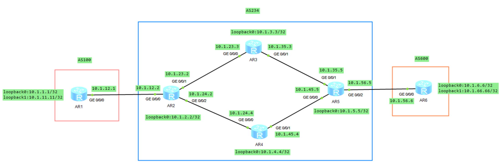
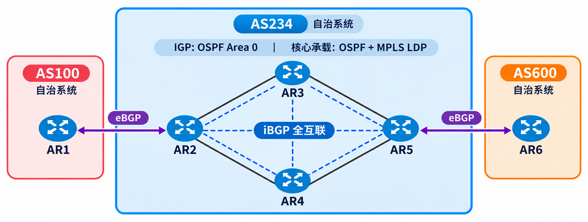
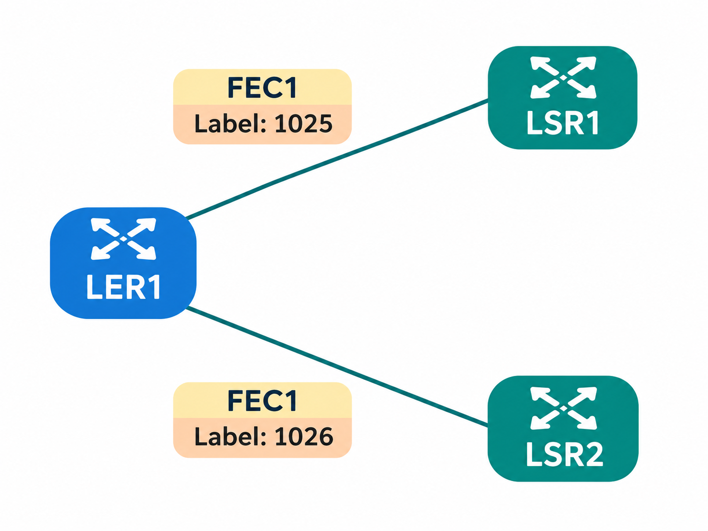
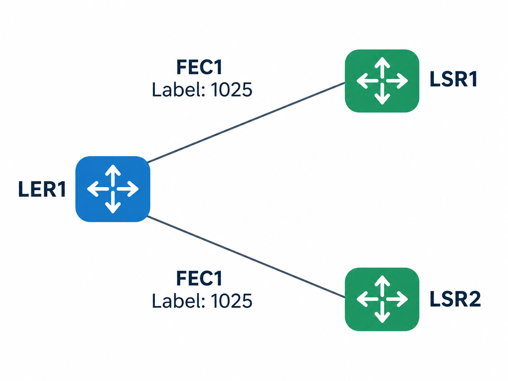
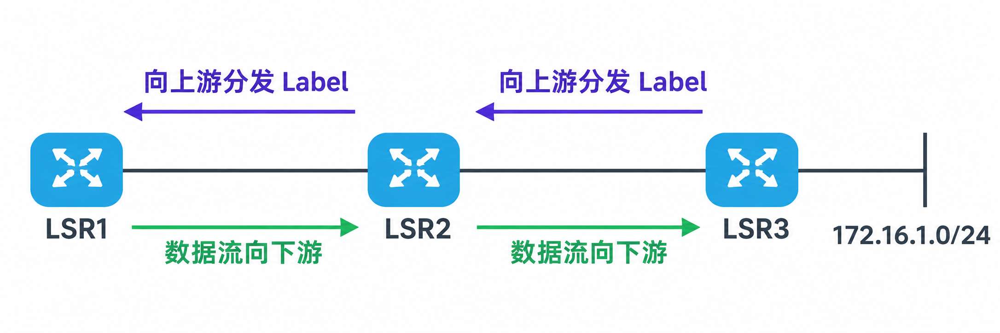
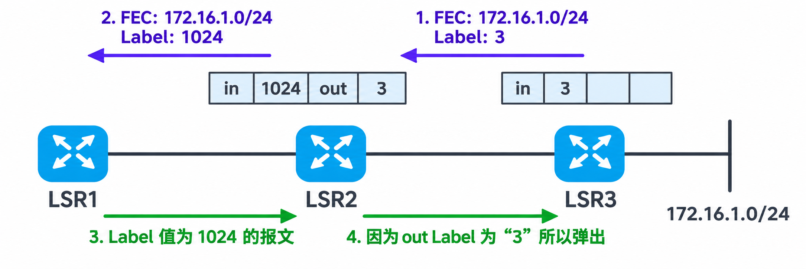
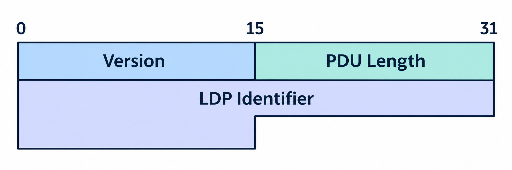
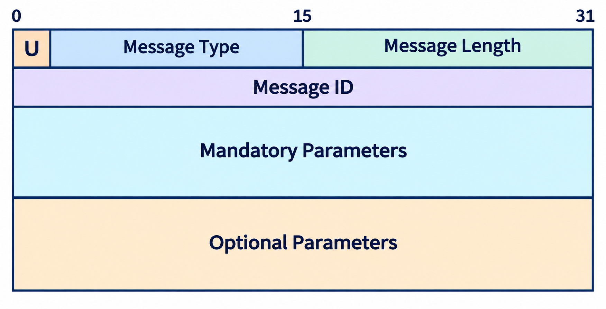
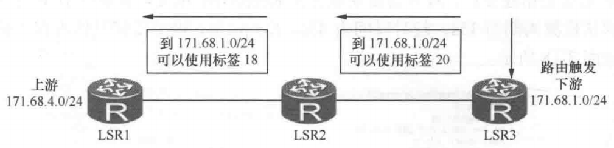
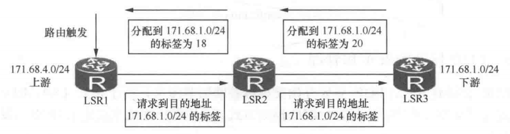

# LDP 协议之一

## 1.LDP 前置基础

### 1.1 MPLS 相关表项

LIB（Label Information Base）属于 MPLS 的控制平面，主要负责保存和管理 FEC 与 MPLS 标签之间的绑定关系。这些信息可以通过 LDP 等标签分发协议获得，包括目的 FEC、本地标签、下游节点发布的标签以及发布该标签的对等体等。**<font color="red">LIB 为建立标签转发表提供依据，但不直接负责报文转发，其中保存的标签信息也不一定全部用于实际转发</font>**。在 Liberal Retention 模式下，设备还可以保留来自非当前下一跳邻居的标签绑定，以便在后续路由发生变化时使用。

LFIB（Label Forwarding Information Base）**<font color="red">属于 MPLS 的数据平面，主要负责指导 MPLS 报文的实际转发</font>**。LFIB 根据有效的标签绑定及路由信息建立转发关系，包含入标签、出标签、下一跳和出接口等信息。当路由器收到 MPLS 报文时，可以根据 LFIB 中的转发规则执行标签交换（Swap）或弹出（Pop）等操作。因此，LIB 负责管理标签信息，而 LFIB 负责实际标签转发。

ILM（Incoming Label Map）**<font color="red">属于 MPLS 的数据平面，主要负责建立入标签与 NHLFE 之间的映射关系，用于处理已经携带 MPLS 标签的报文</font>**。当路由器收到 MPLS 报文时，会根据栈顶入标签查询 ILM，找到对应的 NHLFE，再按照其中的规则转发报文。例如，收到标签为 100 的报文后，通过 ILM 找到 NHLFE，执行标签交换，将标签 100 替换成 300。ILM 在 Transit 节点的作用是将标签和 NHLFE 绑定。

NHLFE（Next Hop Label Forwarding Entry）**<font color="red">属于 MPLS 的数据平面，主要负责规定报文的标签操作和下一跳转发方式</font>**。NHLFE 包含出标签、下一跳、出接口、标签操作、tunnel-id 类型等信息，可以指导设备执行 Push、Swap、Pop 等操作。

NHLFE 可以通过 ILM 或 FTN 找到，因此 ILM 和 FTN 负责查找对应的转发规则，而 NHLFE 负责确定具体的标签处理及转发行为。FEC 与 NHLFE 的映射称为 FTN（**`FEC-to-NHLFE`**），通过查看 FIB 表中 Token 值不为 0x0 的表项，能够获得 FTN 的详细信息。**FTN 只在 Ingress 存在**。

根据 RFC 3031 中对 **`FEC-to-NHLFE`** 的描述，The "FEC-to-NHLFE" (FTN) maps each FEC to a set of NHLFEs. It is used when forwarding packets that arrive unlabeled, but which are to be labeled before being forwarded. 也就是当 LSR 收到一个尚未携带 MPLS 标签、但需要通过 MPLS LSP 转发的普通 IP 报文时，典型情况下由 Ingress 节点根据目的 IP 地址确定 FEC，再通过 FTN 找到相应的 NHLFE，并执行 Push 操作，将普通 IP 报文封装为 MPLS 报文后发送给下一跳。

根据 RFC 3031 中对 ILM 的描述，The "Incoming Label Map" (ILM) maps each incoming label to a set of NHLFEs.  It is used when forwarding packets that arrive as labeled packets. 当 LSR 收到一个已经携带 MPLS 标签的报文时，典型情况下由 Transit 节点根据报文栈顶的入标签查询 ILM，找到对应的 NHLFE，再根据其中规定的操作执行 Swap、Pop 或其他标签栈处理，并将报文转发给指定的下一跳。

### 1.2 华为动态 LDP MPLS 转发的实现

#### 1.2.1 网络拓扑

<div align="center">
    
</div>

我们使用如上的拓扑图来讲解华为 MPLS 动态 LDP 转发表的实现，具体的逻辑结构如下所示，本实验采用 3 个 BGP 自治系统组成的网络拓扑，分别为 AS100、AS234 和 AS600。整个网络通过 eBGP 实现不同自治系统之间的路由交换，通过 iBGP 实现 AS234 内部的 BGP 路由传播。

在 AS234 内部，四台路由器均运行 OSPF，所有骨干接口处于 Area 0，OSPF 负责维护内部 Loopback0 地址和互连接口网络的可达性。同时，AR2、AR3、AR4 和 AR5 之间配置了六条逻辑 iBGP 会话（包含 **`AR2-AR5`**、**`AR3-AR4`**），构成 iBGP 全互联结构，使 AS234 内所有 BGP 路由器都能够直接交换所需的业务路由信息。

在自治系统边界上，**<font color="red">AR1 与 AR2 通过 Loopback0 建立多跳 eBGP 邻居关系，AR5 与 AR6 则通过直连接口建立 eBGP 邻居关系</font>**。AR1 和 AR6 分别通过 BGP 发布业务前缀 **`10.1.11.11/32`** 和 **`10.1.66.66/32`**，由 AS234 内部的 iBGP 全互联结构完成业务路由的传播。此外，AS234 内部四台设备的相应接口均启用了 MPLS LDP，能够依据相关路由信息进行标签分配、通告与动态 LSP 建立。

<div align="center">
    
</div>

#### 1.2.2 转发过程

我们使用 AR1 访问 AR6 上的 **`10.1.66.66/32`** 过程来描述报文如何通过 LSP 进行转发的。入节点 AR2 作为 Ingress 收到目的地址为 **`10.1.66.66/32`** 的 IP 报文，**<font color="blue">首先通过 FIB 表检查该目的 IP 地址对应的 Tunnel ID 值是否为 0x0。若是，按 IP 转发流程处理</font>**。**<font color="red">若不是，则进入 MPLS 转发流程，依据此 Tunnel ID 找到对应 NHLFE 中指示的出接口、下一跳、出标签（假设为 Y）和标签操作类型等信息，压入标签 Y（Push），封装为 MPLS 报文，并按 NHLFE 指示的出接口和下一跳继续转发</font>**。

如下所示，先查 fib，发现目的地址 **`10.1.66.66/32`** 的 FEC 对应的 tunnel-id 地址分别为 **`0x7`**、**`0x5`**，然后执行 **`display tunnel-info tunnel-id 0x7/0x5`**，查询到该隧道的出标签均为 1026，出接口为 **`GE0/0/2`** 和 **`G0/0/1`**，下一跳分别为 **`10.1.24.4`** 和 **`10.1.23.3`**。这就是上面所说的，先查询 fib 表，然后发现其对应的 Tunnel-id 不为 0，则依据此 tunnel-id 去 NHLFE 中找到相关的信息，封装成 MPLS 报文。

```java{.line-numbers}
[AR2]display fib 10.1.66.66
  Route Entry Count: 2
Destination/Mask   Nexthop         Flag  TimeStamp     Interface      TunnelID
10.1.66.66/32      10.1.24.4       DGHU  t[3438]       GE0/0/2        0x7
10.1.66.66/32      10.1.23.3       DGHU  t[3438]       GE0/0/1        0x5
[AR2]display tunnel-info tunnel-id 0x7
Tunnel ID:                    0x7
Tunnel Token:                 7
Type:                         lsp
Destination:                  10.1.5.5
Out Slot:                     0
Instance ID:                  0
Out Interface:                GigabitEthernet0/0/2
Out Label:                    1026
Next Hop:                     10.1.24.4
Lsp Index:                    6151

[AR2]display tunnel-info tunnel-id 0x5
Tunnel ID:                    0x5
Tunnel Token:                 5
Type:                         lsp
Destination:                  10.1.5.5
Out Slot:                     0
Instance ID:                  0
Out Interface:                GigabitEthernet0/0/1
Out Label:                    1026
Next Hop:                     10.1.23.3
Lsp Index:                    6149
```

接下来，Transit AR5 收到该 MPLS 报文，**<font color="red">根据标签 Y 查询 ILM 表中对应的 Tunnel ID，并根据此 Tunnel ID 在 NHLFE 中找到进行下一跳转发所需要的出接口、下一跳、出标签、标签操作类型（标签交换，Swap）</font>**，将标签 Y 换成标签 X 后继续转发。

在 AR4 上收到标签 1026 的 MPLS 数据包时，根据标签 1026 查询 ILM 中对应的 **`token/tunnel-id`**，然后根据这个 0x8 的 token 在 NHLFE 中找到下一跳转发所需要的出接口、下一跳、出标签等。在下面的 LFIB 中，**`in-label`** 和 **`in-interface`** 可以看成是 ILM，而 **`nexthop`**、**`out-label`**、**`out-interface`**、lsrtype、**`Label Operation`** 可以看成是 NHLFE。

```java{.line-numbers}
// 查询 LFIB
[AR4]display mpls lsp in-label 1026 verbose 
                 LSP Information: LDP LSP
  No                  :  1
  VrfIndex            :        
  Fec                 :  10.1.5.5/32
  Nexthop             :  10.1.45.5
  In-Label            :  1026
  Out-Label           :  3
  In-Interface        :  ----------
  Out-Interface       :  GigabitEthernet0/0/1
  LspIndex            :  6152
  Token               :  0x8
  FrrToken            :  0x0
  LsrType             :  Transit
  Outgoing token      :  0x0
  Label Operation     :  SWAP
  Mpls-Mtu            :  ------
  TimeStamp           :  3959sec
  Bfd-State           :  ---
  BGPKey              :  ------
[AR3]display mpls lsp in-label 1026 verbose 
                 LSP Information: LDP LSP
  No                  :  1
  VrfIndex            :        
  Fec                 :  10.1.5.5/32
  Nexthop             :  10.1.35.5
  In-Label            :  1026
  Out-Label           :  3
  In-Interface        :  ----------
  Out-Interface       :  GigabitEthernet0/0/1
  LspIndex            :  6152
  Token               :  0x8
  FrrToken            :  0x0
  LsrType             :  Transit
  Outgoing token      :  0x0
  Label Operation     :  SWAP
  Mpls-Mtu            :  ------
  TimeStamp           :  4295sec
  Bfd-State           :  ---
  BGPKey              :  ------
```

如果倒数第二跳的 Transit 收到该 MPLS 报文，继续上述查询动作，此时由于为 Egress 分给它的标签值为 3，所以进行 PHP 操作，弹出标签 X（Pop）并继续将 IP 报文转发给 Egress。Egress 节点收到该 IP 报文，直接根据对应的 IP 路由表将其转发到目的地。

在 AR4 上可以看到，AR4 收到 MPLS 标签包之后，直接弹出标签 3，变成 IP 数据包，然后按 IP 转发流程处理。可以看到在 AR5 FIB 表中，FEC **`10.1.66.66/32`** 对应的 tunnel-id 为 0x0，因此弹出标签之后直接按照 IP 转发流程处理。

```java{.line-numbers}
[AR5]display fib 10.1.66.66
  Route Entry Count: 1
Destination/Mask   Nexthop         Flag  TimeStamp     Interface      TunnelID
10.1.66.66/32      10.1.56.6       DGHU  t[3436]       GE0/0/2        0x0
```
### 1.3 MPLS LDP 隧道递归

在 AR2 和 AR5 上均配置了如下命令。

```java{.line-numbers}
[AR2] route recursive-lookup tunnel
```

在 AS234 骨干网络中，AR6 首先通过 eBGP 向 AR5 发布路由前缀 **`10.1.66.66/32`**，AR5 再通过 iBGP 将该路由通告给 AR2，并通过 **`next-hop-local`** 将 BGP 下一跳设置为自己的 **`10.1.5.5`**（即下面的 **`Original nexthop`**）。由于 AS234 内部运行 OSPF，AR2 能够通过 OSPF 解析到达 **`10.1.5.5`** 的路径，并在相关 LDP 会话与标签转发状态正常的情况下建立到该 FEC 的动态 LSP。

```java{.line-numbers}
<AR2>display bgp routing-table 10.1.66.66
BGP local router ID : 2.2.2.2
Local AS number : 234
Paths:   1 available, 1 best, 1 select
BGP routing table entry information of 10.1.66.66/32:
From: 10.1.5.5 (5.5.5.5)
Route Duration: 01h44m49s  
Relay IP Nexthop: 10.1.24.4
Relay IP Out-Interface: GigabitEthernet0/0/2
Original nexthop: 10.1.5.5
Qos information : 0x0
AS-path 600, origin igp, MED 0, localpref 100, pref-val 0, valid, internal, best, select, active, pre 255, IGP cost 2
Advertised to such 1 peers:
    10.1.1.1
```

在未配置 **`route recursive-lookup tunnel`** 时，虽然 AR2 已通过 OSPF 和 LDP 建立了到 AR5 **`Loopback0 10.1.5.5/32`** 的动态 LSP，但普通非标签公网 BGP 业务路由不会因此自动使用这条 LSP。因为 BGP 下一跳递归，但递归结果是普通 IP 下一跳与出接口，而不是 MPLS 隧道。未配置 **`route recursive-lookup tunnel`** 时，递归的过程如下所示：

```java{.line-numbers}
业务目的：10.1.66.66/32 -> BGP 下一跳：10.1.5.5 -> 通过 OSPF 解析下一跳 -> AR3（10.1.23.3）或 AR4（10.1.24.4） -> 普通 IP 转发
```

此时，AR2 的 FIB 输出如下：

```java{.line-numbers}
[AR2]display fib 10.1.66.66
  Route Entry Count: 2
Destination/Mask   Nexthop         Flag  TimeStamp     Interface      TunnelID
10.1.66.66/32      10.1.24.4       DGHU  t[3438]       GE0/0/2        0x0
10.1.66.66/32      10.1.23.3       DGHU  t[3438]       GE0/0/1        0x0
```

tunnel-id 为 0x0，表示这两条业务转发项没有关联 MPLS 隧道，设备按照普通 IP 转发流程处理。因此，AR2 收到发往 **`10.1.66.66`** 的 IP 报文后，会按照 FIB 选择 AR3 或 AR4 作为下一跳，并直接发送普通 IP 报文。不过，由于本实验的 AS234 中使用了 iBGP 全互联，并各路由器已学习到相关业务路由，因此即使不使用 MPLS 隧道递归，AR1 与 AR6 仍然可以通过普通 IP 转发实现通信。

在配置 **`route recursive-lookup tunnel`** 之后，**<font color="red">该命令允许非标签公网 BGP 路由优先递归到 LSP 隧道，而不再仅仅递归到普通 IP 下一跳和出接口</font>**。配置后，AR2 依然通过 BGP 学习业务前缀 **`10.1.66.66/32`**，其 BGP **`NEXT_HOP`** 仍为 **`10.1.5.5`**。**但此时 AR2 可以进一步将这条业务路由关联到已经建立的以 **`10.1.5.5/32`** 为 FEC 的 LDP LSP**。

在启用隧道递归后，查询到的 AR2 FIB 如下所示，此时两条 FIB 表项已经关联到了非零 tunnel-id。AR2 作为该 LSP 的 Ingress，根据 FIB 及 NHLFE 压入传输标签，AR3 收到 MPLS 报文后，根据入标签查询 ILM，再通过对应 NHLFE 执行标签转发。如果 AR5 通告的是隐式空标签 3，AR3 就作为倒数第二跳执行 PHP，弹出传输标签后将 IP 报文交给 AR5。AR5 作为 Egress 终结该传输 LSP，再根据原始目的地址 **`10.1.66.66`** 查找 IP 路由，将报文转发给 AR6。

```java{.line-numbers}
[AR2]display fib 10.1.66.66
  Route Entry Count: 2
Destination/Mask   Nexthop         Flag  TimeStamp     Interface      TunnelID
10.1.66.66/32      10.1.24.4       DGHU  t[3438]       GE0/0/2        0x7
10.1.66.66/32      10.1.23.3       DGHU  t[3438]       GE0/0/1        0x5
```

### 1.4 总结

在 MPLS 骨干网络中，BGP、IGP 和 LDP 分别承担不同的职责。BGP 主要负责交换跨自治系统或骨干边界之间的业务路由，IGP 负责维护骨干网络内部的路由可达性，而 LDP 则根据相应的路由信息建立 FEC 与 MPLS 标签之间的绑定关系，从而形成动态 LSP。三个协议可以协同工作，但并不是所有 MPLS LDP 网络都必须运行 BGP。只要设备具有完整的 IP 路由，单独使用 OSPF 就可以实现普通 IP 通信。

## 2.LDP 协议

### 2.1 LDP 的基本概念

LDP 协议在 RFC3036 中被定义，在 MPLS 网络中，**<font color="red">路由器通过运行 LDP 协议为每条内部路由映射一个标签，然后再将标签信息通告给所有邻居，路由器之间通过这种方式来建立标签转发表，最终形成 LSP</font>**，当网络拓扑发生变化时，LDP 还会实时地响应这种变化，动态建立 LSP。

#### 2.1.1 标签空间

LDP 分配标签的空间有两种。

基于接口的标签空间：每个接口通告的标签范围是唯一的，如下图所示，LER1 为同一条 FEC 在不同接口通告的标签是不同的。

<div align="center">
    
</div>

基于平台的标签空间：标签分配时并不是在每个接口下唯一，而是从整台 LSR 中来分配标签的，如下图所示，LER1 为同一条 FEC 通告一个标签。

<div align="center">
    
</div>

下面显示了华为设备默认使用的标签空间，**位于 LSR-ID 后面的数字 0 表示华为默认采用的标签空间是基于平台的**，如下输出所示。

```java{.line-numbers}
[AR1]display mpls ldp session
PeerID          Status      LAM   SsnRole   SsnAge        KASent/Rcv
10.1.2.2:0      Operational DU    Passive   0000:00:00    1/1
TOTAL: 1 session(s) Found.
```

#### 2.1.2 上游 LSR 和下游 LSR

<div align="center">
    
</div>

上游和下游是根据数据报文的流向来定义的，**<font color="red">数据流总是由上游发往下游</font>**，如上图所示，对于网络 **`172.16.1.0/24`** 来说，LSR3 是最后一跳路由器，其上游是 LSR2，而 LSR2 同时又是 LSR1 的下游。标签的通告方向可以是下游通告给上游，上游也可以将其标签通告给下游。

#### 2.1.3 PHP（倒数第二跳弹出）

在 MPLS 网络的出站 LER 处，首先需要对接收的报文进行标签移除（通过查找标签转发表），然后再进行 FIB 表的查找并转发，由于进行了两次查表操作，所以过程比较耗时。如果到达出站 LER 的流量较大，会对设备性能造成一定的影响。为减轻出站 LER 的负担，**<font color="red">标签在到达出站 LER 之前就被弹出，这样在报文到达出站 LER 时已经是 IP 报文了</font>**，只需要查找 IP 转发表就转发出去。

为使标签在到达出站 LER 之前就被弹出，使用了一个特殊的标签 3，这个标签也叫隐式空标签，如下图所示。

<div align="center">
    
</div>

在上图所示的场景中，对于网络 **`172.16.1.0/24`** 来说，LSR3 作为最后一跳路由器，向上游邻居 LSR2 通告一个标签值为 3 的标签，当 LSR2 接收到去往该目标网络的报文（带有标签值为 1024 的报文）时，会将 1024 标签进行弹出操作后再转发至下游邻居 LSR3，也就是说，3 号标签实际上是代表一种弹出操作，而不是实际需要携带的标签，所以叫隐式空标签。

### 2.2 LDP 的报文

LDP 报文是基于 TCP 的（Hello 报文基于 UDP），端口号为 646，并且报文格式是基于 TLV 的方式来封装的，LDP 报文分为头部和报文内容两部分，LDP 报头格式如下图所示。

<div align="center">
    
</div>

- Version：2Byte 无符号整数值，**<font color="red">表示 LDP 协议版本号，目前 LDP 协议版本号为 `0x01`</font>**。
- PDU Length：2Byte 整数值，以字节为单位表示 PDU 长度，不包括版本号和 PDU 长度字段。PDU 最大长度在会话初始化时协商确定，默认最大长度为 4096Byte。在 LDP 中，PDU（协议数据单元）就是 LDP 协议组织和封装消息的基本单位。它由一个 LDP 头部和一个或多个 LDP 消息组成。LDP Message 则负责承载 Hello、Label Mapping、Label Request 等具体协议消息。
- LDP Identifier：6Byte，唯一标识 PDU 所属发送 LSR 的标签空间。**<font color="red">前 4Byte 表示 LSR-ID 地址，后 2Byte 指定 LSR 中的特定标签空间</font>**。

LDP 报文格式如下图所示，对其中的字段解释如下：

<div align="center">
    
</div>

- U：1bit，未知 TLV bit，主要用于告诉接收方如果收到一条自己无法识别的 LDP 消息，应该向发送方报告错误，还是直接忽略这条消息。如果 U=0 的话，接收方无法识别时，向发送方返回 Notification 消息。如果 U=1 的话，接收方无法识别时，直接忽略该未知消息。
- **`Message Type`**：14bit，表示报文所属的类型。
- **`Message Length`**：2Byte，以字节为单位表示报文长度，包括报文标识符、必选参数、可选参数等几部分。
- **`Message ID`**：报文标识符，4Byte，用于标识报文。
- **`Mandatory Parameters`**：必选参数可变长度，必选参数集。
- **`Option Parameters`**：可选参数可变长度，可选参数集。

### 2.3 Hello 报文

LDP 的 Hello 报文用于发现邻居并用作后期邻居关系的维护，基于 UDP 来发送，发送的目标地址是 **`224.0.0.2`**，在启用了 LDP 的接口上会周期性地发送（默认周期=5s）。

在邻居发现阶段，LDP 通过 UDP 646 端口发送 Hello 报文，其中普通 Link Hello 使用组播方式发送，IPv4 目的组播地址为 **`224.0.0.2`**，主要用于发现和维护直连 LDP 邻居。而 Targeted Hello 则采用 UDP 单播方式，用于发现指定的 LDP 邻居，包括非直连邻居。完成邻居发现后，LSR 通过 TCP 646 端口建立 LDP 会话，并利用 TCP 连接可靠地传输 Initialization、KeepAlive、Label Mapping 等协议消息。

Hello 包携带了一些通用参数，比如保持时间等，还有发送方的传输地址。保持时间是删除一个邻居前的等待时间，默认是 15s（**`Hello*3`**），如果双方设置的保持时间不一样，则使用较短的那个时间。**<font color="red">传输地址是用来建立 TCP 连接的地址，默认是跟 LSR-ID 一样的，所以默认情况下，两台 LSR 要能成功建立 LDP 邻居会话关系，各自的 LSR-ID 一定要路由可达</font>**。

可以使用下面的方式来查看保持时间和传输地址，如下输出所示。

```java{.line-numbers}
[LSR1]display mpls ldp interface verbose
LDP Interface Information in Public Network

Interface Name : GigabitEthernet0/0/0
LDP ID         : 10.1.1.1:0     Transport Address : 10.1.1.1
Entity Status  : Active         Effective MTU     : 1500

Configured Hello Hold Timer    : 15 Sec
Negotiated Hello Hold Timer    : 15 Sec
```

### 2.4 Initialization 报文

Initialization 报文用来协商 LDP 邻居会话参数，包括标签的分发方式、防环机制和标签空间。

### 2.5 Address 报文

**<font color="red">Address 报文用来向 LDP 邻居通告本端的所有接口 IP 地址</font>**，以便邻居可以通过 IP 转发表的下一跳地址来决定出站标签。

LDP Address 消息主要用于向 LDP 邻居通告本设备的接口 IP 地址，**<font color="red">使邻居能够建立下一跳 IP 地址与 LDP 对等体之间的对应关系</font>**。当路由器需要为某个 FEC 选择出标签时，首先根据 IP 路由表确定下一跳地址，再通过 Address 消息学习到的地址映射找到对应的 LDP 邻居，**最后从 LIB 中选择该邻居针对这个 FEC 发布的标签，作为 MPLS 转发使用的出标签**。

### 2.6 Keepalive 报文

LDP 邻居会话建立后，双方会定期地交互 KeepAlive 报文，用来对 TCP 会话的保活检测，默认检测周期为 15s，超时时间为 45s。KeepAlive 报文没有具体内容，格式非常简单。

### 2.7 Notification 报文

通知报文分为错误通知或查询通知。在发生以下事件时会发出通知报文：收到的数据包格式错误、无法识别的 TLV、会话超时时等，报文中会向邻居报告具体的差错类型。

## 3.LDP 标签的发布和管理

LDP 会话建立后，LDP 协议开始交换标签映射等报文，用于建立 LSP。RFC3036 分别定义了标签发布方式、标签分配的控制方式、标签保持方式来决定 LSR 如何发布和管理标签。

### 3.1 标签发布方式

标签发布方式是指下游 LSR 发布标签映射通告时，**<font color="red">采取主动出击或在收到上游 LSR 请求后被动回应</font>**，也就是分为 DU（Downstream Unsolicited）和 DoD（Downstream On Demand）两种方式。

#### 3.1.1 DU 下游自主

在 DU 模式下，**<font color="red">当下游 LSR 和上游 LSR 建立完 LDP 会话后，下游主动向上游发布标签映射通告报文</font>**，华为 VRP 系统中默认就采用该模式。但是，华为默认情况下只对路由表中的 32 位掩码路由进行标签映射并通告，如果想要修改触发标签的策略，可以使用 Lsp-Trigger 命令修改。

如图所示，以 **`171.68.1.0/24`** 为例，LSR3 路由器主动向其上游邻居 LSR2 通告标签映射信息，同时，LSR2 也会主动向 LSR1 通告自己的标签映射。

<div align="center">
    
</div>

一般情况下，LSR 会向其上游和下游 LDP 邻居都通告标签，从而提高 LDP LSP 的收敛速度。但是向所有对等体发送标签映射报文会导致大量 LSP 的建立，占用较多的资源。因此，为了减少 LSP 的数量，从而节省内存，推荐使用 **`outbound peer { peer-id | all } split-horizon`** 命令为 LDP 邻居配置水平分割策略，**<font color="red">即控制 LSR 只向其上游 LDP 邻居分配标签</font>**。参数 **`peer-id`** 用来配置不给指定 LSR ID 的下游 LDP 邻居分配标签。如果配置参数 all 的同时又配置 peer-id，则单个 peer 的 LDP 水平分割策略不生效。默认情况下，华为设备上没有启用该配置。

#### 3.1.2 DoD 下游按需

下游 LSR 如果工作在 DoD 模式下时，在收到上游 LSR 的标签请求报文后，会针对上游 LSR 所请求的 FEC 发送对应的标签映射信息给上游 LSR，如图所示，所有 LSR 都工作在 DoD 模式下，LSR1 向 LSR2 发送标签请求，LSR2 也向 LSR3 发送标签请求，LSR3 会将 **`FEC:171.68.1.0/24`** 及映射的标签回应给 LSR2，LSR2 也会向 LSR1 回应自己分配的标签信息。

<div align="center">
    
</div>

## 3.分类

DU：Downstream Unsolicited（下游自主分发）

DU 模式的核心是：下游 LSR 不需要收到上游的 Label Request，就可以主动发送 Label Mapping 消息。

在 LDP 邻居关系建立后，下游设备可以为 FEC 建立标签绑定，并将该绑定主动通告给上游。上游收到标签映射后，根据自己的路由信息判断应该使用哪一个 LDP 邻居提供的标签。

需要注意，DU 并不意味着下游设备不考虑任何条件就分配所有标签。它能否向上游发布某个 FEC 的标签，还受到标签分配控制模式（Independent 或 Ordered）、标签发布策略等因素的约束

DoD：Downstream on Demand（下游按需分发）

DoD 模式的核心是：上游 LSR 需要标签时，先向下游发送 Label Request；下游收到请求后，才向上游发布对应的 Label Mapping。

DoD 并不代表每次转发 IP 报文都要重新请求标签。Label Request 是 LDP 控制平面建立标签绑定关系时使用的协议消息，已经建立的 LSP 可以持续转发大量数据报文。

它强调的是按照请求发布所需的标签映射，而非主动向邻居通告大量 FEC 的标签映射。

标签发布方式：DU / DoD，是否需要上游先请求
标签分配控制方式：Independent / Ordered，是否需要先获得下游标签映射才能向上游发布
标签保持方式：Liberal / Conservative，是否保留非当前下一跳邻居的标签映射

例如，DU + Ordered 表示：LSR 无须收到上游的请求，但通常要先获得下游的标签映射（或者自身就是该 FEC 的 Egress），才能向上游主动发布标签。

DoD + Independent 则表示：LSR 必须先收到上游请求，但可以不等待下一跳的标签映射，就为该 FEC 分配并发布本地标签。RFC 5036 第 2.6.1 节明确区分了这两种控制模式。

