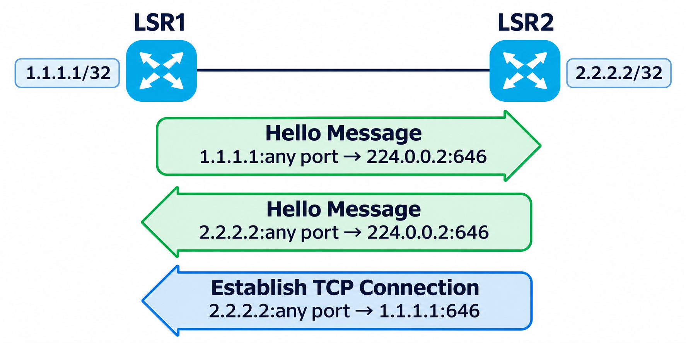
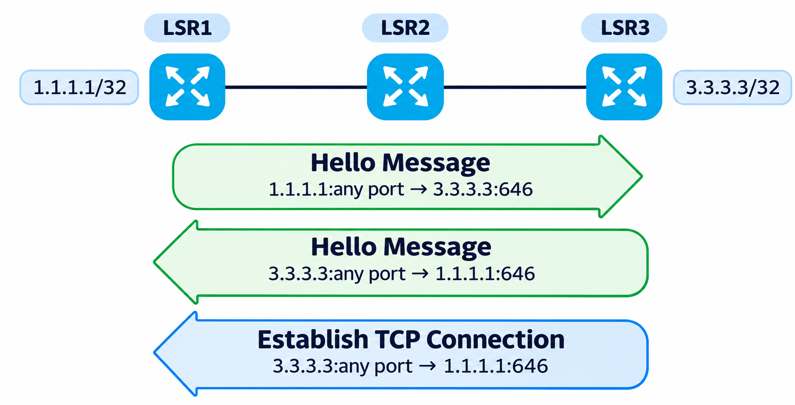
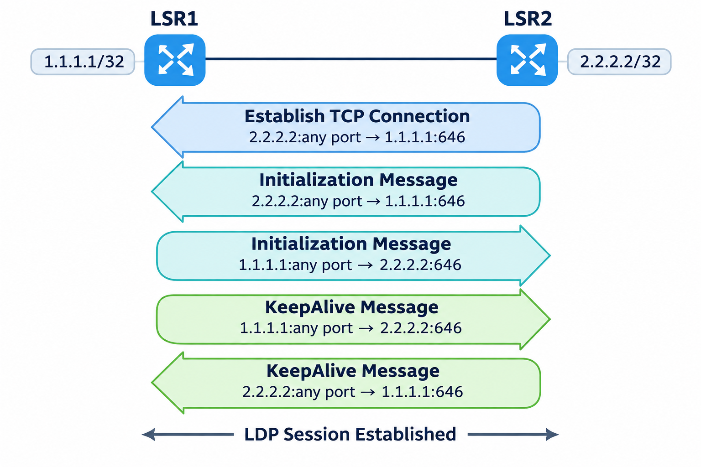
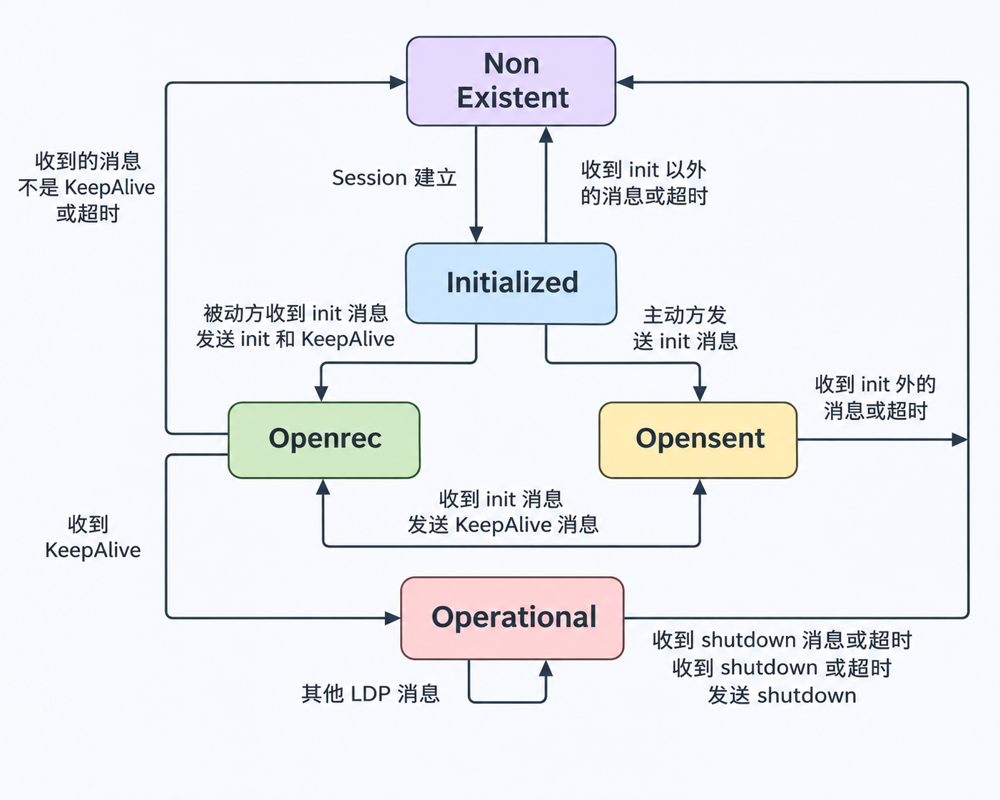
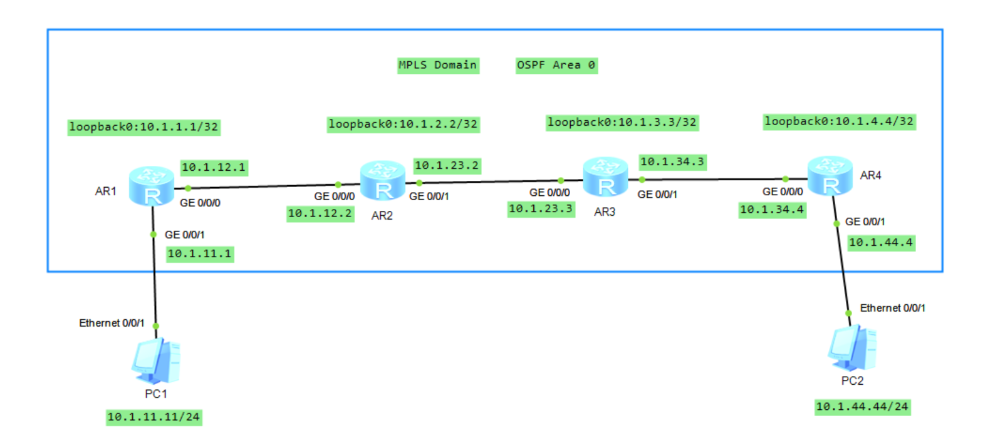
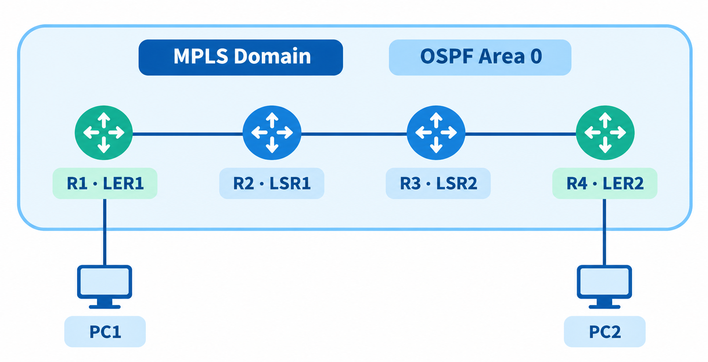
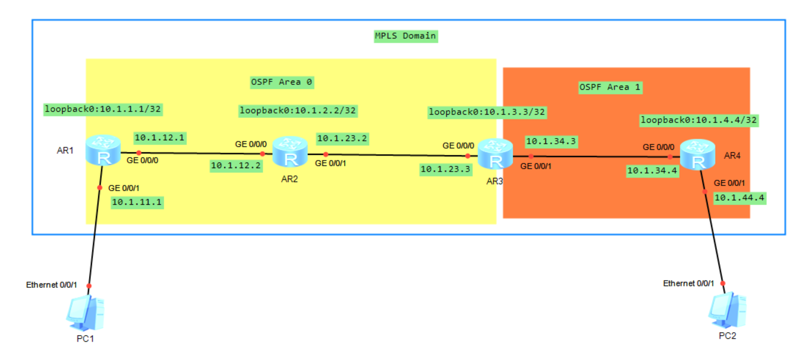
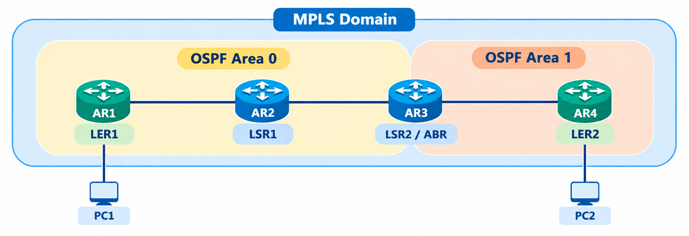

# LDP 协议之二

## 1.LDP 会话建立过程

LDP 会话是建立在 TCP 之上的，所以建立 TCP 连接之前必须知道邻居的 IP 地址，根据获知邻居 IP 地址的方式将 LDP 会话分成两类。

- 本地 LDP 会话：建立会话的两个 LSR 之间是直连的。
- 远端 LDP 会话：建立会话的两个 LSR 之间可以是直连的，也可以是非直连的。

### 1.1 邻居发现

在启动 LDP 协议后，路由器发出 Hello 报文，相邻路由器之间会通过交换 Hello 报文来完成相互问候，通过 Hello 报文可以获知邻居的基本信息，比如用来建立会话的地址（传输地址）等。然后，**<font color="red">由地址大的一方发起 TCP 连接并最终建立邻居会话，这种方式的 LDP 会话就叫本地会话</font>**。如果以手工的方式指定邻居地址，然后建立的会话称为远端的 LDP 会话。如下图所示，两直连邻居之间相互发现的过程。

<div align="center">
    
</div>

>LDP 协议的组播地址为 **`224.0.0.2`**，OSPF 的组播地址为 **`224.0.0.5`**，RIPv2 的组播地址为 **`224.0.0.9`**。

如果邻居是非直连的设备，Hello 会以单播的方式来交换，用于完成远端 LDP 会话的建立，如下图所示。

<div align="center">
    
</div>

### 1.2 会话建立

LDP 邻居之间相互发现或直接指定了邻居地址后，开始建立 TCP 连接，**<font color="red">建立完 TCP 连接后，相互发送初始化报文进行参数协商</font>**，如下所示。

<div align="center">
    
</div>

**<font color="red">如果接受对方的参数，则会回复 KeepAlive 报文，完成 LDP 会话的建立</font>**；如果期间发生错误，则会发送 Notification 报文来报告相应的错误，最终导致连接被关闭。可以通过以下命令检查 LDP 会话的建立情况。

```java{.line-numbers}
<AR4>display mpls ldp session 

 LDP Session(s) in Public Network
 Codes: LAM(Label Advertisement Mode), SsnAge Unit(DDDD:HH:MM)
 A '*' before a session means the session is being deleted.
 ------------------------------------------------------------------------------
 PeerID             Status      LAM  SsnRole  SsnAge      KASent/Rcv
 ------------------------------------------------------------------------------
 10.1.2.2:0         Operational DU   Active   0000:05:30  1322/1322
 10.1.5.5:0         Operational DU   Passive  0000:05:30  1321/1321
 ------------------------------------------------------------------------------
 TOTAL: 2 session(s) Found.
```

状态为 Operational 表示 LDP 会话已经建立成功，邻居之间可以交换标签通告等报文了。在会话建立后，双方会定期发送 Hello 报文以检测邻居状态，也会定期发送 KeepAlive 报文来检测 TCP 连接状态。

### 1.3 LDP 状态会话机

LDP 协议从邻居发现到会话建立过程历经了 4 个状态，状态之间的切换如下图所示。

<div align="center">
    
</div>

Non Existent 状态：LDP 协议的初始状态，类似 BGP 的 IDLE 状态。开始时双方用组播地址 **`224.0.0.2`** 发送 Hello 报文，并且选举主动方和被动方（**<font color="red">LSR IP 地址高的被选为主动方</font>**）。双方收到对方的 Hello 报文后，则开始建立 TCP 连接，接着是建立 TCP 连接三次握手的过程，当 TCP 会话建立成功后，双方进入到 Initialized 状态。

Initialized 状态：该状态下主动方和被动方的工作有点不同。主动方先发送 Initialization 报文，随后便转入 Opensent 状态，并等待被动方回应 Initialization 报文。被动方在这个状态下会等待主动方发送 Initialization 报文过来，**如果收到的 Initialization 报文中的参数都能接受，会给主动方回应 Initialization 和 KeepAlive 报文**，随后便转入 Openrec 状态。主动方和被动方在该状态下收到非 Initialization 报文或等待超时都会跳转至 Non Existent 状态。

Opensent 状态：这个状态是主动方发出 initialization 报文后的状态，该状态下还会等待邻居的 initialization 和 KeepAlive 报文。如果收到的 initialization 报文中的参数都能接受，则会向邻居回应 KeepAlive 报文，并且状态跳变至 Openrec 状态；如果参数不能接受或等待时间超时，则会断开 TCP 会话连接而进入到 Non Existent 状态。

Openrec 状态：不管是主动方还是被动方，**<font color="red">在收到参数正确的 initialization 报文后都会转入此状态，并且在该状态下已经向对方回应了 KeepAlive 报文并等待着邻居回应 KeepAlive 报文</font>**。如果从邻居那边按时接收到了 KeepAlive 报文，则转入 Operational 状态；如果收到其他报文或等待时间超时，则转入 Non Existent 状态。

Operational 状态：到达此状态就意味着 LDP 会话已经建立成功，可以发送和交换所有其他的 LDP 报文了。在该状态下双方通过周期性 KeepAlive 报文交换来维护邻居会话，如果 KeepAlive 超时，则立刻断开 LDP 会话并进入 Non Existent 状态；当收到错误通知报文时，也会断开 LDP 会话并转入 Non Existent 状态。

## 2.LDP 环路检测

在三层网络中使用的每种动态路由技术都有各自的防环机制，LDP 协议也有防环机制，但华为 VRP 系统默认不开启 LDP 防环功能，这是因为三层路由技术已经避免了路由环路，而 LDP 协议又是基于路由来分配标签和建立 LSP 的，所以这时报文通过 LSP 进行转发是不会出现环路的。**除非因为路由协议收敛出现问题，出现了短暂环路。标签中也有 TTL 字段，这样也避免了数据包在 MPLS 网络中无限循环**。LDP 协议本身的防环方式有以下几种。

### 2.1 规定最大跳数

如同 RIP 协议规定路由的最大跳数为 16 跳一样，LDP 协议也可以限制标签报文经过的 LSR 数量，这个特性通过在报文中使用一个叫作 Hop Count 的 TLV 来实现。LDP 报文（比如标签请求报文）每经过一个 LSR，该 LSR 都在跳数 TLV 中增加一跳，当跳数达到最大值后，环路就被检测到了，这时就终止 LSP 的建立。华为 VRP 系统默认定义的最大跳数为 32 跳。

### 2.2 TTL 处理

MPLS 报文中每经过一台 LSR，标签中的 TTL 减 1，当 TTL 减少到 0 的时候，报文最终被丢弃，通过这种方法达到防止数据包的无限循环问题。

### 2.3 路径矢量法

路径矢量法是指在 LDP 报文传递过程中，记录沿途经过的所有 LSR，就像 BGP 协议的 **`AS-PATH`** 属性一样，当一台 LSR 收到 LDP 报文后，就会将自己的 **`LSR-ID`** 添加到报文中；如果收到的 LDP 报文已经有了本地的 **`LSR-ID`**，则认为出现了环路，终止建立 LSP。

## 3.LDP 案例—LDP 基础

### 3.1 场景及需求描述

如下图所示，在网络中某用户的两个 Site（Site1 和 Site2）之间的 IP 业务流量需要通过 MPLS 域转发，LER1、LSR1、LSR2、LER2 是 MPLS 服务商的骨干设备，这些骨干设备已经运行和配置了 OSPF 协议，**<font color="red">设备间互连的接口、每个设备的环回口（Loopback0）及用户的网络都已经宣告进 OSPF 路由协议中</font>**。通过在骨干设备上运行 LDP 协议，从而可以创建公网的 LSP 隧道，用来承载用户站点之间的业务流量。

<div align="center">
    
</div>

逻辑拓扑图如下所示：

<div align="center">
    
</div>

### 3.2 配置思路

首先在所有 LSR 上配置 LSR-ID，这里以 LER1 为例：

```java{.line-numbers}
[AR1-mpls]display this 
#
mpls lsr-id 10.1.1.1
```

LSR 没有缺省的 LSR ID，必须手工配置。**<font color="red">推荐使用 LSR 某个 Loopback 接口的地址作为 LSR ID</font>**。使用 Loopback 地址可保持 LSR ID 稳定，因为即使在链路故障或设备重启之后，Loopback 接口状态也保持不变。**如果在没有修改 Transport Address（用来建立 LDP 邻居会话的地址）的情况下，LSR ID 使用的地址必须能被邻居访问到，因为默认情况下，LSR ID 就是 Transport Address**。

接着在所有 LSR 上启动 MPLS 及 MPLS LDP，首先在全局启用 MPLS 和 MPLS LDP，然后在骨干网的接口上启用 MPLS 和 MPLS LDP。这里以 LER1 为例：

```java{.line-numbers}
#
mpls lsr-id 10.1.1.1
mpls
#
mpls ldp
#
interface GigabitEthernet0/0/0
 ip address 10.1.12.1 255.255.255.0 
 mpls
 mpls ldp
```

然后就是要在 LER1 和 LER2 上配置 **`lsp-trigger`** 命令，因为要实现 **`10.1.11.0/24`** 和 **`10.1.44.0/24`** 这两个网段的互访，而华为路由器默认只对 32 位地址的主机IP路由（不包括接口的 32 位地址的主机IP路由）触发建立 LSP。具体配置如下：

```java{.line-numbers}
#
 sysname AR4
mpls
 lsp-trigger ip-prefix PC-FEC 
#
ip ip-prefix PC-FEC index 10 permit 10.1.44.0 24
ip ip-prefix PC-FEC index 20 permit 10.1.11.0 24
#
 sysname AR1
mpls
 lsp-trigger ip-prefix PC-FEC 
#
ip ip-prefix PC-FEC index 10 permit 10.1.11.0 24
ip ip-prefix PC-FEC index 20 permit 10.1.44.0 24
```

lsp-trigger 是华为 MPLS LDP 中用于控制 **`Ingress LSP`** 和 **`Egress LSP`** 建立的命令。它通过匹配指定的 IP 路由前缀（FEC），决定哪些路由可以触发相应的动态 LSP 建立。默认使用 host 模式，主要允许符合条件的 **`/32 `**主机路由触发 LSP。通过 **`lsp-trigger ip-prefix`** 可以允许指定的非主机路由（例如 **`/24`** 网段）触发 LSP。

- Ingress LSP：如果路由器 X 存在一条到达目的网段 A 的非直连路由，并且 A 匹配 **`lsp-trigger`** 策略，那么 **<font color="red">X 就可以成为去往目的 FEC A 的 LDP LSP 的 Ingress 节点</font>**。当普通 IP 报文需要通过该 LSP 转发时，X 可以根据转发关系压入 MPLS 标签，并发送给下一跳。
- Egress LSP：如果路由器 X 存在一条本地直连网段 B 的路由，并且 B 匹配 **`lsp-trigger`** 策略，**<font color="red">那么 X 就可以针对目的 FEC B 建立 Egress LSP，并向相应的上游 LDP 邻居通告标签映射</font>**。若采用隐式空标签机制，X 可以通告标签 3，使倒数第二跳执行 PHP（弹出标签）。

>**`lsp-trigger`** 主要控制 Ingress 和 Egress LSP 的触发条件，不直接控制 Transit LSP 的建立。

```java{.line-numbers}
lsp-trigger { all | host | ip-prefix ip-prefix-name | none }
```

对 **`lsp-trigger`** 的具体参数说明如下：

- all: 可根据所有静态路由和 IGP 路由项分配标签，触发建立 LSP；
- host: 可根据 32 位地址的主机 IP 路由触发建立 LSP，华为设备默认使用的参数；
- ip-prefix: 为 IP 地址前缀列表匹配的路由前缀分配标签，触发建立 LSP；
- none: 不为任何路由前缀分配标签。

### 3.3 验证

可以通过 **`display mpls ldp session`** 验证 LDP 邻居会话状态，以 LSR1 为例，下面的输出信息显示出 LSR1 已经和两个 LDP 邻居正确建立会话（会话状态为 Operational），如下表所示。

```java{.line-numbers}
<AR2>display mpls ldp session 
 LDP Session(s) in Public Network
 Codes: LAM(Label Advertisement Mode), SsnAge Unit(DDDD:HH:MM)
 A '*' before a session means the session is being deleted.
 ------------------------------------------------------------------------------
 PeerID             Status      LAM  SsnRole  SsnAge      KASent/Rcv
 ------------------------------------------------------------------------------
 10.1.1.1:0         Operational DU   Active   0000:00:18  76/76
 10.1.3.3:0         Operational DU   Passive  0000:00:18  75/75
 ------------------------------------------------------------------------------
 TOTAL: 2 session(s) Found.
```

观察和分析 LSP 转发表，这里以 LSR1 为例，如下所示。

>**`display mpls ldp lsp`** 侧重查看 LDP 协议建立和维护的 LSP 信息。**`display mpls lsp`** 侧重查看设备上的 MPLS LSP 转发信息，而且不限于 LDP，可包含 LDP、静态 LSP、BGP LSP、RSVP-TE LSP 等，取决于设备支持情况。

```java{.line-numbers}
<AR1>display mpls ldp lsp
 LDP LSP Information
 -------------------------------------------------------------------------------
 DestAddress/Mask   In/OutLabel    UpstreamPeer    NextHop         OutInterface
 -------------------------------------------------------------------------------
 10.1.2.2/32        1024/3         10.1.2.2        10.1.12.2       GE0/0/0
 10.1.3.3/32        1025/1025      10.1.2.2        10.1.12.2       GE0/0/0
 10.1.11.0/24       3/NULL         10.1.2.2        10.1.11.1       GE0/0/1
*10.1.11.0/24       Liberal/1024                   DS/10.1.2.2
 10.1.44.0/24       NULL/1026      -               10.1.12.2       GE0/0/0
 10.1.44.0/24       1026/1026      10.1.2.2        10.1.12.2       GE0/0/0
 -------------------------------------------------------------------------------
 TOTAL: 5 Normal LSP(s) Found.
 TOTAL: 1 Liberal LSP(s) Found.
 TOTAL: 0 Frr LSP(s) Found.

<AR2>display mpls ldp lsp 
 LDP LSP Information
 -------------------------------------------------------------------------------
 DestAddress/Mask   In/OutLabel    UpstreamPeer    NextHop         OutInterface
 -------------------------------------------------------------------------------
 10.1.2.2/32        3/NULL         10.1.1.1        127.0.0.1       InLoop0
 10.1.2.2/32        3/NULL         10.1.3.3        127.0.0.1       InLoop0
*10.1.2.2/32        Liberal/1024                   DS/10.1.1.1
*10.1.2.2/32        Liberal/1024                   DS/10.1.3.3
 10.1.3.3/32        NULL/3         -               10.1.23.3       GE0/0/1
 10.1.3.3/32        1025/3         10.1.1.1        10.1.23.3       GE0/0/1
 10.1.3.3/32        1025/3         10.1.3.3        10.1.23.3       GE0/0/1
*10.1.3.3/32        Liberal/1025                   DS/10.1.1.1
 10.1.11.0/24       1024/3         10.1.1.1        10.1.12.1       GE0/0/0
 10.1.11.0/24       1024/3         10.1.3.3        10.1.12.1       GE0/0/0
*10.1.11.0/24       Liberal/1025                   DS/10.1.3.3
 10.1.44.0/24       1026/1026      10.1.1.1        10.1.23.3       GE0/0/1
 10.1.44.0/24       1026/1026      10.1.3.3        10.1.23.3       GE0/0/1
*10.1.44.0/24       Liberal/1026                   DS/10.1.1.1
 -------------------------------------------------------------------------------
 TOTAL: 9 Normal LSP(s) Found.
 TOTAL: 5 Liberal LSP(s) Found.
 TOTAL: 0 Frr LSP(s) Found.

<AR3>display mpls ldp lsp 
 LDP LSP Information
 -------------------------------------------------------------------------------
 DestAddress/Mask   In/OutLabel    UpstreamPeer    NextHop         OutInterface
 -------------------------------------------------------------------------------
 10.1.2.2/32        NULL/3         -               10.1.23.2       GE0/0/0
 10.1.2.2/32        1024/3         10.1.2.2        10.1.23.2       GE0/0/0
 10.1.2.2/32        1024/3         10.1.4.4        10.1.23.2       GE0/0/0
*10.1.2.2/32        Liberal/1024                   DS/10.1.4.4
 10.1.3.3/32        3/NULL         10.1.2.2        127.0.0.1       InLoop0
 10.1.3.3/32        3/NULL         10.1.4.4        127.0.0.1       InLoop0
*10.1.3.3/32        Liberal/1025                   DS/10.1.2.2
*10.1.3.3/32        Liberal/1025                   DS/10.1.4.4
 10.1.11.0/24       1025/1024      10.1.2.2        10.1.23.2       GE0/0/0
 10.1.11.0/24       1025/1024      10.1.4.4        10.1.23.2       GE0/0/0
*10.1.11.0/24       Liberal/1026                   DS/10.1.4.4
 10.1.44.0/24       1026/3         10.1.2.2        10.1.34.4       GE0/0/1
 10.1.44.0/24       1026/3         10.1.4.4        10.1.34.4       GE0/0/1
*10.1.44.0/24       Liberal/1026                   DS/10.1.2.2
 -------------------------------------------------------------------------------
 TOTAL: 9 Normal LSP(s) Found.
 TOTAL: 5 Liberal LSP(s) Found.
 TOTAL: 0 Frr LSP(s) Found.
```

#### 3.3.1 默认 host 策略与 Ingress/Egress LSP

接下来我们仔细分析一下 AR1 和 AR2 上的 LDP LSP 信息。**`lsp-trigger`** 是华为 MPLS LDP 中控制 **Ingress LSP 和 Egress LSP 建立条件**的命令，该命令默认采用 **`host`** 策略，主要允许符合条件的 **`/32`** 主机路由触发 LSP。当配置 **`lsp-trigger ip-prefix`** 后，则以指定的 IP 前缀列表作为触发条件，而不再同时沿用默认的 **`host`** 策略（和前面总结的 lsp-trigger 规律一样）。

当 AR2 和 AR3 没有显式配置 **`lsp-trigger`** 时，默认采用 **`host`** 模式。对于本地 **`/32`** 主机路由，设备可以作为对应 FEC 的 Egress。对于通过 OSPF 等路由协议学习到的远端 **`/32`** 主机路由，则设备可以作为 Ingress。

对于 AR2 来说，其 **`Loopback0`** 地址为 **`10.1.2.2/32`**，属于本地主机路由，因此 AR2 为该 FEC 建立 Egress LSP，并向 AR1、AR3 通告隐式空标签 3。在 LDP LSP 表中，可以看到 **`10.1.2.2/32`** 对应两条 **`3/NULL`** 表项，分别关联不同的 LDP 对等体。而对于 AR3 的 **`Loopback0`** **`10.1.3.3/32`**，AR2 已经通过 OSPF 学到该路由，由于该路由符合默认 host 策略，因此 AR2 建立对应的 Ingress LSP，形成 **`NULL/3`** 表项，并且分配好本地标签 **`1025/3`** 之后向 AR1 和 AR3 通告。

对于 AR3 来说，情况正好相反。对于本地 Loopback0 **`10.1.3.3/32`**，AR3 作为 Egress，建立 **`3/NULL`** 表项，并向 AR2、AR4 通告标签 3。对于通过 OSPF 学到的远端 FEC **`10.1.2.2/32`**，可以作为该 FEC 的 Ingress，建立 **`NULL/3`** 表项。

#### 3.3.2 ip-prefix 策略与 Ingress/Egress LSP

在 AR1 和 AR4 上配置 **`lsp-trigger ip-prefix PC-FEC`** 后，**<font color="red">设备仅允许符合 **`PC-FEC`** 前缀列表的路由触发相应的 Ingress/Egress LSP</font>**。本实验中，前缀列表只允许 **`10.1.11.0/24`** 和 **`10.1.44.0/24`**。

从 AR1 的 **`display mpls ldp lsp`** 输出可以看到，对于本地直连网段 **`10.1.11.0/24`**，AR1 建立了 **`3/NULL`** 表项，表示 AR1 是该 FEC 的 Egress，并向上游 AR2 通告隐式空标签 3。而对于远端网段 **`10.1.44.0/24`**，AR1 已经通过 OSPF 学到该路由，建立了 **`NULL/1026`** 的 Ingress LSP。

虽然 AR1 通过 OSPF 学到了 **`10.1.2.2/32`** 和 **`10.1.3.3/32`** 等远端主机路由，并通过 LDP 从 AR2 获得了相应的下游标签，但由于这些 FEC 不匹配 PC-FEC 策略，因此 AR1 没有为它们触发 Ingress LSP。不过，AR1 的 LDP LSP 表中仍然存在 **`10.1.2.2/32`** 对应的 **`1024/3`** 和 **`10.1.3.3/32`** 对应的 **`1025/1025`**。相比之下，AR2、AR3 没有显式配置 **`lsp-trigger`**，采用默认的 host 策略，无法为 **`10.1.11.0`** 和 **`10.1.44.0`** 分别建立对应的 Ingress LSP。

接下来解释为什么在 AR1-AR4 的 LDP LSP 表中都没有 **`10.1.1.1/32`** 和 **`10.1.4.4/32`** 的条目。在本实验中，AR1 和 AR4 的 **`PC-FEC`** 仅允许 **`10.1.11.0/24`** 和 **`10.1.44.0/24`**，没有允许各自 Loopback0 对应的 **`10.1.1.1/32`**、**`10.1.4.4/32`**。因此不会通过当前策略触发对应的 Egress LSP，也不会由这些出口 LSP 向上游发布相应的标签映射。

```java{.line-numbers}
<AR2>display mpls ldp verbose 
                           LDP Global Information
 ------------------------------------------------------------------------------
 Protocol Version        : V1            Neighbor Liveness    : 600 Sec
 Graceful Restart        : Off           FT Reconnect Timer   : 0 Sec
 MTU Signaling           : On            Recovery Timer       : 300 Sec
 Capability-Announcement : Off           Longest-match        : Off
 P2MP Capability         : Off                                       

                          LDP Instance Information
 ------------------------------------------------------------------------------
 Instance ID             : 0             VPN-Instance         :
 Instance Status         : Active        LSR ID               : 10.1.2.2
 Loop Detection          : Off           Path Vector Limit    : 32
 Label Distribution Mode : Ordered       Label Retention Mode : Liberal
 Instance Deleting State : No            Instance Reseting State : No
 Graceful-Delete         : Off           Graceful-Delete Timer : 5 Sec
```

由于华为 LDP 默认采用 **Ordered（有序标签控制）**（如上所示），非 Egress 节点需要先获得下游针对该 FEC 发布的标签映射，才能继续向上游建立和传播对应的标签关系。因此，当 AR1、AR4 未触发各自 Loopback0 的 Egress LSP 时，AR2、AR3 也无法通过正常的有序标签传播过程建立这两个 FEC 对应的完整 LSP。

### 3.4 MPLS 数据包转发的流程分析

现在假设 Site1 中的主机 PC1 开始访问 Site2 的主机 PC2，当数据流到达 MPLS 骨干网时，我们一起来观察和分析一下每台 LSR 是如何处理接收到的报文的。

报文到达 LER1 时的处理。首先来观察一下 LER1 的 LSP 转发表中关于 **`FEC：10.1.44.0/24`** 的详细信息，如下输出所示。

```java{.line-numbers}
<AR1>display mpls lsp include 10.1.44.0 24 verbose 
-------------------------------------------------------------------------------
                 LSP Information: LDP LSP
-------------------------------------------------------------------------------
  No                  :  1
  VrfIndex            :        
  Fec                 :  10.1.44.0/24
  Nexthop             :  10.1.12.2
  In-Label            :  NULL
  Out-Label           :  1025
  In-Interface        :  ----------
  Out-Interface       :  GigabitEthernet0/0/0
  LspIndex            :  6146
  Token               :  0x3
  FrrToken            :  0x0
  LsrType             :  Ingress
  Outgoing token      :  0x0
  Label Operation     :  PUSH
  Mpls-Mtu            :  1500
  TimeStamp           :  164sec
  Bfd-State           :  ---
  BGPKey              :  ------
```

由上面的输出信息可知，LER1 会使用出标签 1025（标签操作为 PUSH）将该 FEC 的所有报文发至下一跳 **`10.1.12.2`**（LSR1）。实际上作为该 LSP 的 Ingress 节点，当 LER1 接收到用户的 IP 报文时，通过查找 FIB 表后进行转发，所以我们再来观察一下 FIB 表中关于该路由前缀的转发信息，如下输出所示。

```java{.line-numbers}
<AR1>display fib 10.1.44.0 verbose 
  Route Entry Count: 1
 Destination: 10.1.44.0           Mask     : 255.255.255.0       
 Nexthop    : 10.1.12.2           OutIf    : GigabitEthernet0/0/0
 LocalAddr  : 10.1.12.1           LocalMask: 0.0.0.0             
 Flags      : DGU                 Age      : 482sec              
 ATIndex    : 0                   Slot     : 0                   
 LspFwdFlag : 1                   LspToken : 0x3                 
 InLabel    : NULL                OriginAs : 0                   
 BGPNextHop : 0.0.0.0             PeerAs   : 0                   
 QosInfo    : 0x0                 OriginQos: 0x0                 
 NexthopBak : 0.0.0.0             OutIfBak : [No Intf]           
 LspTokenBak: 0x0                 InLabelBak : NULL                
 LspToken_ForInLabelBak : 0x0                 
 EntryRefCount : 0                   
 VlanId : 0x0                 
 BgpKey : 0                   
 BgpKeyBak : 0                   
 LspType         : 3              Label_ForLspTokenBak   : 0
 MplsMtu         : 1500           Gateway_ForLspTokenBak : 0.0.0.0             
 NextToken       : 0x0            IfIndex_ForLspTokenBak : 0
 Label_NextToken : NULL           Label : 1025
 LspBfdState     : 9    
```

在上面的输出信息中，可以发现路由前缀 **`10.1.44.0`** 在 FIB 中对应着一个标签 1025，也就是转发去往该目标路由前缀的 IP 报文时需要压入此标签，而这个标签信息来源于 LSP 转发表。**<font color="red">FIB 中的路由前缀是通过使用 LspToken 这种指针的方式关联 LSP 转发表的标签</font>**。这里的 LspToken 值为 0x3，这与 LSP 转发表中 **`10.1.44.0/24`** 对应的 token 值是相同的。在 FIB 表中，如果该指针值为 0，则对应的报文采用 IP 转发的方式。

## 4.LDP 案例—路由汇总对 LSP 的影响

LDP 会依据路由表中的路由前缀进行标签的分配，同时根据标签的分发方式，将本地分配的标签通告给 LDP 邻居，从而触发建立 LSP。接下来对案例分析 1 稍微作了一下修改，将 MPLS 骨干网划分为两个 OSPF 区域，LER1、LSR1、LSR2 互连的接口位于区域 0，LSR2 和 LER2 互连的接口及 LER2 右侧的接口位于区域 1，然后在 LSR2 上对路由前缀 **`10.1.44.0/24`** 做路由汇总，汇总后的路由前缀为 **`10.1.44.0/22`**。

<div align="center">
    
</div>

上述拓扑图的逻辑图如下所示：

<div align="center">
    
</div>

### 4.1 汇总前

汇总前 LSR2 的 LSP 转发表如下所示：

```java{.line-numbers}
<AR3>display mpls lsp 
-------------------------------------------------------------------------------
                 LSP Information: LDP LSP
-------------------------------------------------------------------------------
FEC                In/Out Label  In/Out IF                      Vrf Name       
10.1.44.0/24       1024/3        -/GE0/0/1                                     
10.1.3.3/32        3/NULL        -/-                                           
10.1.2.2/32        NULL/3        -/GE0/0/0                                     
10.1.2.2/32        1025/3        -/GE0/0/0                                     
10.1.11.0/24       1026/1024     -/GE0/0/0  
```

LSR1 的 LSP 转发表，如下输出所示：

```java{.line-numbers}
<AR2>display mpls lsp 
-------------------------------------------------------------------------------
                 LSP Information: LDP LSP
-------------------------------------------------------------------------------
FEC                In/Out Label  In/Out IF                      Vrf Name       
10.1.2.2/32        3/NULL        -/-                                           
10.1.11.0/24       1024/3        -/GE0/0/0                                     
10.1.3.3/32        NULL/3        -/GE0/0/1                                     
10.1.3.3/32        1025/3        -/GE0/0/1                                     
10.1.44.0/24       1026/1024     -/GE0/0/1  
```

```java{.line-numbers}
<AR2>display ip routing-table 
Route Flags: R - relay, D - download to fib
------------------------------------------------------------------------------
Routing Tables: Public    Destinations : 17       Routes : 17       

Destination/Mask    Proto   Pre  Cost      Flags NextHop         Interface

       10.1.1.1/32  OSPF    10   1           D   10.1.12.1       GigabitEthernet0/0/0
       10.1.2.2/32  Direct  0    0           D   127.0.0.1       LoopBack0
       10.1.3.3/32  OSPF    10   1           D   10.1.23.3       GigabitEthernet0/0/1
       10.1.4.4/32  OSPF    10   2           D   10.1.23.3       GigabitEthernet0/0/1
      10.1.11.0/24  OSPF    10   2           D   10.1.12.1       GigabitEthernet0/0/0
      10.1.12.0/24  Direct  0    0           D   10.1.12.2       GigabitEthernet0/0/0
      10.1.12.2/32  Direct  0    0           D   127.0.0.1       GigabitEthernet0/0/0
    10.1.12.255/32  Direct  0    0           D   127.0.0.1       GigabitEthernet0/0/0
      10.1.23.0/24  Direct  0    0           D   10.1.23.2       GigabitEthernet0/0/1
      10.1.23.2/32  Direct  0    0           D   127.0.0.1       GigabitEthernet0/0/1
    10.1.23.255/32  Direct  0    0           D   127.0.0.1       GigabitEthernet0/0/1
      10.1.34.0/24  OSPF    10   2           D   10.1.23.3       GigabitEthernet0/0/1
      10.1.44.0/24  OSPF    10   3           D   10.1.23.3       GigabitEthernet0/0/1

<AR3>display ip routing-table 
Route Flags: R - relay, D - download to fib
------------------------------------------------------------------------------
Routing Tables: Public     Destinations : 17       Routes : 17       
Destination/Mask    Proto   Pre  Cost      Flags NextHop         Interface

       10.1.1.1/32  OSPF    10   2           D   10.1.23.2       GigabitEthernet0/0/0
       10.1.2.2/32  OSPF    10   1           D   10.1.23.2       GigabitEthernet0/0/0
       10.1.3.3/32  Direct  0    0           D   127.0.0.1       LoopBack0
       10.1.4.4/32  OSPF    10   1           D   10.1.34.4       GigabitEthernet0/0/1
      10.1.11.0/24  OSPF    10   3           D   10.1.23.2       GigabitEthernet0/0/0
      10.1.12.0/24  OSPF    10   2           D   10.1.23.2       GigabitEthernet0/0/0
      10.1.23.0/24  Direct  0    0           D   10.1.23.3       GigabitEthernet0/0/0
      10.1.23.3/32  Direct  0    0           D   127.0.0.1       GigabitEthernet0/0/0
    10.1.23.255/32  Direct  0    0           D   127.0.0.1       GigabitEthernet0/0/0
      10.1.34.0/24  Direct  0    0           D   10.1.34.3       GigabitEthernet0/0/1
      10.1.34.3/32  Direct  0    0           D   127.0.0.1       GigabitEthernet0/0/1
    10.1.34.255/32  Direct  0    0           D   127.0.0.1       GigabitEthernet0/0/1
      10.1.44.0/24  OSPF    10   2           D   10.1.34.4       GigabitEthernet0/0/1
```

### 4.2 汇总后

在 AR3 上配置了如下命令，这表示 AR3 将 Area 1 中位于 **`10.1.44.0/22`** 范围内的路由进行区域间汇总，**<font color="red">并向 Area 0 发布汇总后的路由，而不再逐条发布被汇总的明细前缀</font>**。

```java{.line-numbers}
[AR3-ospf-1-area-0.0.0.1]display this 
#
 area 0.0.0.1 
  abr-summary 10.1.44.0 255.255.252.0
  network 10.1.34.0 0.0.0.255 
```

汇总后的路由（**`10.1.44.0/22`**）会通告给 LSR1（AR2），而明细路由 **`10.1.44.0/24`** 不再通告给 LSR1（AR2）。AR3 和 AR2 的汇总后的路由表如下所示，可以看到，LSR2（AR3）上只有明细路由，没有汇总路由，而在 LSR1（AR2）上只有汇总路由，没有明细路由，这说明 AR3 没有再向 AR2 通告明细路由。

```java{.line-numbers}
<AR3>display ip routing-table 10.1.44.0
Route Flags: R - relay, D - download to fib
------------------------------------------------------------------------------
Routing Table : Public
Summary Count : 1
Destination/Mask    Proto   Pre  Cost      Flags NextHop         Interface
      10.1.44.0/24  OSPF    10   2           D   10.1.34.4       GigabitEthernet0/0/1
<AR3>display ospf lsdb summary 
	 OSPF Process 1 with Router ID 3.3.3.3
		         Area: 0.0.0.0
		 Link State Database 
  Type      : Sum-Net
  Ls id     : 10.1.44.0
  Adv rtr   : 3.3.3.3  
  Ls age    : 1382 
  Len       : 28 
  Options   :  E  
  seq#      : 80000003 
  chksum    : 0x9d7b
  Net mask  : 255.255.252.0
  Tos 0  metric: 2
  Priority  : Low


<AR2>display ip routing-table 10.1.44.0
Route Flags: R - relay, D - download to fib
------------------------------------------------------------------------------
Routing Table : Public
Summary Count : 1
Destination/Mask    Proto   Pre  Cost      Flags NextHop         Interface
      10.1.44.0/22  OSPF    10   3           D   10.1.23.3       GigabitEthernet0/0/1
```

所以这时的问题就是 LSR1（AR1）虽然得到了路由 **`10.1.44.0/22`**，并且收到了 AR3 通告的 **`10.1.44.0/24`** 以及对应的标签 1024。由于华为设备默认采用有序控制的方式来建立 LSP，根据 RFC 5036，When using LSP Ordered Control, an LSR may initiate the transmission of a label mapping only for a FEC for which it has a label mapping for the FEC next hop, or for which the LSR is the egress. 

也就是说 LSR 只有在自己是某个 FEC 的 Egress，或者已经获得该 FEC 当前下一跳的标签映射时，才能按有序控制方式向上游发起标签通告。而此时 LSR1 的路由表中没有 **`10.1.44.0/24`**，因此无法为其分配本地标签。所以在有序控制的标签发布方式下，LSR1 自身也不再将分配标签信息给到上游邻居（LER1）。

```java{.line-numbers}
<AR3>display mpls ldp lsp 
 LDP LSP Information
 -------------------------------------------------------------------------------
 DestAddress/Mask   In/OutLabel    UpstreamPeer    NextHop         OutInterface
 -------------------------------------------------------------------------------
*10.1.11.0/24       Liberal/1026                   DS/10.1.4.4
 10.1.44.0/24       1024/3         10.1.4.4        10.1.34.4       GE0/0/1
 10.1.44.0/24       1024/3         10.1.2.2        10.1.34.4       GE0/0/1
 -------------------------------------------------------------------------------
 TOTAL: 9 Normal LSP(s) Found.
 TOTAL: 4 Liberal LSP(s) Found.
 TOTAL: 0 Frr LSP(s) Found.

<AR2>display mpls ldp lsp 
 LDP LSP Information
 -------------------------------------------------------------------------------
 DestAddress/Mask   In/OutLabel    UpstreamPeer    NextHop         OutInterface
 -------------------------------------------------------------------------------
*10.1.44.0/24       Liberal/1024                   DS/10.1.3.3
 -------------------------------------------------------------------------------
 TOTAL: 7 Normal LSP(s) Found.
 TOTAL: 5 Liberal LSP(s) Found.
 TOTAL: 0 Frr LSP(s) Found.

<AR1>display mpls ldp lsp 
 LDP LSP Information
 -------------------------------------------------------------------------------
 DestAddress/Mask   In/OutLabel    UpstreamPeer    NextHop         OutInterface
 -------------------------------------------------------------------------------
 10.1.2.2/32        1024/3         10.1.2.2        10.1.12.2       GE0/0/0
 10.1.3.3/32        1025/1025      10.1.2.2        10.1.12.2       GE0/0/0
 10.1.11.0/24       3/NULL         10.1.2.2        10.1.11.1       GE0/0/1
*10.1.11.0/24       Liberal/1024                   DS/10.1.2.2
 -------------------------------------------------------------------------------
 TOTAL: 3 Normal LSP(s) Found.
 TOTAL: 1 Liberal LSP(s) Found.
 TOTAL: 0 Frr LSP(s) Found.
```

也就是说，对于由用户 Site1 发往目标路由前缀 **`10.1.44.0/24`** 的数据包来说，经过路径 LER1、LSR1、LSR2 时，使用的是 IP 转发方式。经过 LSR2 后，采用的是 MPLS 转发方式。也就是说，对于该 FEC 来说，LSP 实际上是不连续的。