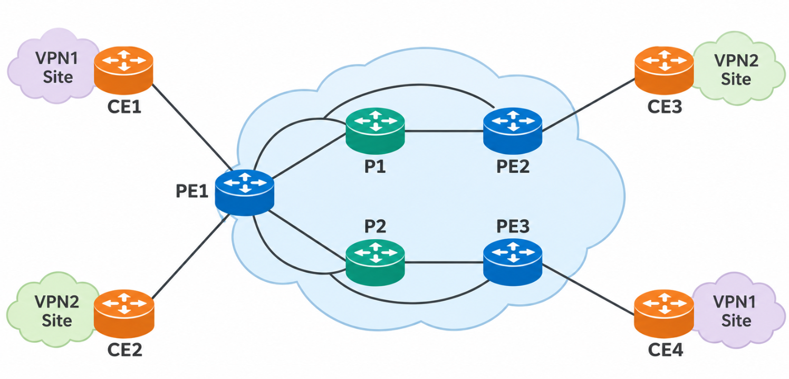
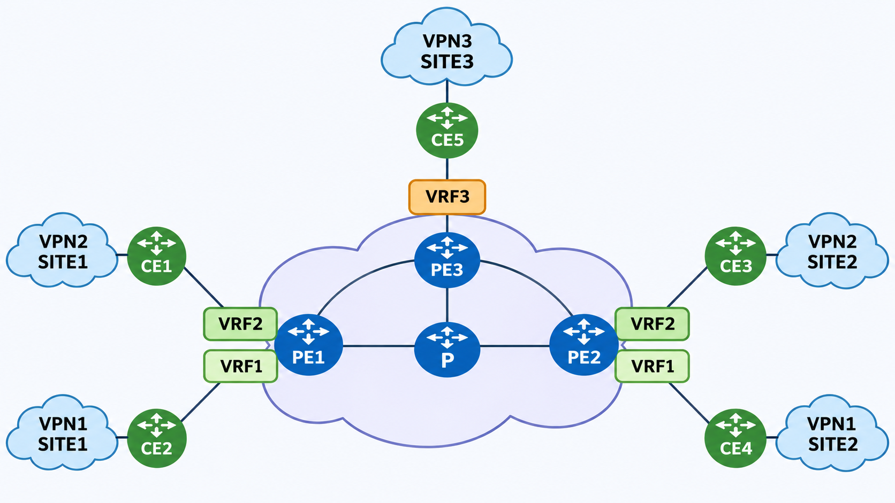
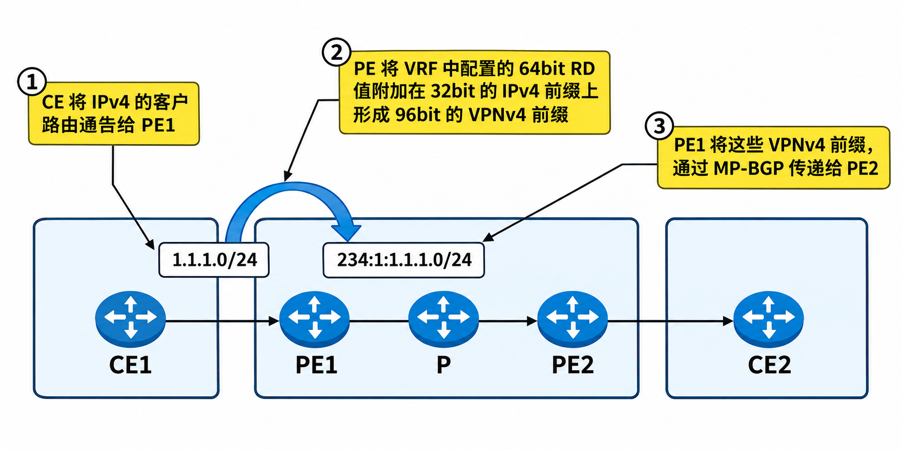
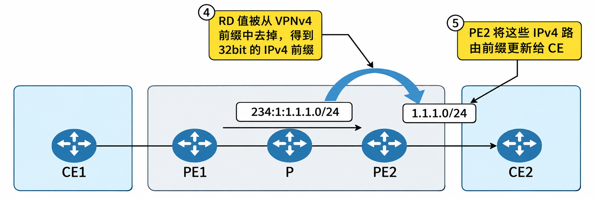
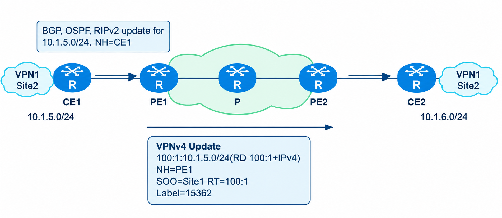
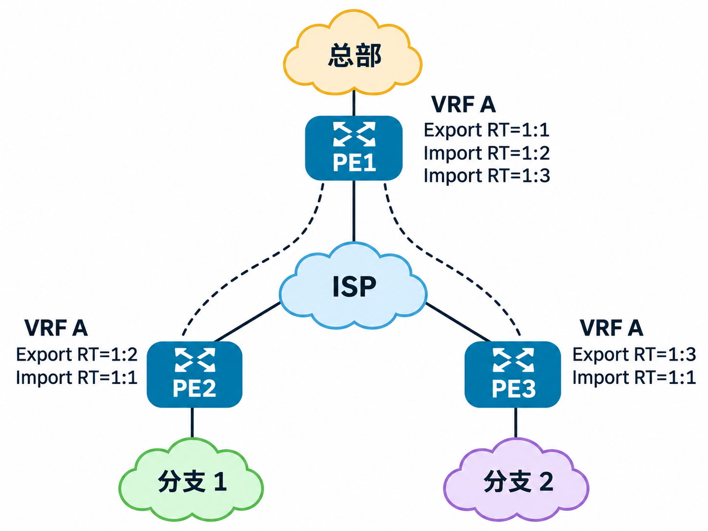
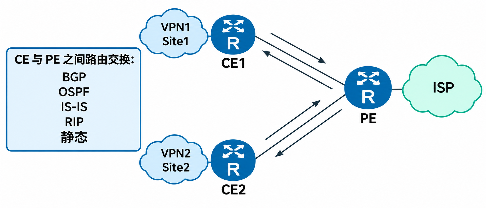
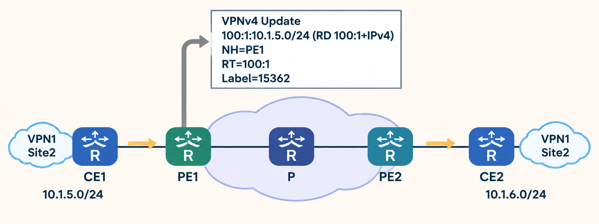
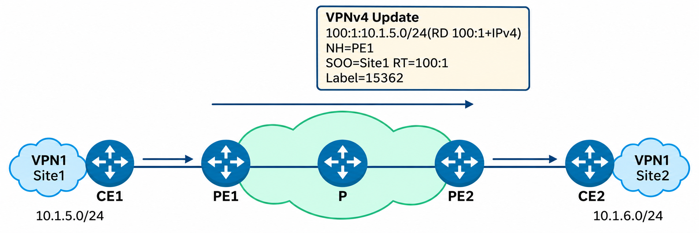
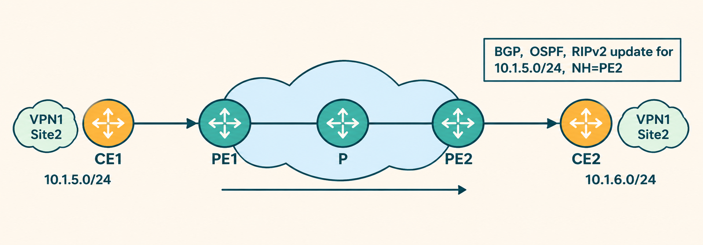

# MPLS VPN 基础

## 1.MPLS VPN 的网络结构

一个典型的 MPLS VPN 网络中具有如下不同的设备角色。

    

**CE（Custom Edge）** 是用户网络的边界设备，直接与服务提供商网络相连。CE 可以是路由器、交换机，也可以是一台主机。**PE（Provider Edge Router）** 是指骨干网络的边界设备，直接连接 CE，从而提供 VPN 业务接入。**P（Provider Router）** 是指骨干网络中的核心路由器，主要提供内部路由和数据包转发服务。

在 MPLS VPN 网络中，P 和 PE 运行 MPLS 协议，而用户设备（CE）不需要运行 MPLS。CE 和 PE 之间交换三层路由信息，P 仅学习骨干网路由。一个 PE 可连接多台 CE（共享）或一台 CE（专用）。**数据流先通过 IP 转发到 PE，再通过 MPLS 标签转发穿越网络**。

## 2.MPLS VPN 基本概念

### 2.1 vpn-instance 

在典型的 MPLS VPN 网络中，虽然 CE 和 PE 之间可以使用任何 IP 路由协议，但当多个 VPN 用户连入同一 PE 或不同 VPN 用户需要通信时，会出现地址空间重叠问题。例如，VPN1 和 VPN2 都使用 **`10.10.10.0/24`** 网段地址，导致地址空间的重叠（Address Spaces Overlapping），而在 PE 上产生路由冲突。

因此在 PE 上必须将这些不同 VPN 用户的路由隔离起来，这就产生了 VPN 实例的技术，VPN 实例也称为 VPN 路由转发表 VRF（VPN Routing and Forwarding Table）。**一个 VPN 实例相当于一台虚拟的路由器，这台虚拟路由器具有自己的接口、路由转发表等资源，在控制平面上是独立运行的**。每个 VPN 用户都会在 PE 上拥有自己的 VPN 实例，当 PE 收到来自不同用户的私网路由时，会将其放在该用户对应的 VPN 实例的路由转发表中。一台 PE 可以拥有多个路由转发表，包括**一个公网路由转发表，以及一个或多个 VPN 路由转发表**。

    

VPN 实例技术实际上解决了两大问题：（1）在 PE 上解决不同 VPN 用户的路由冲突问题；（2）不需要使用 ACL 等工具，简化了隔离不同用户网络的操作。

如上图所示的场景中，两个不同 VPN 用户（VPN1 和 VPN2）连接到同一个 PE 上，这时如果在 PE1 和 PE2 上为 VPN1 和 VPN2 都创建了相应的 VPN 实例，那么当 PE 接收到来自这两个 VPN 用户的私网路由时，会存放在不同的 VPN 实例转发表中。这样，即使这两个 VPN 用户的私网地址空间有重叠，在 PE 上也不会产生路由冲突的问题，因为不同 VPN 实例的路由转发表之间是相互隔离的。同时，**来自用户的私网路由也不会进入骨干网中的公网全局路由转发表，因为用户 VPN 实例中的路由转发表和全局路由转发表之间也是相互隔离的**。

公网路由转发表与 VPN 实例存在以下不同：

- 公网路由表包括所有 PE 和 P 设备的 IPv4 路由，该路由可能通过静态路由或者动态路由协议产生。
- VPN 实例的路由表包括属于该 VPN 实例用户的所有 Site 的路由，**通过 CE 与 PE 之间或者两个 PE 之间的 VPN 路由信息交互获得**。
- 公网转发表是根据路由管理策略从公网路由表提取出来的转发信息，而 VPN 转发表是根据路由管理策略从对应的 VPN 路由表提取出来的转发信息。
- 可以看出，PE 上的各 VPN 实例之间相互独立，并与公网路由转发表也是相互独立的。
- 可以将每个 VPN 实例看作一台虚拟的设备，维护独立的地址空间并有连接到私网的接口。

### 2.2 RD（Route Distinguisher）

**用户的 VPN 路由是通过 MP-BGP（多协议 BGP）在 MPLS VPN 骨干网络中来传递的**，如果来自不同用户的 VPN 路由地址空间相同，BGP 协议就无法区分这是来自哪个用户的路由了，为了保证每个用户的 VPN 路由的唯一性，引入了 RD 的概念。

通过在 PE 上为每个用户分配一个唯一的 RD 值，并且在通告用户私网路由时附带上该 RD 值，这时在接收端路由器收到不同用户的 VPN 路由后，因为每条路由有一个唯一标识符（即 RD 值），所以能区分出这些路由是否来自同个用户，不会因为 BGP 在进行最优路由选择时，导致某些用户的 VPN 路由被弃选。比如一台 PE 在接收到两条来自不同用户、相同前缀的 VPN 路由时，根据 BGP 的选路原则，会在这两条路由中选择出最优路由，另一条路由就会被冷落了。

**在一条 IPv4 路由前缀之前加上 RD 值后，就变成 VPN-IPv4 地址簇了（可简称 VPNv4 地址簇），VPNv4 地址簇只在运营商骨干网内部存在，由 PE 路由器产生并发布**。

    

    

用户的 CE1 设备先将一条 IPv4 的私网路由前缀（**`1.1.1.0/24`**）通告给 PE1，PE1 **从 VPN 实例中将该路由引入至 MP-BGP**，并且将 RD 值添加至 IPv4 路由前缀之前变成了 96bit 的 VPNv4 路由，然后发布到骨干网中的其他 PE。当另一侧的 PE 收到该 VPNv4 路由后，**在其发布给 CE 之前，先将 RD 剥离掉，还原回 IPv4 的路由再通告给对面的 CE 路由器**。

RD 值共 64bit，这 64bit 的值有两种表示方式：**`ASN:nn`** 和 **`IP-Address:nn`**，其中 nn 代表数字，管理员可以自定义。最常用的格式为 **`ASN:nn`**，其中 ASN 代表自治系统号。通常情况下，在服务提供商所使用的 **`ASN:nn`** 中，ASN 是 IANA 分配给服务提供商的 AS 号，nn 可以是服务提供商分配给每个 VPN 实例的唯一号码。

### 2.3 VPN Target

VPN Target（也称为 Route Target，RT）是 BGP 的一个扩展团体属性，**用来判断路由该被送入到哪个 VPN 实例中**，或者说，VPN 实例使用 RT 来表达对路由的喜好。当一个 PE 将 VPN 路由引入到 MP-BGP 后，就会让其携带一个 RT 值，然后送到远端的 PE，远端的 PE 根据 RT 值来决定将其送往哪个 VPN 实例。

VPN 实例中的 RT 值分为 Export（导出）和 Import（导入）两种值，Export 的 RT 会在 VPNv4 路由发布出来时携带，在 VPNv4 路由的接收端 PE 上，会比较路由携带过来的 Export RT 值跟本地所有 VRF 的 Import RT 值，如果匹配上了，该路由就被送往相应的 VRF 路由表，如下图所示，下图中的标签 15362 是私网标签。

    

>根据发送过来带有 export RT 值与本地所有的 VRF 的 import RT 值匹配，如果有某个 VPN 实例的 import RT 匹配上了，则把 VPNv4 路由引入为 IPv4 路由，并且根据本地 VRF 的 import RT 属性加入到相应的 VRF 中，**私网标签保留，留在数据转发时使用**，再由本 VRF 上的路由协议引入并转发给相应的 CE。

由上图可知，PE1 在将 CE1 发过来的 IPv4 路由转变为 VPNv4 路由时，除了添加一个 RD 以外，还携带了一个 Export RT 值，当 PE2 接收到该 VPNv4 路由后，将其转变了 IPv4 路由，再通过匹配各 VRF 的 Import RT 值，从而将该 IPv4 路由加入到指定的路由表中。

一条 VPNv4 路由可以携带多个 RT 值，通过灵活配置 RT 值。根据 RFC 4364 的规定，There is a set of Route Targets that a PE router attaches to a route received from site S; these may be called the "Export Targets". And there is a set of Route Targets that a PE router uses to determine whether a route received from another PE router could be placed in the VRF associated with site S; these may be called the "Import Targets". **Note that a particular VPN-IPv4 route is only eligible for installation in a particular VRF if there is some Route Target that is both one of the route's Route Targets and one of the VRF's Import Targets**. 也就是说，当一个 RT 同时存在于 VPNv4 路由携带的 RT 集合和目标 VRF 的 Import RT 集合中时，该路由就有资格导入这个 VRF。

这样可以非常方便地实现同一 VPN 内部或者不同 VPN 之间各个站点之间的路由控制。例如，在某用户的 VPN 网络中，可能只允许各个分支站点与总部站点之间互相交换路由信息，而禁止分支站点与分支站点之间直接交换路由信息，通过在各个站点的 VRF 中配置相应的 RT 值，即可满足此需求。

    

如上图所示，用户公司拥有总部、分支 1 和分支 2 共 3 个站点，用户希望通过 MPLS VPN 实现这 3 个站点之间的相互通信，但同时有特定的安全和监控需求：两个分支公司（分支 1 和分支 2）之间进行通信的流量必须经过总部转发，从而实现安全控制和流量监控。

为实现上述需求，可以在总部站点的 PE1 上，为总部的 VPN 实例设置两个 Import RT 值，分别对应两个分支站点的 Export RT 值。而两分支站点的 VPN 实例只能接收来自总部的路由信息，通过这种方法来控制不同站点之间（不论是同一 VPN 内部或不同 VPN 之间）的路由交换。

## 3.路由发布的过程

用户站点（CE）内部路由信息必须发布给 PE 设备，在 PE 和 CE 之间可以运行动态路由协议（RIP、OSPF、IS-IS、BGP）或静态路由。PE 从 CE 学习到的路由先放进 VPN 实例的路由表，然后再将其引入到 MP-BGP 成为 VPNv4 路由后发布到骨干网络。为了使路由进入骨干网络后具有唯一性，MP-BGP 给 IPv4 路由添加了一个 RD 值，从而允许不同的用户地址空间可以重叠，并且使用了 RT 值来标识此路由是去往哪个 VPN 实例的。下面我们就详细分析一下 MPLS VPN 中路由信息的交换过程，其中包括如下 4 个阶段。

- CE 到 PE 之间的路由交换。
- PE 将 VRF 中的路由注入进 MP-BGP。
- VPNv4 路由在骨干网中传递。
- PE 将 VPNv4 路由注入到 VRF 中。

### 3.1 CE 到 PE 之间的路由交换过程

如下图所示，PE 和 CE 之间可以通过标准路由协议（如 BGP、OSPF、IS-IS、RIP）或者静态路由来交换路由信息，PE 收到从不同 CE 发过来的路由信息后，根据入接口将收到的路由存放在不同的 VPN 实例中。所有的 CE 端都可以使用相同的路由协议，但是需要在 PE 的每个 VRF 运行不同路由协议实例，相互之间没有干扰。

    

### 3.2 PE 将 VPN 实例中的路由引入到 MP-BGP

PE 从 CE 学习到客户的私网路由后，需要将这些私网路由从 VPN 实例中引入到 MP-BGP 成为 VPNv4 路由（**如果 PE 和 CE 之间运行的是 BGP，就不需要引入**），如下图所示。

    

当 PE 将 VPN 实例中的客户私网路由引入到 MP-BGP 后，会在 IPv4 路由前缀的前面添加一个 RD 形成 VPNv4 路由。然后在 VPNv4 路由通告中携带 Export RT 值，**还会为该 VPNv4 路由分配一个私网标签（每条 VPNv4 都会映射到一个私网标签，由 MP-BGP 协议随机自动分配）**，同时还将路由的下一跳修改成自己。这些操作完成后，PE 将 VPNv4 路由发布到所有的 MP-BGP 邻居。

### 3.3 VPNv4 路由在公网中传递

客户的私网路由在 PE 上被引入到 MP-BGP 后变成了 VPNv4 路由，这些 VPNv4 路由需要传递到其他的 PE（或者先传递到骨干网中的 RR，再由 RR 反射到其他 PE）。如果这些 PE 都在同一个 AS 中，那么需要在 PE 之间配置 MP-iBGP 邻居关系（或者所有 PE 都与 RR 建立 MP-iBGP 邻居关系），经过多协议扩展后的 BGP 可以用来传递 VPNv4 路由，如下图所示。

    

### 3.4 PE 将 VPNv4 路由注入到 VPN 实例

当 PE 收到邻居发送过来的 VPNv4 路由后，根据该路由携带的 Export RT 值和本地所有 VRF 的 Import RT 值，将满足条件的路由注入到对应的 VRF 中。当把该 VPNv4 路由注入到 VRF 时，会将路由携带的 RD 值去掉，把 VPNv4 路由还原成 IPv4 路由，然后通过本地 PE 和 CE 之间的路由协议将该 IPv4 路由发布给 CE，如下图所示。

    

需要注意，**由于 VPNv4 路由携带着一个用于数据转发的私网标签，PE 并不会将该标签发给 CE，而是将该标签信息保存在 FIB 表中**。

经过上述 4 个步骤后，VPN 客户的不同站点就可以实现私网路由的交互，从而构建成一个 VPN。在这个过程中可以发现，**在骨干网络中，只有 PE 设备才会保存私网路由（存放在各 VRF 中），而骨干网的核心设备（P 设备）根本不会收到任何私网路由，它上面只存在公网路由**，从而节省了设备开销。

## 4.典型案例分析

### 4.1 CE-PE 之间运行静态路由

