# MPLS VPN 基础

## 1.MPLS VPN 的网络结构

一个典型的 MPLS VPN 网络中具有如下不同的设备角色。

<div align="center">
    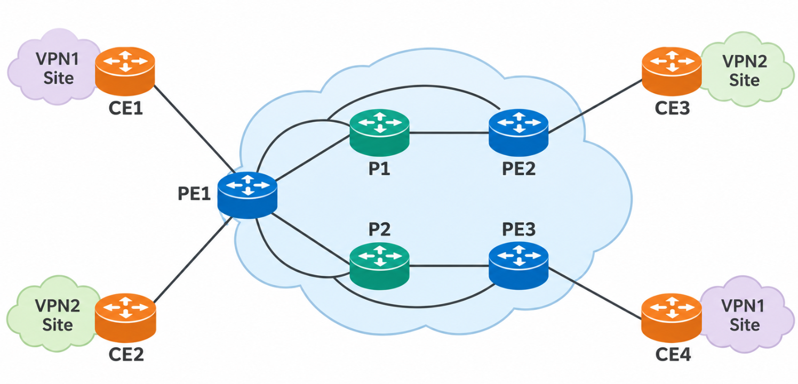
</div>

**CE（Custom Edge）** 是用户网络的边界设备，直接与服务提供商网络相连。CE 可以是路由器、交换机，也可以是一台主机。**PE（Provider Edge Router）** 是指骨干网络的边界设备，直接连接 CE，从而提供 VPN 业务接入。**P（Provider Router）** 是指骨干网络中的核心路由器，主要提供内部路由和数据包转发服务。

在 MPLS VPN 网络中，P 和 PE 运行 MPLS 协议，而用户设备（CE）不需要运行 MPLS。CE 和 PE 之间交换三层路由信息，P 仅学习骨干网路由。一个 PE 可连接多台 CE（共享）或一台 CE（专用）。**<font color="red">数据流先通过 IP 转发到 PE，再通过 MPLS 标签转发穿越网络</font>**。

## 2.MPLS VPN 基本概念

### 2.1 vpn-instance 

在典型的 MPLS VPN 网络中，虽然 CE 和 PE 之间可以使用任何 IP 路由协议，但当多个 VPN 用户连入同一 PE 或不同 VPN 用户需要通信时，会出现地址空间重叠问题。例如，VPN1 和 VPN2 都使用 **`10.10.10.0/24`** 网段地址，导致地址空间的重叠（Address Spaces Overlapping），而在 PE 上产生路由冲突。

因此在 PE 上必须将这些不同 VPN 用户的路由隔离起来，这就产生了 VPN 实例的技术，VPN 实例也称为 VPN 路由转发表 VRF（VPN Routing and Forwarding Table）。**<font color="red">一个 VPN 实例相当于一台虚拟的路由器，这台虚拟路由器具有自己的接口、路由转发表等资源，在控制平面上是独立运行的</font>**。每个 VPN 用户都会在 PE 上拥有自己的 VPN 实例，当 PE 收到来自不同用户的私网路由时，会将其放在该用户对应的 VPN 实例的路由转发表中。一台 PE 可以拥有多个路由转发表，包括**一个公网路由转发表，以及一个或多个 VPN 路由转发表**。

<div align="center">
    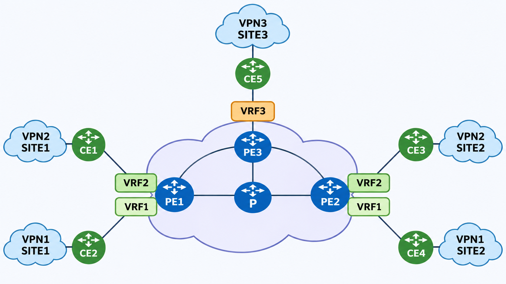
</div>

VPN 实例技术实际上解决了两大问题：（1）在 PE 上解决不同 VPN 用户的路由冲突问题；（2）不需要使用 ACL 等工具，简化了隔离不同用户网络的操作。

如上图所示的场景中，两个不同 VPN 用户（VPN1 和 VPN2）连接到同一个 PE 上，这时如果在 PE1 和 PE2 上为 VPN1 和 VPN2 都创建了相应的 VPN 实例，那么当 PE 接收到来自这两个 VPN 用户的私网路由时，会存放在不同的 VPN 实例转发表中。这样，即使这两个 VPN 用户的私网地址空间有重叠，在 PE 上也不会产生路由冲突的问题，因为不同 VPN 实例的路由转发表之间是相互隔离的。同时，**来自用户的私网路由也不会进入骨干网中的公网全局路由转发表，因为用户 VPN 实例中的路由转发表和全局路由转发表之间也是相互隔离的**。

公网路由转发表与 VPN 实例存在以下不同：

- 公网路由表包括所有 PE 和 P 设备的 IPv4 路由，该路由可能通过静态路由或者动态路由协议产生。
- VPN 实例的路由表包括属于该 VPN 实例用户的所有 Site 的路由，**通过 CE 与 PE 之间或者两个 PE 之间的 VPN 路由信息交互获得**。
- 公网转发表是根据路由管理策略从公网路由表提取出来的转发信息，而 VPN 转发表是根据路由管理策略从对应的 VPN 路由表提取出来的转发信息。
- 可以看出，PE 上的各 VPN 实例之间相互独立，并与公网路由转发表也是相互独立的。
- 可以将每个 VPN 实例看作一台虚拟的设备，维护独立的地址空间并有连接到私网的接口。

### 2.2 RD（Route Distinguisher）

**<font color="red">用户的 VPN 路由是通过 MP-BGP（多协议 BGP）在 MPLS VPN 骨干网络中来传递的</font>**，如果来自不同用户的 VPN 路由地址空间相同，BGP 协议就无法区分这是来自哪个用户的路由了，为了保证每个用户的 VPN 路由的唯一性，引入了 RD 的概念。

通过在 PE 上为每个用户分配一个唯一的 RD 值，并且在通告用户私网路由时附带上该 RD 值，这时在接收端路由器收到不同用户的 VPN 路由后，因为每条路由有一个唯一标识符（即 RD 值），所以能区分出这些路由是否来自同个用户，不会因为 BGP 在进行最优路由选择时，导致某些用户的 VPN 路由被弃选。比如一台 PE 在接收到两条来自不同用户、相同前缀的 VPN 路由时，根据 BGP 的选路原则，会在这两条路由中选择出最优路由，另一条路由就会被冷落了。

**<font color="red">在一条 IPv4 路由前缀之前加上 RD 值后，就变成 VPN-IPv4 地址簇了（可简称 VPNv4 地址簇），VPNv4 地址簇只在运营商骨干网内部存在，由 PE 路由器产生并发布</font>**。

<div align="center">
    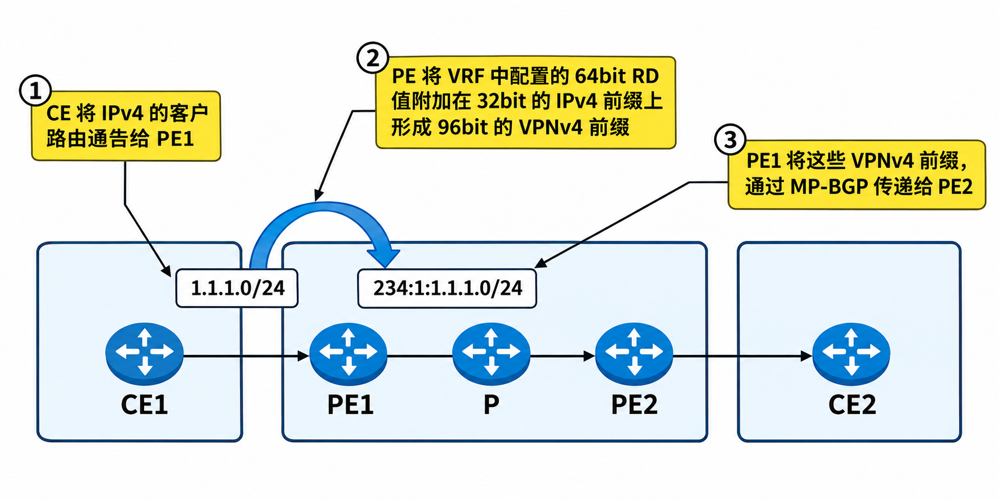
</div>

<div align="center">
    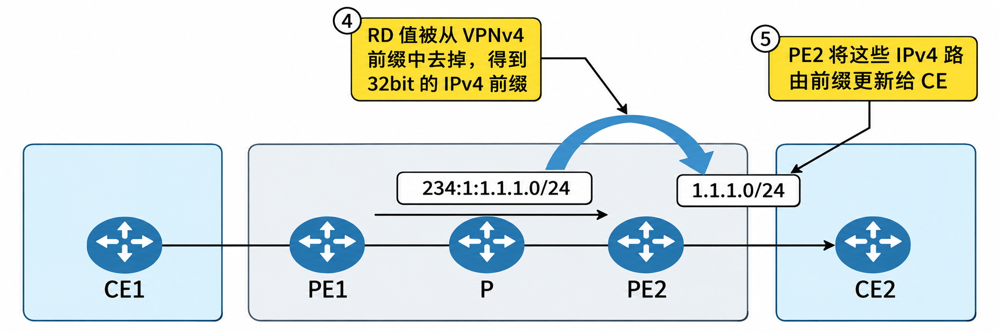
</div>

用户的 CE1 设备先将一条 IPv4 的私网路由前缀（**`1.1.1.0/24`**）通告给 PE1，PE1 **从 VPN 实例中将该路由引入至 MP-BGP**，并且将 RD 值添加至 IPv4 路由前缀之前变成了 96bit 的 VPNv4 路由，然后发布到骨干网中的其他 PE。当另一侧的 PE 收到该 VPNv4 路由后，**在其发布给 CE 之前，先将 RD 剥离掉，还原回 IPv4 的路由再通告给对面的 CE 路由器**。

RD 值共 64bit，这 64bit 的值有两种表示方式：**`ASN:nn`** 和 **`IP-Address:nn`**，其中 nn 代表数字，管理员可以自定义。最常用的格式为 **`ASN:nn`**，其中 ASN 代表自治系统号。通常情况下，在服务提供商所使用的 **`ASN:nn`** 中，ASN 是 IANA 分配给服务提供商的 AS 号，nn 可以是服务提供商分配给每个 VPN 实例的唯一号码。

### 2.3 VPN Target

VPN Target（也称为 Route Target，RT）是 BGP 的一个扩展团体属性，**<font color="red">用来判断路由该被送入到哪个 VPN 实例中</font>**，或者说，VPN 实例使用 RT 来表达对路由的喜好。当一个 PE 将 VPN 路由引入到 MP-BGP 后，就会让其携带一个 RT 值，然后送到远端的 PE，远端的 PE 根据 RT 值来决定将其送往哪个 VPN 实例。

VPN 实例中的 RT 值分为 Export（导出）和 Import（导入）两种值，Export 的 RT 会在 VPNv4 路由发布出来时携带，在 VPNv4 路由的接收端 PE 上，会比较路由携带过来的 Export RT 值跟本地所有 VRF 的 Import RT 值，如果匹配上了，该路由就被送往相应的 VRF 路由表，如下图所示，下图中的标签 15362 是私网标签。

<div align="center">
    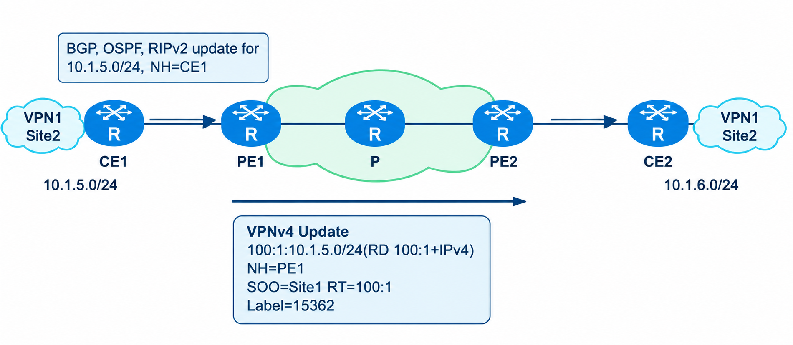
</div>

>根据发送过来带有 export RT 值与本地所有的 VRF 的 import RT 值匹配，如果有某个 VPN 实例的 import RT 匹配上了，则把 VPNv4 路由引入为 IPv4 路由，并且根据本地 VRF 的 import RT 属性加入到相应的 VRF 中，**<font color="red">私网标签保留，留在数据转发时使用</font>**，再由本 VRF 上的路由协议引入并转发给相应的 CE。

由上图可知，PE1 在将 CE1 发过来的 IPv4 路由转变为 VPNv4 路由时，除了添加一个 RD 以外，还携带了一个 Export RT 值，当 PE2 接收到该 VPNv4 路由后，将其转变了 IPv4 路由，再通过匹配各 VRF 的 Import RT 值，从而将该 IPv4 路由加入到指定的路由表中。

一条 VPNv4 路由可以携带多个 RT 值，通过灵活配置 RT 值。根据 RFC 4364 的规定，There is a set of Route Targets that a PE router attaches to a route received from site S; these may be called the "Export Targets". And there is a set of Route Targets that a PE router uses to determine whether a route received from another PE router could be placed in the VRF associated with site S; these may be called the "Import Targets". **<font color="red">Note that a particular VPN-IPv4 route is only eligible for installation in a particular VRF if there is some Route Target that is both one of the route's Route Targets and one of the VRF's Import Targets</font>**. 也就是说，当一个 RT 同时存在于 VPNv4 路由携带的 RT 集合和目标 VRF 的 Import RT 集合中时，该路由就有资格导入这个 VRF。

这样可以非常方便地实现同一 VPN 内部或者不同 VPN 之间各个站点之间的路由控制。例如，在某用户的 VPN 网络中，可能只允许各个分支站点与总部站点之间互相交换路由信息，而禁止分支站点与分支站点之间直接交换路由信息，通过在各个站点的 VRF 中配置相应的 RT 值，即可满足此需求。

<div align="center">
    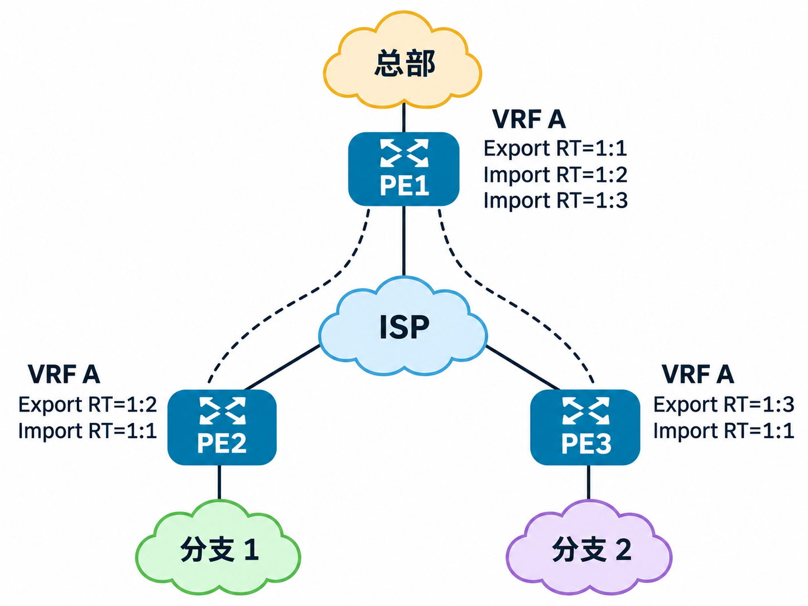
</div>

如上图所示，用户公司拥有总部、分支 1 和分支 2 共 3 个站点，用户希望通过 MPLS VPN 实现这 3 个站点之间的相互通信，但同时有特定的安全和监控需求：两个分支公司（分支 1 和分支 2）之间进行通信的流量必须经过总部转发，从而实现安全控制和流量监控。

为实现上述需求，可以在总部站点的 PE1 上，为总部的 VPN 实例设置两个 Import RT 值，分别对应两个分支站点的 Export RT 值。而两分支站点的 VPN 实例只能接收来自总部的路由信息，通过这种方法来控制不同站点之间（不论是同一 VPN 内部或不同 VPN 之间）的路由交换。

## 3.路由发布的过程

用户站点（CE）内部路由信息必须发布给 PE 设备，在 PE 和 CE 之间可以运行动态路由协议（RIP、OSPF、IS-IS、BGP）或静态路由。PE 从 CE 学习到的路由先放进 VPN 实例的路由表，然后再将其引入到 MP-BGP 成为 VPNv4 路由后发布到骨干网络。为了使路由进入骨干网络后具有唯一性，MP-BGP 给 IPv4 路由添加了一个 RD 值，从而允许不同的用户地址空间可以重叠，并且使用了 RT 值来标识此路由是去往哪个 VPN 实例的。下面我们就详细分析一下 MPLS VPN 中路由信息的交换过程，其中包括如下 4 个阶段。

- CE 到 PE 之间的路由交换。
- PE 将 VRF 中的路由注入进 MP-BGP。
- VPNv4 路由在骨干网中传递。
- PE 将 VPNv4 路由注入到 VRF 中。

### 3.1 CE 到 PE 之间的路由交换过程

如下图所示，PE 和 CE 之间可以通过标准路由协议（如 BGP、OSPF、IS-IS、RIP）或者静态路由来交换路由信息，PE 收到从不同 CE 发过来的路由信息后，根据入接口将收到的路由存放在不同的 VPN 实例中。所有的 CE 端都可以使用相同的路由协议，但是需要在 PE 的每个 VRF 运行不同路由协议实例，相互之间没有干扰。

<div align="center">
    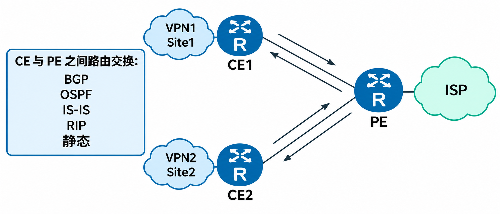
</div>

### 3.2 PE 将 VPN 实例中的路由引入到 MP-BGP

PE 从 CE 学习到客户的私网路由后，需要将这些私网路由从 VPN 实例中引入到 MP-BGP 成为 VPNv4 路由（**<font color="red">如果 PE 和 CE 之间运行的是 BGP，就不需要引入</font>**），如下图所示。

<div align="center">
    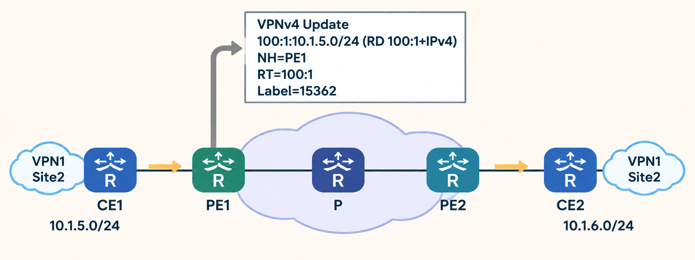
</div>

当 PE 将 VPN 实例中的客户私网路由引入到 MP-BGP 后，会在 IPv4 路由前缀的前面添加一个 RD 形成 VPNv4 路由。然后在 VPNv4 路由通告中携带 Export RT 值，**<font color="red">还会为该 VPNv4 路由分配一个私网标签（每条 VPNv4 都会映射到一个私网标签，由 MP-BGP 协议随机自动分配）</font>**，同时还将路由的下一跳修改成自己。这些操作完成后，PE 将 VPNv4 路由发布到所有的 MP-BGP 邻居。

### 3.3 VPNv4 路由在公网中传递

客户的私网路由在 PE 上被引入到 MP-BGP 后变成了 VPNv4 路由，这些 VPNv4 路由需要传递到其他的 PE（或者先传递到骨干网中的 RR，再由 RR 反射到其他 PE）。如果这些 PE 都在同一个 AS 中，那么需要在 PE 之间配置 MP-iBGP 邻居关系（或者所有 PE 都与 RR 建立 MP-iBGP 邻居关系），经过多协议扩展后的 BGP 可以用来传递 VPNv4 路由，如下图所示。

<div align="center">
    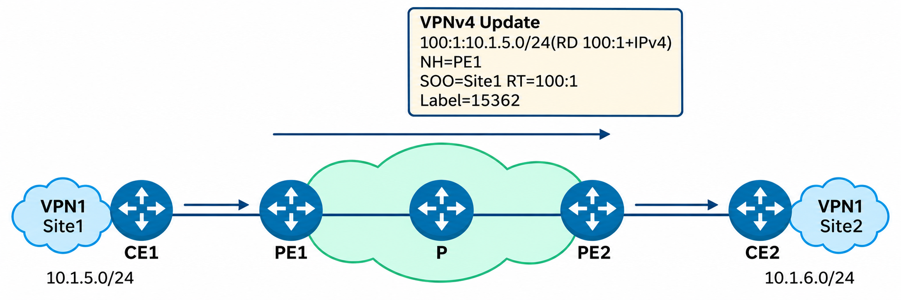
</div>

### 3.4 PE 将 VPNv4 路由注入到 VPN 实例

当 PE 收到邻居发送过来的 VPNv4 路由后，根据该路由携带的 Export RT 值和本地所有 VRF 的 Import RT 值，将满足条件的路由注入到对应的 VRF 中。当把该 VPNv4 路由注入到 VRF 时，会将路由携带的 RD 值去掉，把 VPNv4 路由还原成 IPv4 路由，然后通过本地 PE 和 CE 之间的路由协议将该 IPv4 路由发布给 CE，如下图所示。

<div align="center">
    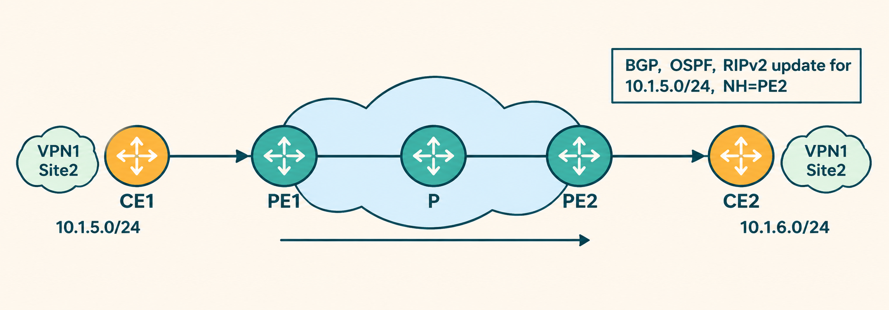
</div>

需要注意，**<font color="red">由于 VPNv4 路由携带着一个用于数据转发的私网标签，PE 并不会将该标签发给 CE，而是将该标签信息保存在 FIB 表中</font>**。

经过上述 4 个步骤后，VPN 客户的不同站点就可以实现私网路由的交互，从而构建成一个 VPN。在这个过程中可以发现，**<font color="blue">在骨干网络中，只有 PE 设备才会保存私网路由（存放在各 VRF 中），而骨干网的核心设备（P 设备）根本不会收到任何私网路由，它上面只存在公网路由</font>**，从而节省了设备开销。

## 4.CE-PE 之间运行 OSPF 协议

### 4.1 网络拓扑介绍

如下图所示，某客户（VPN A）的两个站点（Site1 和 Site2）通过 MPLS VPN 实现互访，其中 CE1 连接 Site1，CE1 通过服务提供商的 PE1 接入至 MPLS VPN 骨干网。CE2 连接 Site2，CE2 通过服务提供商的 PE2 接入至 MPLS VPN 骨干网。

<div align="center">
    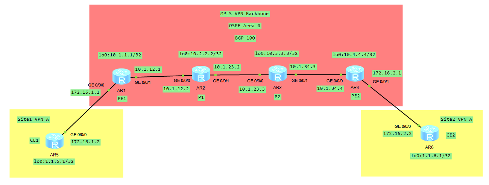
</div>

服务商骨干网的 BGP AS 号为 100，IGP 使用 OSPF，服务商为客户分配的 VPN 实例名为 vpna，RD 值为 **`100:1`**，Site1 和 Site2 的 Import RT 值和 Export RT 值均为 **`1:1`**，PE-CE 之间使用 OSPF 协议交换私网路由，Site1 和 Site2 均在 Area0 中。

在上述拓扑图中，作为经典的 MPLS L3 VPN 技术中，OSPF 作为运营商骨干网的 IGP，提供公网路由可达性，确保各 PE、P 路由器之间能够互相到达。**<font color="red">MPLS LDP 基于骨干网的 IP 可达性分发公网标签，建立从入口 PE 到出口 PE 的公网 LSP。MP-BGP VPNv4 在 PE 路由器之间交换客户 VPN 路由和私网标签</font>**，私网标签由通告 VPN 路由的出口 PE 分配，再通过 MP-BGP 随 VPNv4 路由传递给入口 PE。

RD 用于区分 VPNv4 前缀，RT 用于控制 VPN 路由的导入关系。入口 PE 根据客户所属 VPN 实例查询目的路由，为报文封装私网标签及适当的公网标签。中间 P 路由器 根据外层 MPLS 标签完成标签交换，无需学习客户 VPN 路由，不需要运行 BGP。出口 PE 根据私网标签确定对应 VRF 中的转发信息，并将数据包发送给目标 CE，最终到达目的站点。上述拓扑图的逻辑拓扑图如下所示。

<div align="center">
    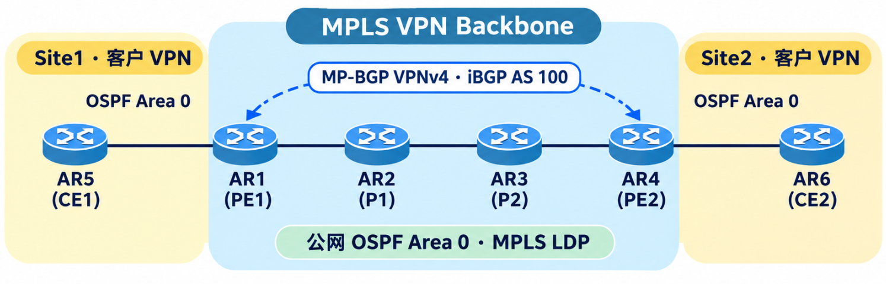
</div>

具体 AR1 上的配置如下所示：

```java{.line-numbers}
#
 sysname AR1
#
ip vpn-instance vpna
 ipv4-family
  route-distinguisher 100:1
  vpn-target 1:1 export-extcommunity
  vpn-target 1:1 import-extcommunity
#
mpls lsr-id 10.1.1.1
mpls
#
mpls ldp
#
interface GigabitEthernet0/0/0
 ip binding vpn-instance vpna
 ip address 172.16.1.1 255.255.255.0 
#
interface GigabitEthernet0/0/1
 ip address 10.1.12.1 255.255.255.0 
 mpls
 mpls ldp
#
interface LoopBack0
 ip address 10.1.1.1 255.255.255.255 
#
bgp 100
 router-id 10.1.1.1
 undo default ipv4-unicast
 peer 10.4.4.4 as-number 100 
 peer 10.4.4.4 connect-interface LoopBack0
 #
 ipv4-family unicast
  undo synchronization
  undo peer 10.4.4.4 enable
 # 
 ipv4-family vpnv4
  policy vpn-target
  peer 10.4.4.4 enable
 #
 ipv4-family vpn-instance vpna 
  import-route ospf 2
#
ospf 1 router-id 1.1.1.1 
 area 0.0.0.0 
  network 10.1.1.1 0.0.0.0 
  network 10.1.12.0 0.0.0.255 
#
ospf 2 router-id 10.1.1.1 vpn-instance vpna
 import-route bgp
 area 0.0.0.0 
  network 172.16.1.0 0.0.0.255 
```

AR4 上的配置如下所示：

```java{.line-numbers}
#
 sysname AR4
#
ip vpn-instance vpna
 ipv4-family
  route-distinguisher 100:1
  vpn-target 1:1 export-extcommunity
  vpn-target 1:1 import-extcommunity
#
mpls lsr-id 10.4.4.4
mpls
#
mpls ldp
#
interface GigabitEthernet0/0/0
 ip address 10.1.34.4 255.255.255.0 
 mpls
 mpls ldp
#
interface GigabitEthernet0/0/1
 ip binding vpn-instance vpna
 ip address 172.16.2.1 255.255.255.0 
#
interface LoopBack0
 ip address 10.4.4.4 255.255.255.255 
#
bgp 100
 router-id 10.4.4.4
 undo default ipv4-unicast
 peer 10.1.1.1 as-number 100 
 peer 10.1.1.1 connect-interface LoopBack0
 peer 10.4.4.4 as-number 100 
 #
 ipv4-family unicast
  undo synchronization
  undo peer 10.1.1.1 enable
  undo peer 10.4.4.4 enable
 # 
 ipv4-family vpnv4
  policy vpn-target
  peer 10.1.1.1 enable
 #
 ipv4-family vpn-instance vpna 
  import-route ospf 2
#
ospf 1 router-id 4.4.4.4 
 area 0.0.0.0 
  network 10.1.34.0 0.0.0.255 
  network 10.4.4.4 0.0.0.0 
#
ospf 2 router-id 10.4.4.4 vpn-instance vpna
 import-route bgp
 area 0.0.0.0 
  network 172.16.2.0 0.0.0.255 
```

从上述 PE1 和 PE2 的配置中可以看到，如果在 **`PE-CE`** 之间配置 OSPF 协议，那么需要实现 OSPF 和 MP-BGP 之间的双向引入。将 OSPF 路由引入 MP-BGP 是因为需要将 PE1 从 CE1 学到的 OSPF 路由引入 BGP，使其能够通过 MP-BGP VPNv4 通告给 PE2。而将 MP-BGP 路由引入 OSPF，是为了让 PE2 从 MP-BGP 学到的远端 VPN 路由引入本地 OSPF，使 CE2 能够学习到 CE1 的网段。

在配置完成之后，在 PE1 和 PE2 上查看 BGP VPNv4 邻居建立的情况，可以看到 PE1 和 PE2 之间的 BGP VPNv4 邻居已经建立成功，状态为 Established。

```java{.line-numbers}
<AR1>display bgp vpnv4 all peer 
 BGP local router ID : 10.1.1.1
 Local AS number : 100
 Total number of peers : 1		  Peers in established state : 1
  Peer            V          AS  MsgRcvd  MsgSent  OutQ  Up/Down       State Pre fRcv
  10.4.4.4        4         100       46       47     0 00:42:05 Established     2
<AR4>display bgp vpnv4 all peer 
 BGP local router ID : 10.4.4.4
 Local AS number : 100
 Total number of peers : 1		  Peers in established state : 1
  Peer            V          AS  MsgRcvd  MsgSent  OutQ  Up/Down       State Pre fRcv
  10.1.1.1        4         100       49       49     0 00:45:22 Established     2
```

### 4.2 控制层面

这里以控制层面中 Site1 中 **`1.1.5.1/32`** 的路由信息发送至 Site2 中为例，分析一下整个路由传递的过程。

第 1 步：首先 CE1 通过 OSPF 协议将网络 **`1.1.5.1/32`** 以 IPv4 路由的方式发送给 PE1，可以在 PE1 的 VPN 实例 vpnA 的路由表中查看到该路由，如下输出所示，可以看到 PE1 通过 OSPF 协议学习到 **`1.1.5.1/32`** 的路由信息，并且该路由的下一跳为 CE1 的地址。

```java{.line-numbers}
<AR1>display ip routing-table vpn-instance vpna
Route Flags: R - relay, D - download to fib
------------------------------------------------------------------------------
Routing Tables: vpna
         Destinations : 7        Routes : 7        
Destination/Mask    Proto   Pre  Cost      Flags NextHop         Interface
        1.1.5.1/32  OSPF    10   1           D   172.16.1.2      GigabitEthernet0/0/0
        1.1.6.1/32  IBGP    255  2          RD   10.4.4.4        GigabitEthernet0/0/1
```

第 2 步：PE1 将 IPv4 路由 **`1.1.5.1/32`** 引入到 MP-BGP，形成 VPNv4 路由，VPNv4 路由将携带该客户的 RD（**`100:1`**）以及 Export RT（**`1:1`**）值。同时，MP-BGP 还会为这条 VPNv4 路由分配一个私网标签。下面的输出信息显示了 **<font color="red">`Received/Applied: NULL/1028`，也就是说 PE1 未从其他 PE 接收此路由的 VPN 标签，本地为该路由分配的标签为 1028</font>**。

```java{.line-numbers}
<AR1>display bgp vpnv4 all routing-table 1.1.5.1 32
 BGP local router ID : 10.1.1.1
 Local AS number : 100

 Total routes of Route Distinguisher(100:1): 1
 BGP routing table entry information of 1.1.5.1/32:
 Imported route. 
 Label information (Received/Applied): NULL/1028
 From: 0.0.0.0 (0.0.0.0)
 Route Duration: 00h49m56s  
 Direct Out-interface: GigabitEthernet0/0/0
 Original nexthop: 172.16.1.2
 Qos information : 0x0
 Ext-Community:RT <1 : 1>, OSPF DOMAIN ID <0.0.0.0 : 0>,  OSPF RT <0.0.0.0 : 1 : 0>, OSPF ROUTER ID <10.1.1.1 : 0>
 AS-path Nil, origin incomplete, MED 2, pref-val 0, valid, local, best, select,  pre 255
 Advertised to such 1 peers: 10.4.4.4

 VPN-Instance vpna, Router ID 10.1.1.1:
 Total Number of Routes: 1
 BGP routing table entry information of 1.1.5.1/32:
 Imported route. 
 From: 0.0.0.0 (0.0.0.0)
 Route Duration: 00h49m56s  
 Direct Out-interface: GigabitEthernet0/0/0
 Original nexthop: 172.16.1.2
 Qos information : 0x0
 Ext-Community:OSPF DOMAIN ID <0.0.0.0 : 0>, OSPF RT <0.0.0.0 : 1 : 0>, OSPF ROUTER ID <10.1.1.1 : 0>
 AS-path Nil, origin incomplete, MED 2, pref-val 0, valid, local, best, select, pre 10
 Not advertised to any peer yet
```

第 3 步，PE1 将这个 **`1.1.5.1/32`** VPNv4 路由通告给 MP-iBGP 邻居 PE2。

第 4 步：PE2 收到 PE1 通告的 VPNv4 路由后，将路由携带的 **`Export RT 1:1`** 与本地 VPN 实例 vpna 的 **`Import RT 1:1`** 进行匹配。匹配成功后，将该 VPNv4 路由还原为不含 RD 的 IPv4 路由 **`1.1.5.1/32`**，并导入 vpna 路由表。同时，PE2 保留 PE1 分配的私网标签 1028（**`Label information (Received/Applied): 1028/NULL`**），用于后续 MPLS VPN 数据转发。

从路由详细信息可以看出，该路由的协议为 IBGP，BGP 下一跳为 PE1（**`10.1.1.1`**），私网标签为 1028。经过递归解析后，实际转发下一跳为 **`10.1.34.3`**，**`Flags: RD`** 表明该路由已完成递归解析并下发 FIB，说明 PE2 已具备向 PE1 转发该 VPN 业务流量所需的路由与标签信息。

```java{.line-numbers}
<AR4>display bgp vpnv4 all routing-table 1.1.5.1
 BGP local router ID : 10.4.4.4
 Local AS number : 100

 Total routes of Route Distinguisher(100:1): 1
 BGP routing table entry information of 1.1.5.1/32:
 Label information (Received/Applied): 1028/NULL
 From: 10.1.1.1 (10.1.1.1)
 Route Duration: 01h08m33s  
 Relay IP Nexthop: 10.1.34.3
 Relay IP Out-Interface: GigabitEthernet0/0/0
 Relay Tunnel Out-Interface: GigabitEthernet0/0/0
 Relay token: 0x1
 Original nexthop: 10.1.1.1
 Qos information : 0x0
 Ext-Community:RT <1 : 1>, OSPF DOMAIN ID <0.0.0.0 : 0>, OSPF RT <0.0.0.0 : 1 : 0>, OSPF ROUTER ID <10.1.1.1 : 0>
 AS-path Nil, origin incomplete, MED 2, localpref 100, pref-val 0, valid, internal, best, select, pre 255, IGP cost 3
 Not advertised to any peer yet

<AR4>display ip vpn-instance verbose vpna
 VPN-Instance Name and ID : vpna, 1
  Interfaces : GigabitEthernet0/0/1
 Address family ipv4
  Create date : 2026/11/18 12:53:03 UTC-08:00    
  Up time : 0 days, 01 hours, 12 minutes and 16 seconds
  Route Distinguisher : 100:1
  Export VPN Targets :  1:1
  Import VPN Targets :  1:1
  Label Policy : label per route
  Log Interval : 5

<AR4>display ip routing-table vpn-instance vpna 1.1.5.1 verbose 
Route Flags: R - relay, D - download to fib
------------------------------------------------------------------------------
Routing Table : vpna
Summary Count : 1

Destination: 1.1.5.1/32
     Protocol: IBGP             Process ID: 0
   Preference: 255                    Cost: 2
      NextHop: 10.1.1.1          Neighbour: 10.1.1.1
        State: Active Adv Relied       Age: 01h12m01s
          Tag: 0                  Priority: low
        Label: 1028                QoSInfo: 0x0
   IndirectID: 0x3              
 RelayNextHop: 10.1.34.3         Interface: GigabitEthernet0/0/0
     TunnelID: 0x1                   Flags: RD
```

第 5 步：PE2 将来自 Site1 的私网路由发布给 CE2。下面的输出显示了 CE2 已经接收到该路由。

```java{.line-numbers}
<AR6>display ip routing-table 
Route Flags: R - relay, D - download to fib
------------------------------------------------------------------------------
Routing Tables: Public
         Destinations : 10       Routes : 10       
Destination/Mask    Proto   Pre  Cost      Flags NextHop         Interface
        1.1.5.1/32  OSPF    10   3           D   172.16.2.1      GigabitEthernet0/0/0
```

最后总结如下：在 MPLS L3VPN 的控制平面中，CE1 首先通过 OSPF 将本地 Loopback0 路由 **`1.1.5.1/32`** 通告给 PE1，PE1 通过绑定 VPN 实例 vpna 的 OSPF 进程 2 学习该路由，并将其安装到 vpna 实例路由表中，下一跳为 CE1 的接口地址 **`172.16.1.2`**。随后，PE1 通过 **`import-route ospf 2`** 将该 IPv4 路由引入 BGP，生成携带 **`RD 100:1`**、**`Export RT 1:1`** 及 OSPF 相关扩展团体属性的 VPNv4 路由，同时为其分配私网标签 1028，并通过 MP-iBGP 将该路由通告给 PE2。

PE2 收到 VPNv4 路由后，将其 **`Export RT 1:1`** 与本地 VPN 实例 vpna 的 **`Import RT 1:1`** 进行匹配，匹配成功后将其导入 vpna 路由表，形成一条目的网络为 **`1.1.5.1/32`** 的 IBGP 路由，同时保留收到的私网标签 1028。该路由的 BGP 下一跳为 PE1（**`10.1.1.1`**），经过 MPLS 隧道递归解析后，实际转发下一跳为 **`10.1.34.3`**。最后，PE2 通过 OSPF 进程 2 下的 **`import-route bgp`** 将远端 VPN 路由引入 OSPF，并通过 OSPF LSA 通告给 CE2，使 CE2 最终学习到 **`1.1.5.1/32`** 的 OSPF 路由，下一跳为 PE2 的接口地址 **`172.16.2.1`**。

### 4.3 数据层面

在实现了私网路由的交换后，再看一下如何通过该 VPN 来传递业务流量。首先数据流由 CE 到 PE 使用的是 IP 转发。**<font color="red">而数据流要经过骨干网，因为骨干网内部 P 路由器没有私网路由，也就是没办法使用 IP 转发，这时就应该想到用 MPLS 标签转发技术</font>**。在 IP 报文进入到 MPLS 骨干网的 PE 后封装上一个公网标签，该标签对应着穿越整个公网的 LSP，数据包通过 LSP 隧道转发到出站的 PE，中间的 P 路由器只使用标签交换转发方式，而不需要 IP 转发，数据包的入站 PE 和出站 PE 同时使用了 IP 转发和标签转发。

在公网中，建立公网 LSP 的方法是通过 LDP 协议为公网中的 IGP 路由映射标签，然后再通告标签等步骤完成。当数据包穿越公网到达出站 PE 时，由于在出站 PE 上可能同时连接着多个不同的 VPN 用户，当数据包从公网接口进入出站 PE 时，出站 PE 需要判断出这个数据包是要转发给哪个 VPN 实例的，也就是要从哪个接口转发给哪个 CE。这时就用到了前面提到的私网标签，MP-BGP 协议在通告 VPNv4 路由时会给每条 VPN 路由分配一个私网标签，使得出站 PE 可以根据此私网标签决定数据包如何转发。

因此，**<font color="red">经过 MPLS VPN 骨干网络的业务数据流将会携带两层标签，外层标签叫公网标签，用来穿越整个公网到达出站的 PE；内层标签叫私网标签，用来在出站的 PE 上辨认数据包该送往哪个 VPN 实例</font>**，下面把数据转发过程分为 3 个步骤来进行详细分析。

#### 4.3.1 数据由 CE 转发给入站的 PE

如图所示，假设现在 Site2 中的主机需要发送业务数据流到 Site1 中。首先，CE2 将用户的 IP 报文通过普通的 IP 转发方式转发到服务商的 PE2。PE2 收到这个 IP 报文后，会根据报文到达的接口判断出属于哪个 VPN 实例，然后查询该 VPN 实例对应的转发表。

```java{.line-numbers}
<AR4>display ip routing-table vpn-instance vpna 1.1.5.1 verbose 
Route Flags: R - relay, D - download to fib
------------------------------------------------------------------------------
Routing Table : vpna
Summary Count : 1

Destination: 1.1.5.1/32
     Protocol: IBGP             Process ID: 0
   Preference: 255                    Cost: 2
      NextHop: 10.1.1.1          Neighbour: 10.1.1.1
        State: Active Adv Relied       Age: 02h18m42s
          Tag: 0                  Priority: low
        Label: 1028                QoSInfo: 0x0
   IndirectID: 0x3              
 RelayNextHop: 10.1.34.3         Interface: GigabitEthernet0/0/0
     TunnelID: 0x1                   Flags: RD
```

在转发表中可以查找到转发该报文的公网下一跳（即对端 PE 的 Loopback 接口地址 **`10.1.1.1/32`**）及私网标签 1028，PE2 封装上私网标签后，还需要再封装一个公网标签，**<font color="red">于是 PE2 通过查询公网标签转发表（LSP 转发表）找到到达下一跳地址（对端 PE 的 Loopback 接口地址 **`10.1.1.1/32`**）的标签</font>**，然后将其作为公网标签封装在私网标签的外层。两层标签都封装好后，PE2 就将该数据包转发到 MPLS 网络中。

```java{.line-numbers}
<AR4>display mpls lsp
------------------------------------------------------------------------------- 
LSP Information: BGP LSP
------------------------------------------------------------------------------- 
FEC In/Out Label In/Out IF Vrf Name 
172.16.2.0/24 1027/NULL -/- vpna 
1.1.6.1/32 1028/NULL -/- vpna
------------------------------------------------------------------------------- 
LSP Information: LDP LSP
------------------------------------------------------------------------------- 
FEC In/Out Label In/Out IF Vrf Name 
10.1.1.1/32 NULL/1025 -/GE0/0/0 
10.1.1.1/32 1024/1025 -/GE0/0/0 
10.2.2.2/32 NULL/1024 -/GE0/0/0 
10.2.2.2/32 1025/1024 -/GE0/0/0 
10.3.3.3/32 NULL/3 -/GE0/0/0 
10.3.3.3/32 1026/3 -/GE0/0/0 
10.4.4.4/32 3/NULL -/-
```

从上述的 LDP LSP 信息中可以看到，第一条 **`LSR NULL/1025`**，PE2 作为入站 LSR，当 PE2 收到 CE2 发来的普通 IPv4 报文时，首先获得目的前缀 **`1.1.5.1/32`** 对应的私网标签 1028。随后根据 BGP 下一跳 **`10.1.1.1`** 递归到对应的公网 LDP LSP，找到对应的公网标签 1025，并且对业务报文执行公网标签压入（Push）操作。

```java{.line-numbers}
<AR4>display fib vpn-instance vpna 1.1.5.1
  Route Entry Count: 1
Destination/Mask   Nexthop         Flag  TimeStamp     Interface      TunnelID
1.1.5.1/32         10.1.34.3       DGHU  t[67]         GE0/0/0        0x1	
<AR4>display tunnel-info tunnel-id 0x1
Tunnel ID:                    0x1
Tunnel Token:                 1
Type:                         lsp
Destination:                  10.1.1.1
Out Slot:                     0
Instance ID:                  0
Out Interface:                GigabitEthernet0/0/0
Out Label:                    1025
Next Hop:                     10.1.34.3
Lsp Index:                    6144
<AR4>display mpls lsp include 10.1.1.1 32 verbose 
-------------------------------------------------------------------------------
                 LSP Information: LDP LSP
  No                  :  1
  VrfIndex            :        
  Fec                 :  10.1.1.1/32
  Nexthop             :  10.1.34.3
  In-Label            :  NULL
  Out-Label           :  1025
  In-Interface        :  ----------
  Out-Interface       :  GigabitEthernet0/0/0
  LspIndex            :  6144
  Token               :  0x1
  FrrToken            :  0x0
  LsrType             :  Ingress
  Outgoing token      :  0x0
  Label Operation     :  PUSH
  Mpls-Mtu            :  1500
  TimeStamp           :  10434sec
  Bfd-State           :  ---
  BGPKey              :  ------
```

在前文有说到，当 IP 报文由入站 PE 进入 MPLS 网络后会通过 LSP 转发，并且通过中间的 P 设备查找标签转发表进行标签交换，最终通过公网 LSP 转发到出站的 PE。具体的示意图如下所示：

<div align="center">
    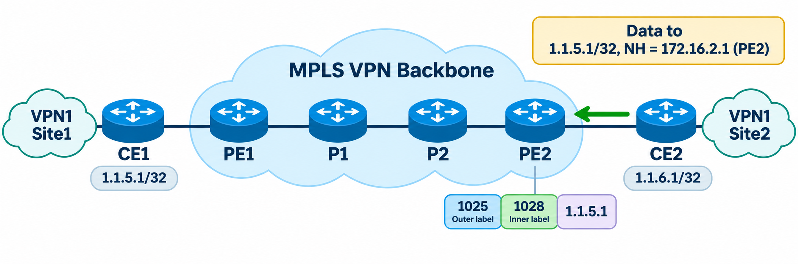
</div>

#### 4.3.2 数据由入站的 PE 转发给出站 PE

在前文有说到，当 IP 报文由入站 PE2 进入 MPLS 网络后会通过 LSP 转发。当 P2 路由器收到数据包时，会根据数据包的公网标签直接根据标签转发表进行转发，由下面的输出可以知道，P2 路由器接收到带有标签值为 1025 的报文时，直接将标签交换成出标签 1025，然后从 **`GE0/0/0`** 转发给下一跳 P1 路由器。

```java{.line-numbers}
<AR3>display mpls lsp
------------------------------------------------------------------------------- 
LSP Information: LDP LSP
------------------------------------------------------------------------------- 
FEC In/Out Label In/Out IF Vrf Name 
10.3.3.3/32 3/NULL -/- 
10.2.2.2/32 NULL/3 -/GE0/0/0 
10.2.2.2/32 1024/3 -/GE0/0/0 
10.1.1.1/32 NULL/1025 -/GE0/0/0 
10.1.1.1/32 1025/1025 -/GE0/0/0 
10.4.4.4/32 NULL/3 -/GE0/0/1 
10.4.4.4/32 1026/3 -/GE0/0/1 
<AR2>display mpls lsp
------------------------------------------------------------------------------- 
LSP Information: LDP LSP
------------------------------------------------------------------------------- 
FEC In/Out Label In/Out IF Vrf Name 
10.3.3.3/32 NULL/3 -/GE0/0/1 
10.3.3.3/32 1024/3 -/GE0/0/1 
10.2.2.2/32 3/NULL -/- 
10.1.1.1/32 NULL/3 -/GE0/0/0 
10.1.1.1/32 1025/3 -/GE0/0/0 
10.4.4.4/32 NULL/1026 -/GE0/0/1 
10.4.4.4/32 1026/1026 -/GE0/0/1
<AR1>display mpls lsp
------------------------------------------------------------------------------- 
LSP Information: BGP LSP
------------------------------------------------------------------------------- 
FEC In/Out Label In/Out IF Vrf Name 
172.16.1.0/24 1027/NULL -/- vpna 
1.1.5.1/32 1028/NULL -/- vpna
------------------------------------------------------------------------------- 
LSP Information: LDP LSP
------------------------------------------------------------------------------- 
FEC In/Out Label In/Out IF Vrf Name 
10.3.3.3/32 NULL/1024 -/GE0/0/1 
10.3.3.3/32 1024/1024 -/GE0/0/1 
10.2.2.2/32 NULL/3 -/GE0/0/1 
10.2.2.2/32 1025/3 -/GE0/0/1 
10.1.1.1/32 3/NULL -/- 
10.4.4.4/32 NULL/1026 -/GE0/0/1 
10.4.4.4/32 1026/1026 -/GE0/0/1
```

数据流到达 P1 路由器，P1 路由器与 P2 路由器对数据包的处理是一样的，P1 路由器查找标签转发表，将公网标签 1025 弹出，然后将报文转发给 PE1，此时数据包中只剩下一层私网标签。

#### 4.3.3 数据由出站的 PE 转发给远端的 CE

**<font color="red">当数据包由 MPLS 骨干网转发到达出站 PE1 时，只剩下一层私网标签，这是因为 PHP（倒数第二跳弹出）的原因，公网标签已经在倒数第二跳的 P1 设备剥离掉了</font>**。出站 PE 利用该私网标签判断出该数据包去往的 VPN 实例，在查找到相应的 VPN 实例转发表后，移除该私网标签，将报文还原为 IP 报文后再转发给 CE，如下图所示。

<div align="center">
    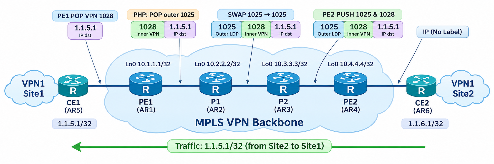
</div>

至此，客户通过 MPLS VPN 完成了私网站点之间的流量转发，可以发现 VPN 业务的数据流是经过骨干网的 LSP 隧道方式进行转发的，从而保证了客户数据的安全性。传递 VPN 业务数据流时需要使用到两层标签（私网标签+公网标签），公网标签用于帮助 VPN 业务数据流穿越公网中的 LSP，而私网标签用于 LSP 的出站 PE 进行判断该向哪个 VPN 实例进行转发。

因此上述数据层面的数据转发过程为：当 Site2 向 Site1 的 **`1.1.5.1/32`** 发送业务数据时，CE2 首先根据通过 OSPF 学习到的路由，将普通 IPv4 报文转发给 PE2（**`172.16.2.1`**）。PE2 收到报文后，根据入接口绑定的 VPN 实例 vpna 查询对应的转发表，**<font color="red">同时获得 PE1 分配的私网标签 1028，以及 BGP 下一跳 PE1 的 Loopback0 地址 `10.1.1.1`</font>**。

由于该 BGP 下一跳并非直连，PE2 需要进行公网下一跳及 MPLS 隧道递归解析。首先根据骨干 OSPF 路由确定到达 **`10.1.1.1/32`** 的实际下一跳为 P2（**`10.1.34.3`**），随后找到以 **`10.1.1.1/32`** 为 FEC 的公网 LDP LSP。该 LSP 的公网出标签在 PE2 上为 1025，由下游 P2 通过 LDP 通告给 PE2，且标签操作为 PUSH。因此，PE2 先为数据报文压入内层私网标签 1028，再压入外层公网标签 1025，形成双层标签结构，并将其转发给 P2。

P2（AR3）收到报文后，根据公网入标签 1025 查找 MPLS 标签转发表，将其交换为出标签 1025，随后转发给 P1（AR2）。P1 收到报文后，根据标签转发表匹配到 **`1025/3`**，由于出标签 3 为隐式空标签，因此执行 PHP（倒数第二跳弹出） 操作，移除外层公网标签，仅保留私网标签 1028，再将报文转发给 PE1。

最后，PE1（AR1）根据私网标签 1028 查找对应的 VPN 转发信息，识别出 VPN 实例 vpna 及目的路由 **`1.1.5.1/32`**，移除私网标签，将报文还原为普通 IPv4 报文，并转发给 CE1（**`172.16.1.2`**）。

