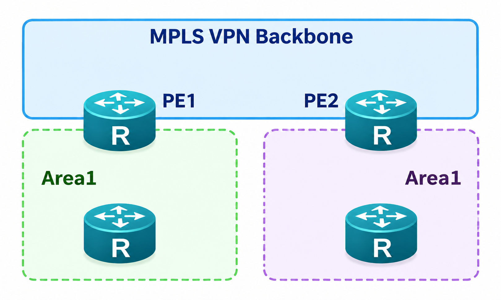

# MPLS VPN 基础

## 7.MPLS L3VPN 中的 OSPF VPN 扩展机制

### 7.1 OSPF 超级骨干区域

OSPF 协议是 PE 和 CE 之间路由协议的另一种选择，如果要将 VPN 用户路由传递到其他 PE，**<font color="red">那么需要在 PE 上把 OSPF 路由引入到 MP-BGP，在远端 PE 上需要将 MP-BGP 的 VPNv4 路由引入到 OSPF</font>**。在远端站点的 PE 上将 MP-BGP 的 VPNv4 路由引入到 OSPF 后，这些路由变成了 OSPF 外部路由（从 BGP 引入到 OSPF），导致路由的优先级变低，这样会带来以下两个问题。

- 如果此时客户站点之间拥有备份链路（后门链路），如下图所示，当两个客户站点的 PE-CE 链路及站点间的后门链路均属于同一个 OSPF 区域时，**<font color="red">CE 可以通过后门链路学习到远端站点的 OSPF 区域内路由（O）</font>**。与此同时，**<font color="red">远端站点的 OSPF 路由通过 MP-BGP VPNv4 在 PE 之间传播后，为 OSPF 外部路由（ASE）</font>**。这会导致远端站点优先选择后门链路的路由，而不是穿越 MPLS VPN 骨干的路由。这不符合用户起初的期望。

<div align="center">
    
</div>

- 另外，从网络设计角度考虑，这种情况下使得同个 VPN 用户的不同站点被 MPLS VPN 骨干分割了。

为避免在远端 PE 上将从 BGP 引入 OSPF 中的路由变成外部路由，MPLS VPN 在远端 PE 上将 MP-BGP 传递过来的 VPNv4 路由引入到 OSPF 时，以 LSA3 的形式通告出来（常规 OSPF 的做法是以 LSA5 的形式通告出来，PE 是 ASBR），如下图所示。这样的设计就让 MPLS VPN 骨干网看起来像一个 OSPF 的骨干区域（PE 成了 ABR）。对于 OSPF 来说，我们称之为超级骨干区域。从网络设计角度看，这就由中间的一个超级骨干区域将多个站点的 OSPF 区域连接在了一起，从而形成了一个整体。·1

<div align="center">
    
</div>

总的来说，在传统的 OSPF 网络中，不同区域通常通过骨干区域 Area 0 实现路由交换，ABR 负责连接不同区域，并通过 Type 3 LSA 通告区域间路由。例如，一条路由从 Area 1 经过 Area 0 传递到 Area 2，Area 2 中的路由器通常会将其识别为 OSPF 区域间路由，而不是外部路由。

但是，当企业的多个站点通过 MPLS L3VPN 互联时，各站点之间不再通过传统 OSPF 骨干直接交换路由，而是需要由本地 PE 从 CE 学习 OSPF 路由，再转换成 VPNv4 路由，通过 MP-BGP 传递到远端 PE，最后由远端 PE 重新发布到客户 OSPF 网络。如果按照普通的 BGP 到 OSPF 路由重分发机制处理，远端 PE 通常会将从 MP-BGP 学到的路由作为 OSPF 外部路由。这样，原本属于同一个企业 OSPF 域的内部路由，在经过 MPLS VPN 后就变成了外部路由，可能改变原有的 OSPF 选路结果。

为了解决这个问题，RFC 4577 将 MPLS VPN 骨干在逻辑上视为客户 OSPF 网络的一个**超级骨干区域（Superbackbone）**。

对于 OSPF 来说，有了这个超级骨干区域后，用户各站点内的 OSPF 区域设计需要注意以下几点。

- **<font color="red">用户站点内如果是单区域，各站点可以使用相同或不同的区域</font>**，如下图所示。

<div align="center">
    
    
</div>

- **<font color="red">用户站点内部如果采用多区域，要确保骨干区域（Area0）连接在 PE 上</font>**，如下图所示。

<div align="center">
    
</div>

如果用户站点内部采用多区域，而骨干区域（Area0）没有连接在 PE 上，那么会发生什么呢？（如下图所示）。

<div align="center">
    
</div>

**这样会导致用户站点 Area0 学不到其他站点的路由**，上述网络拓扑图的逻辑结构如下：

```java{.line-numbers}
                  MPLS VPN Backbone
               （MP-BGP 超级骨干区域）
                   │           │
                  PE1         PE2
                   │           │
                 Area 1      Area 2
                   │           │
                  CE1         CE2
                   │           │
                 Area 0      Area 0
                   │           │
                 Site1       Site2
```

**（1）Site1 发布路由到 Site2**

假设 Site1 的 Area 0 中存在一条网络 **`10.10.10.0/24`**，现在希望将这条路由通过 MPLS VPN 传递给 Site2。由于 CE1 同时连接 Area 0 和 Area 1，它是一个普通的 OSPF ABR，CE1 首先通过 Area 0 内部的 **`Type 1/Type 2`** 等 LSA 学习到 **`10.10.10.0/24`**。随后，CE1 向 Area 1 生成一条 Type 3 LSA，PE1 可以接收到这条 Type3 LSA。

PE1 收到了 Type3 LSA，但是 PE1 作为超级骨干区域中的 ABR。**<font color="red">因为 ABR 在非骨干区域收到 Type-3 LSA，虽然它会将其装载进 LSDB，但是该路由器不会使用这些 Type-3 LSA 进行路由计算</font>**（不会进全局路由表），当然它更不会将这些 Type-3 LSA 再注入回 Area0 中。并且 ABR 从非骨干区域发往骨干区时，只能通告 **`intra-area routes`**。

因此 PE1 可以在 Area 1 的 LSDB 中看到 **`10.10.10.0/24`** 对应 Type 3 LSA，但它不会根据这条来自非骨干区域的 Type 3 LSA 计算出相应的区域间路由。因此，由于 PE1 没有学到有效路由，也就无法通过 MP-BGP 正常发布，PE2 和 Site2 也就无法正常学习到它。

**（2）Site2 发布路由到 Site1**

假设 CE2 在 Area 2 中存在网络 **`192.168.20.0/24`**，PE2 可以通过 Area 2 的 OSPF 正常学习这条区域内路由，并将其引入 MP-BGP，再通过 VPNv4 路由传递给 PE1。

PE1 收到该路由后，如果 OSPF Domain ID 匹配、原始路由类型正确，就可以向本地 Area 1 生成 Type 3 LSA。此时，Area 1 中的普通内部路由器可以根据 Type3 LSA 学到 **`192.168.20.0/24`**。但是 CE1 同时连接 Area 0 和 Area 1，是一个 ABR。因此 CE1 不会利用从非骨干区域 Area 1 收到的 Type 3 LSA 计算区域间路由。

所以，即使 PE1 已经把远端 Site2 的路由作为 Type3 LSA 发布到了 Area 1，CE1 仍然不会将它通告到自己连接的 Area 0 中。

前文中提到过，如果本端站点内的路由通告到远端站点后变成了区域间路由，如果这时用户的站点之间还有后门链路，那么本端站点内部的路由通过后门链路传递过去的还是内部路由，而此时通过 MPLS VPN 骨干接收到的路由是区域间路由，根据 OSPF 的路由优先顺序，远端站点还是优选后门链路的路由。要避免这种情况，必须在 PE 之间配置一条特殊的链路 Sham-Link（伪链路），关于此内容后面再详细介绍。

## 一、MPLS L3VPN 为什么需要 OSPF 超级骨干区域？

## 二、OSPF 超级骨干区域的核心思想

所谓超级骨干区域，并不是在运营商 MPLS 网络中真正创建一个新的 OSPF Area，也不是要求 P 路由器运行客户 OSPF，而是将 **MP-BGP 的 VPN 路由分发机制，逻辑上视为连接多个客户 OSPF 站点的骨干网络**。

在这个模型中，PE 可以表现出类似 OSPF ABR 的行为。普通 ABR 通过 Area 0 在不同区域之间交换路由，而 MPLS L3VPN 中的 PE 则通过 MP-BGP 在不同站点之间交换 VPNv4 路由。当远端 PE 收到 VPNv4 路由后，如果确认该路由来自相同的 OSPF Domain，并且原始路由属于 OSPF 区域内或区域间路由，就可以将其以 Type 3 Summary LSA 的形式通告给本地 CE，使 CE 将其识别为区域间路由，而不是外部路由。

需要注意的是，超级骨干只是一种逻辑抽象，不代表不同 Site 的 OSPF 链路状态数据库（LSDB）会合并，也不意味着 Type 1、Type 2 LSA 会直接穿越运营商骨干。各个 Site 仍然维护自己的 OSPF LSDB，PE 之间交换的是 VPNv4 路由以及与原始 OSPF 路由有关的属性，再由远端 PE 根据这些属性重新生成适当类型的 LSA。

因此，**超级骨干机制的核心作用，是在跨站点传播 VPN 路由时，尽可能保留原始 OSPF 路由的内部与外部属性，而不是透明传输 OSPF 链路状态信息。**

## 三、结合 PE1、PE2、CE1、CE2 理解路由传播过程

假设某个企业有两个站点 Site1 和 Site2，分别通过 CE1—PE1 和 CE2—PE2 接入 MPLS L3VPN。两个 Site 都运行 OSPF，并且属于同一个企业 OSPF Domain。现在假设 Site2 存在一条 `192.168.20.0/24` 路由，该路由原本属于 OSPF 区域内部路由，希望通过 MPLS VPN 将其通告给 Site1，同时保留其内部路由性质。

首先，CE2 通过 OSPF 将 `192.168.20.0/24` 通告给 PE2。由于 PE2 面向 CE2 的接口绑定了 VPN 实例 `vpna`，并且运行了与该实例关联的 OSPF 进程，因此 PE2 可以通过 OSPF 邻接、LSA 交换和路由计算学习这条路由，并将有效路由安装到 `vpna` 的路由表中。在这个阶段，它仍然是一条客户 OSPF 路由。

随后，PE2 通过 BGP VPN 实例地址族下的 `import-route ospf 2`，将符合条件的 OSPF 路由引入 BGP，并通过 MP-BGP 向 PE1 发布 VPNv4 路由。在转换过程中，PE2 不仅关联 RD、RT、VPN Label 和 BGP Next-Hop 等 MPLS L3VPN 信息，还会根据 RFC 4577 携带与原始 OSPF 路由有关的属性，包括 OSPF Domain ID、OSPF Route Type 以及可选的 OSPF Router ID。原始路由的度量信息通常通过 BGP MED 属性传递。

这些 OSPF 属性使 PE1 不仅能够知道目的前缀是 `192.168.20.0/24`，还能够判断这条路由来自哪个 OSPF Domain，以及它原来属于区域内、区域间还是外部路由。这就为后续恢复正确的 OSPF 路由类型提供了依据。

接下来，PE1 收到 VPNv4 路由后，首先根据 RT 和本地 VPN 路由策略判断它是否可以导入 `vpna`，并经过 BGP 选路、下一跳可达性检查等处理，确定该路由能否成为有效的 VPN 路由。需要特别区分的是：**RT 决定 VPN 路由可以导入哪个 VRF，而 OSPF Domain ID 和 Route Type 决定该路由重新发布到 OSPF 时应按什么类型处理。**

最后，PE1 通过 VPN 实例 OSPF 进程下的 `import-route bgp`，将远端 BGP VPN 路由重新发布给 CE1。在这个过程中，PE1 检查路由携带的 OSPF Domain ID 是否与本地 OSPF 实例匹配，并判断原始路由类型。如果 `192.168.20.0/24` 原本属于 OSPF 区域内部路由，两个 PE 对应的 OSPF Domain ID 匹配，并且满足相应的路由发布条件，那么 PE1 就可以生成 Type 3 Summary LSA，使 CE1 将该路由识别为区域间路由，而不是通过 Type 5 LSA 将其视为外部路由。

## 四、OSPF Domain ID 如何影响 Type 3 和 Type 5 LSA？

OSPF Domain ID 是判断不同站点的 OSPF 路由是否属于同一个 OSPF 域的重要标识。它不同于 OSPF Area ID，也不同于 OSPF 进程号。Area ID 用于区分同一个 OSPF 域中的不同区域，而 Domain ID 用于标识不同的 OSPF 路由域。例如，一个企业可以同时运行 Area 0、Area 1 和 Area 2，但它们仍然属于同一个 OSPF Domain。

当 PE2 将 OSPF 路由转换为 VPNv4 路由时，会携带对应的 OSPF Domain ID。PE1 接收到路由后，将其与本地 OSPF 实例的 Domain ID 进行比较。如果按照 RFC 4577 的规则能够匹配，并且原始路由属于区域内或区域间路由，那么 PE1 通常将其作为 Type 3 LSA 发布，使本地 CE 学到区域间路由。

如果两端 OSPF Domain ID 不匹配，那么即使这条路由在 Site2 中原本是区域内部路由，PE1 也会将其按照外部路由处理，在普通区域中通常生成 Type 5 LSA。另一种情况是，即使 Domain ID 匹配，但这条路由原本就是 OSPF 外部路由，PE1 仍应保留其外部路由性质，而不是将其转换为 Type 3。对于 NSSA 外部路由，还需要按照相应的 Type 7 LSA 规则处理。实际是否发布，也受到区域类型和路由策略等条件限制。

需要注意，RFC 4577 对 NULL Domain ID 还有特殊的匹配规则，因此并不是只有显式配置相同数字的 Domain ID 才能够匹配。

**因此，Type 3 与 Type 5/7 的选择主要取决于两个因素：路由是否来自相同的 OSPF Domain，以及该路由原本属于内部路由还是外部路由。**

## 五、结合教材图 8-52 理解 PE 的 ABR 角色

在教材图 8-52 中，CE1 一侧存在 Area 1，而 CE1 与 PE1 之间运行 OSPF Area 0。如果 CE1 同时连接 Area 0 和 Area 1，那么 CE1 就是一个真正的 OSPF ABR。PE1 则通过面向 CE1 的 OSPF 接口参与客户网络，同时通过 MP-BGP 与远端 PE 交换 VPNv4 路由。在超级骨干模型中，PE1 可以表现出类似 ABR 的路由通告行为，将远端站点符合条件的内部路由作为 Type 3 LSA 发布给本地客户网络。

仍然以 Site2 的 `192.168.20.0/24` 为例，当这条路由经过 PE2 的 OSPF → MP-BGP 转换，再通过 MPLS VPN 骨干传递到 PE1 后，PE1 根据其携带的 OSPF 属性，在本地 Area 0 中重新生成 Type 3 LSA。CE1 收到后，将其作为区域间路由进行计算。如果 CE1 同时连接 Area 1，那么它还可以按照 OSPF 的区域间路由通告规则，向 Area 1 重新生成相应的 Type 3 LSA，使 Area 1 中的其他路由器也能够学习远端 Site2 的网络。

这里需要注意，Type 3 LSA 并不是直接从 PE2 穿越 MPLS 骨干传递到 CE1 的，而是 **PE2 将 OSPF 路由转换成 VPNv4 路由，PE1 再将 VPNv4 路由转换为本地 OSPF LSA，随后 CE1 作为 ABR 向其他区域重新通告**。整个过程是不同设备分别生成路由通告，而不是同一份 LSA 在不同 Site 之间直接泛洪。

此外，如果两个 Site 原本属于同一个 OSPF Area，但通过 MPLS VPN 互联，那么默认情况下，跨 VPN 学到的内部路由通常仍然表现为区域间路由。如果希望 MPLS VPN 路径在 OSPF 中表现为区域内路径，则需要进一步考虑 Sham Link 机制。

## 六、总结

MPLS L3VPN 中的 OSPF 超级骨干区域，本质上是通过 MP-BGP 在不同客户站点之间传递 VPNv4 路由，并利用 OSPF Domain ID、Route Type 等属性保留原始路由性质的特殊交互机制。它使不同 Site 即使在物理上被 MPLS VPN 骨干隔开，也能够在逻辑上按照同一 OSPF 域的规则交换内部路由，而不必全部转换成外部路由。

对于来自相同 OSPF Domain 的区域内或区域间路由，远端 PE 在满足相关条件时，可以将其作为 Type 3 LSA 通告给 CE；对于不同 OSPF Domain 的路由，或者原本就是 OSPF 外部路由的情况，则按照外部路由机制处理，通常使用 Type 5 或 Type 7 LSA。

**核心结论：MPLS L3VPN 的 OSPF 超级骨干区域，就是通过 MP-BGP 连接不同 Site 的 OSPF 路由域，并由远端 PE 根据路由来源和原始类型重新生成适当的 OSPF LSA，从而在实现跨站点互通的同时，尽可能保留 OSPF 原有的路由属性和选路逻辑。**

## 参考资料

* [RFC 4577 — OSPF as the PE/CE Protocol for BGP/MPLS VPNs](https://www.rfc-editor.org/rfc/rfc4577.html)，重点参考 §4.1、§4.2.4、§4.2.6 和 §4.2.8。
* [华为官方 — OSPF 工作原理](https://info.support.huawei.com/info-finder/encyclopedia/zh/OSPF.html)，关于 OSPF 区域、ABR、LSA 及路由计算的说明。
