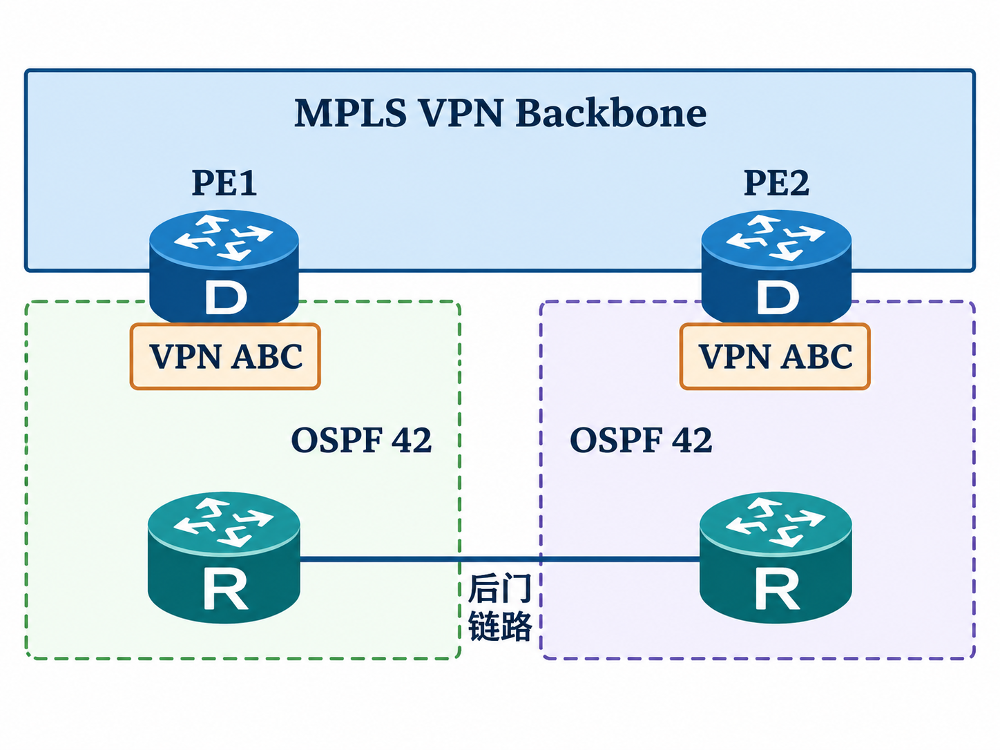
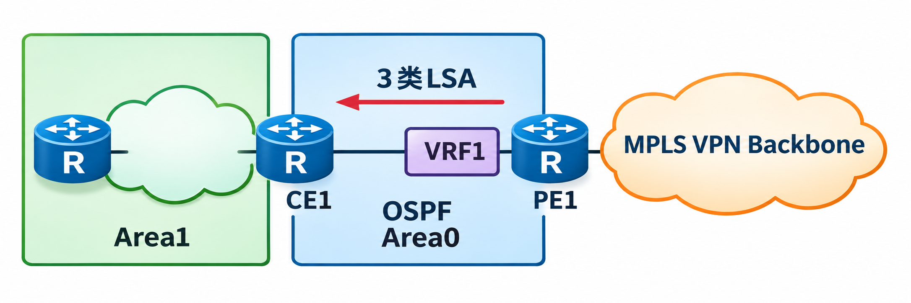
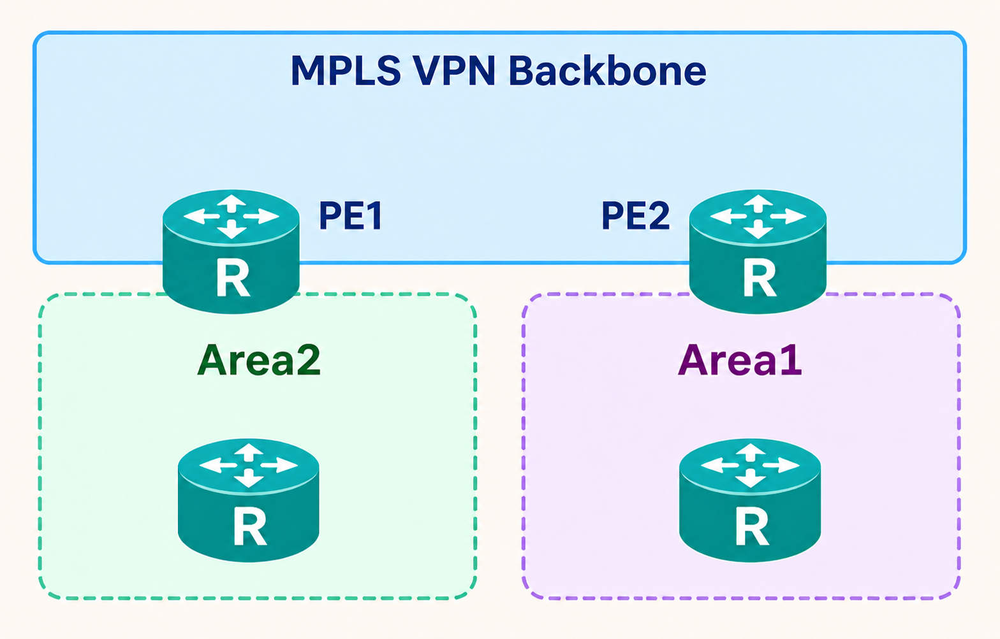
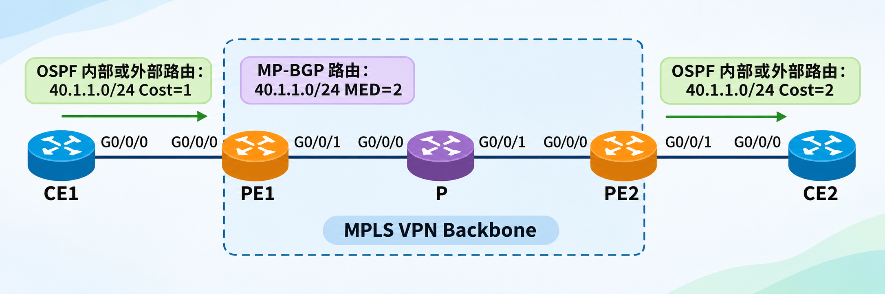
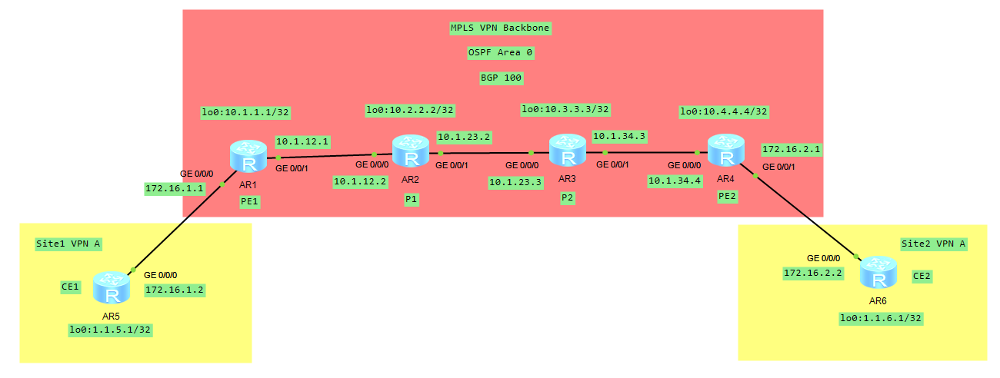

# MPLS VPN 基础

## 7.MPLS L3VPN 中的 OSPF VPN 扩展机制

### 7.1 OSPF 超级骨干区域

OSPF 协议是 PE 和 CE 之间路由协议的另一种选择，如果要将 VPN 用户路由传递到其他 PE，**<font color="red">那么需要在 PE 上把 OSPF 路由引入到 MP-BGP，在远端 PE 上需要将 MP-BGP 的 VPNv4 路由引入到 OSPF</font>**。在远端站点的 PE 上将 MP-BGP 的 VPNv4 路由引入到 OSPF 后，这些路由变成了 OSPF 外部路由（从 BGP 引入到 OSPF），导致路由的优先级变低，这样会带来以下两个问题。

- 如果此时客户站点之间拥有备份链路（后门链路），如下图所示，当两个客户站点的 PE-CE 链路及站点间的后门链路均属于同一个 OSPF 区域时，**<font color="red">CE 可以通过后门链路学习到远端站点的 OSPF 区域内路由（O）</font>**。与此同时，**<font color="red">远端站点的 OSPF 路由通过 MP-BGP VPNv4 在 PE 之间传播后，为 OSPF 外部路由（ASE）</font>**。这会导致远端站点优先选择后门链路的路由，而不是穿越 MPLS VPN 骨干的路由。这不符合用户起初的期望。

<div align="center">
    
</div>

- 另外，从网络设计角度考虑，这种情况下使得同个 VPN 用户的不同站点被 MPLS VPN 骨干分割了。

为避免在远端 PE 上将从 BGP 引入 OSPF 中的路由变成外部路由，MPLS VPN 在远端 PE 上将 MP-BGP 传递过来的 VPNv4 路由引入到 OSPF 时，以 LSA3 的形式通告出来（常规 OSPF 的做法是以 LSA5 的形式通告出来，PE 是 ASBR），如下图所示。这样的设计就让 MPLS VPN 骨干网看起来像一个 OSPF 的骨干区域（PE 成了 ABR）。对于 OSPF 来说，我们称之为超级骨干区域。从网络设计角度看，这就由中间的一个超级骨干区域将多个站点的 OSPF 区域连接在了一起，从而形成了一个整体。·1

<div align="center">
    
</div>

总的来说，在传统的 OSPF 网络中，不同区域通常通过骨干区域 Area 0 实现路由交换，ABR 负责连接不同区域，并通过 Type 3 LSA 通告区域间路由。例如，一条路由从 Area 1 经过 Area 0 传递到 Area 2，Area 2 中的路由器通常会将其识别为 OSPF 区域间路由，而不是外部路由。

但是，当企业的多个站点通过 MPLS L3VPN 互联时，各站点之间不再通过传统 OSPF 骨干直接交换路由，而是需要由本地 PE 从 CE 学习 OSPF 路由，再转换成 VPNv4 路由，通过 MP-BGP 传递到远端 PE，最后由远端 PE 重新发布到客户 OSPF 网络。如果按照普通的 BGP 到 OSPF 路由重分发机制处理，远端 PE 通常会将从 MP-BGP 学到的路由作为 OSPF 外部路由。这样，原本属于同一个企业 OSPF 域的内部路由，在经过 MPLS VPN 后就变成了外部路由，可能改变原有的 OSPF 选路结果。

为了解决这个问题，RFC 4577 将 MPLS VPN 骨干在逻辑上视为客户 OSPF 网络的一个**超级骨干区域（Superbackbone）**。

对于 OSPF 来说，有了这个超级骨干区域后，用户各站点内的 OSPF 区域设计需要注意以下几点。

- **<font color="red">用户站点内如果是单区域，各站点可以使用相同或不同的区域</font>**，如下图所示。

<div align="center">
    
    
</div>

- **<font color="red">用户站点内部如果采用多区域，要确保骨干区域（Area0）连接在 PE 上</font>**，如下图所示。

<div align="center">
    
</div>

如果用户站点内部采用多区域，而骨干区域（Area0）没有连接在 PE 上，那么会发生什么呢？（如下图所示）。

<div align="center">
    
</div>

**这样会导致用户站点 Area0 学不到其他站点的路由**，上述网络拓扑图的逻辑结构如下：

```java{.line-numbers}
                      MPLS VPN Backbone
                   （MP-BGP 超级骨干区域）
                       │           │
                      PE1         PE2
                       │           │
                     Area 1      Area 2
                       │           │
                      CE1         CE2
                       │           │
                     Area 0      Area 0
                       │           │
                     Site1       Site2
```

**（1）Site1 发布路由到 Site2**

假设 Site1 的 Area 0 中存在一条网络 **`10.10.10.0/24`**，现在希望将这条路由通过 MPLS VPN 传递给 Site2。由于 CE1 同时连接 Area 0 和 Area 1，它是一个普通的 OSPF ABR，CE1 首先通过 Area 0 内部的 **`Type 1/Type 2`** 等 LSA 学习到 **`10.10.10.0/24`**。随后，CE1 向 Area 1 生成一条 Type 3 LSA，PE1 可以接收到这条 Type3 LSA。

PE1 收到了 Type3 LSA，但是 PE1 作为超级骨干区域中的 ABR。**<font color="red">因为 ABR 在非骨干区域收到 Type-3 LSA，虽然它会将其装载进 LSDB，但是该路由器不会使用这些 Type-3 LSA 进行路由计算</font>**（不会进全局路由表），当然它更不会将这些 Type-3 LSA 再注入回 Area0 中。并且 ABR 从非骨干区域发往骨干区时，只能通告 **`intra-area routes`**。

因此 PE1 可以在 Area 1 的 LSDB 中看到 **`10.10.10.0/24`** 对应 Type 3 LSA，但它不会根据这条来自非骨干区域的 Type 3 LSA 计算出相应的区域间路由。因此，由于 PE1 没有学到有效路由，也就无法通过 MP-BGP 正常发布，PE2 和 Site2 也就无法正常学习到它。

**（2）Site2 发布路由到 Site1**

假设 CE2 在 Area 2 中存在网络 **`192.168.20.0/24`**，PE2 可以通过 Area 2 的 OSPF 正常学习这条区域内路由，并将其引入 MP-BGP，再通过 VPNv4 路由传递给 PE1。

PE1 收到该路由后，如果 OSPF Domain ID 匹配、原始路由类型正确，就可以向本地 Area 1 生成 Type 3 LSA。此时，Area 1 中的普通内部路由器可以根据 Type3 LSA 学到 **`192.168.20.0/24`**。但是 CE1 同时连接 Area 0 和 Area 1，是一个 ABR。因此 CE1 不会利用从非骨干区域 Area 1 收到的 Type 3 LSA 计算区域间路由。

所以，即使 PE1 已经把远端 Site2 的路由作为 Type3 LSA 发布到了 Area 1，CE1 仍然不会将它通告到自己连接的 Area 0 中。

### 7.2 用于 OSPF 的 BGP 扩展团体属性

要想 OSPF 路由能无缝地穿越 MPLS VPN 骨干网络，就必须使 MP-BGP 协议携带 OSPF 路由的特征，比如路由类型、进程号等，**<font color="red">这些特征可以帮助远端 PE 决定向 CE 端通告什么类型的 LSA</font>**，这样就使得 OSPF 路由可以在远端 PE 处得以完全重建。

MPLS VPN 体系结构中使用 BGP 的扩展团体属性来传递 OSPF 路由的特征，这些特征包括：

- 路由类型；
- 区域号；
- OSPF 路由器 ID；
- 域 ID；
- OSPF 外部路由的度量值类型 1 或 2。

在 MPLS L3VPN 的 OSPF VPN 扩展机制中，PE 将 VPNv4 路由重新发布到 OSPF 时，需要根据路由携带的 OSPF Domain ID 和 OSPF Route Type 扩展团体属性，共同判断该路由应当以哪种 LSA 类型进行通告。

**<font color="red">如果路由的 Domain ID 与本地 OSPF 进程的 Domain ID 匹配，并且 Route Type 为 1、2、3，则远端 PE 通常以 Type 3 LSA 的形式将该路由通告给 CE；如果 Domain ID 不匹配，或者原始路由属于 OSPF 外部路由，则将其按照外部路由处理，通常以 Type 5 LSA 的形式发布</font>**。

OSPF 进程的域 ID 包含在此进程生成的路由中，在将 OSPF 路由引入到 BGP 中时，域 ID 被附加到 VPNv4 路由上，作为 BGP 的扩展团体属性传递。根据 RFC 2328，A 32-bit number identifying the area. The Area ID of **`0.0.0.0`** is reserved for the backbone. 根据 RFC 4577，each OSPF instance MUST be associated with one or more Domain Identifiers. Area numbers are relative to a particular OSPF domain. 也就是说 OSPF 区域编号是相对于某个特定的 OSPF 路由域而言的。

<div align="center">
    
</div>

在之前 PE-CE 之间运行 OSPF 协议的网络拓扑图，PE2 上 VPNv4 路由（**`1.1.5.1/32`**）的路由更新，以及为该路由所关联的 BGP 扩展属性如下所示。

```java{.line-numbers}
<AR4>display bgp vpnv4 all routing-table 1.1.5.1 32

 BGP local router ID : 10.4.4.4
 Local AS number : 100

 Total routes of Route Distinguisher(100:1): 1
 BGP routing table entry information of 1.1.5.1/32:
 Label information (Received/Applied): 1028/NULL
 From: 10.1.1.1 (10.1.1.1)
 Route Duration: 00h00m19s  
 Relay IP Nexthop: 10.1.34.3
 Relay IP Out-Interface: GigabitEthernet0/0/0
 Relay Tunnel Out-Interface: GigabitEthernet0/0/0
 Relay token: 0x1
 Original nexthop: 10.1.1.1
 Qos information : 0x0
 Ext-Community:RT <1 : 1>, OSPF DOMAIN ID <0.0.0.0 : 0>, 
               OSPF RT <0.0.0.0 : 1 : 0>, OSPF ROUTER ID <10.1.1.1 : 0>
 AS-path Nil, origin incomplete, MED 2, localpref 100, pref-val 0, valid, internal, best, select, pre 255, IGP cost 3
 Not advertised to any peer yet
```

关于上面的输出内容，BGP 扩展团体属性的解释如下。

- **`RT<1:1>`**：这个值表示 VPN 路由的 RT 值，注意这里不是表示路由类型（route-type），而是 vpn-target，也就是 **`export RT`** 值为 **`1:1`**。
- **`OSPF DOMAIN ID<0.0.0.0:0>`**：冒号前面部分 **`0.0.0.0`** 表示域 ID 值，后面部分表示可选项，默认为 0。
- **`OSPF RT<0.0.0.0:1:0>`**：这个值表示 OSPF 路由类型，共分成 3 部分，第 1 部分表示区域号，第 2 部分表示路由类型，第 3 部分表示外部路由的度量值类型 1 或 2。后两个部分（路由及度量值类型）取值及其解释如下。
  - **`:1:0`** or **`:2:0`** 表示内部路由（LSA1 或 LSA2）。
  - **`:3:0`** 表示区域间路由（LSA3）。
  - **`:5:0`** or **`5:1`** 表示外部路由（LSA5），度量值类型分别是 1 或 2。
  - **`:7:0`** or **`7:1`** 表示外部路由（LSA7），度量值类型分别是 1 或 2。
  - **`:129:0`** 表示 sham-link 端点。
- **`OSPF Router-ID<10.1.1.1:0>`** 表示发送该路由的 VPN 实例的 Router-ID。

### 7.3 OSPF 路由穿越 MPLS VPN 骨干网的 metric 传递

在 PE 上将 OSPF 内部路由或外部路由引入到 BGP 后，使用 OSPF 路由的 Cost 值来设置 BGP 路由的 MED 值。当远端的 PE 把 BGP 路由引入到 OSPF 区域时，又将 MED 值复制回来给 OSPF 路由的 Cost 值，具体过程分为以下几种情况。

（1）两端 PE 的域 ID 设置相同的情况，OSPF 内部和外部路由的 Cost 传递的情况如下图所示。

<div align="center">
    
</div>

如上图所示，PE1 收到 CE1 的路由后，**因为要累加入口链路的开销，所以引入到 BGP 后的 MED 值为 2**。远端的 PE2 将 BGP 路由引入到 OSPF 区域时，直接用 MED 值代替 OSPF 路由的开销值。这种情况下，由于 PE1 和 PE2 的域 ID 相同，所以在 PE2 上会根据路由的类型来产生相应的 LSA 给 CE2。

（2）两端 PE 的域 ID 设置不相同的情况，OSPF 内部和外部路由的 Cost 传递的情况如下图所示。

<div align="center">
    
</div>

如上图所示，因为 PE1 和 PE2 的域 ID 不同，所以在 PE2 上把 BGP 路由引入到 OSPF 区域的路由都是 OSPF 外部路由，而 Cost 值仍然是复制 BGP 路由的 MED 值。

>华为设备的 **`DOMAIN-ID`** 值默认为 0，它和 VPN 实例中的 OSPF 进程 ID 大小没有关系。

### 7.4 防止 OSPF 站点间的路由环路

在对网络健壮性要求较高的应用中，可以采用 CE 双归属方式组网，如下图所示。

<div align="center">
    
</div>

但是在 CE 双归属场景中，用户的 VPN 路由有可能通过多个 PE 传播到公网，导致潜在路由环路的产生，下面是产生环路的案例。

<div align="center">
    
</div>

如上图所示，PE1、PE2、PE3 都已建立 iBGP 连接，PE 和 CE 之间使用 OSPF 路由协议。这时假设由于链路质量问题，PE1 先接收到来自 PE3 的 VPNv4 路由（**`2.2.2.2/32`**），PE1 会将 BGP 路由引入到左侧站点的 OSPF 区域，PE2 从 OSPF 学习到该路由，下一跳指向 CE1。然后又在 PE 上做了双向引入，所以 PE2 会将该 OSPF 路由引入到 BGP 形成 VPNv4 路由，同时将该路由通告给 PE1。这时，PE1 从 PE2 和 PE3 接收到了同一条 VPN 路由，在链路开销相等的情况下，假设 PE2 的 **`Router-ID`** 小于 PE3 的 **`Router-ID`**，那么 PE1 会优选 PE2 为下一跳，环路就产生了。

为避免潜在的路由环路问题，需要使用到 OSPF 报文头部选项中的 DN 比特位。DN 比特位于 **`LSA3/LSA5/LSA7`** 中的 Option 字段，用于表明路由是由 PE 向 CE 方向传递的，**<font color="red">也就是说一条路由如果由 PE 发布给 CE，这条路由的 DN 比特位就会被置位为 1</font>**。同一用户站点的其他 PE 在收到带有置了 DN 比特位的 LSA3 时，不会进行 SPF 路由计算，更不会将其引入到 BGP 中。如下图所示，显示了一台 PE 路由器在接收到置了 DN 比特位的 LSA 时，不会再将其通告进 BGP 中。

<div align="center">
    
</div>

#### 7.4.1 普通 CE 会接收 DN 置位的 LSA 并计算路由

<div align="center">
    
</div>

在上述网络拓扑中，PE-CE 之间运行 OSPF 协议，远端站点 CE2 的客户路由 **`1.1.6.1/32`** 可能先通过 OSPF 交给 PE2，再由 PE2 转换成 MP-BGP VPN 路由穿越 VPN Backbone。当这条 VPN 路由到达 PE1 后，PE1 又把它转换成 OSPF 路由发送给 CE1。当 PE1 把这种 VPN 路由重新发布成 **`Type 3/Type 5`** 传递给 CE1 时，会在相应 LSA 中设置 DN Bit。通过下面的输出可以看到，PE1 发布给 CE1 的 **`1.1.6.1/32`** Type3 LSA 带有 DN 标志位。

```java{.line-numbers}
<AR1>display ospf lsdb summary 1.1.6.1
	 OSPF Process 2 with Router ID 10.1.1.1
		         Area: 0.0.0.0
		 Link State Database 
  Type      : Sum-Net
  Ls id     : 1.1.6.1
  Adv rtr   : 10.1.1.1  
  Ls age    : 107 
  Len       : 28 
  Options   :  E  DN  
  seq#      : 80000003 
  chksum    : 0x1fa3
  Net mask  : 255.255.255.255
  Tos 0  metric: 2
  Priority  : Low
```

然后 CE1 作为普通的 CE 会接收这个 Type3 LSA，然后计算并形成 OSPF 路由，如下所示。

```java{.line-numbers}
<AR5>display ospf lsdb summary 1.1.6.1
	 OSPF Process 1 with Router ID 5.5.5.5
		         Area: 0.0.0.0
		 Link State Database 
  Type      : Sum-Net
  Ls id     : 1.1.6.1
  Adv rtr   : 10.1.1.1  
  Ls age    : 181 
  Len       : 28 
  Options   :  E  DN  
  seq#      : 80000003 
  chksum    : 0x1fa3
  Net mask  : 255.255.255.255
  Tos 0  metric: 2
  Priority  : Medium
<AR5>display ospf routing 
	 OSPF Process 1 with Router ID 5.5.5.5
		  Routing Tables 

 Routing for Network 
 Destination        Cost  Type       NextHop         AdvRouter       Area
 1.1.5.1/32         0     Stub       1.1.5.1         5.5.5.5         0.0.0.0
 172.16.1.0/24      1     Transit    172.16.1.2      5.5.5.5         0.0.0.0
 1.1.6.1/32         3     Inter-area 172.16.1.1      10.1.1.1        0.0.0.0

 Routing for ASEs
 Destination        Cost      Type       Tag         NextHop         AdvRouter
 172.16.2.0/24      1         Type2      3489661028  172.16.1.1      10.1.1.1

 Total Nets: 4  
 Intra Area: 2  Inter Area: 1  ASE: 1  NSSA: 0 
```

根据华为的官方文档，DN-bit It is a flag bit used by OSPF multi-instance processes to prevent routing loops. **<font color="red">_After OSPF multi-instanceis configured on the router (a PE or an MCE)_</font>**, the router sets the DN-bit of generated Type 3, Type 5, or Type 7 LSAs to 1 and retains the DN-bit (0) of other LSAs. When calculating routes, the OSPF multi-instance process on the router ignores LSAs with DN-bit 1, which prevents the router from receiving the LSAs that are advertised by itself. **<font color="red">也就是针对华为的设备，执行 DN Bit 检查的是 OSPF 多实例进程，典型设备是 PE 或 MCE</font>**。

#### 7.4.2 MCE 未关闭 DN Bit 检查:LSA 入库但不生成路由

接下来我们对 CE1 的配置进行更改，使其从普通的 CE 变为 MCE。具体的 MCE 配置如下所示：

```java{.line-numbers}
#
 sysname AR5
#
ip vpn-instance vpna
 ipv4-family
  route-distinguisher 100:5
#
interface GigabitEthernet0/0/0
 ip binding vpn-instance vpna
 ip address 172.16.1.2 255.255.255.0 
#
interface LoopBack0
 ip binding vpn-instance vpna
 ip address 1.1.5.1 255.255.255.255 
#
ospf 1 router-id 5.5.5.5 vpn-instance vpna
 area 0.0.0.0 
  network 1.1.5.1 0.0.0.0 
  network 172.16.1.0 0.0.0.255 
```

上述就是 MCE 的配置，首先是创建 VPN 实例 vpna，并且和 OSPF 进程 1 绑定。根据华为的官方文档，An OSPF process can be bound to only one VPN instance. If an OSPF process is not bound to any VPN instance before it is started, this process becomes a public network process and cannot be bound to a VPN instance later. **<font color="red">一个 OSPF 进程只能绑定一个 VPN 实例（也就是不能让同一个 OSPF 进程同时属于 vpna 和 vpnb）</font>**，而同一台路由器可以运行多个独立的 OSPF 进程。

接下来，在 VPN 实例 vpna 中，配置了 **`route-distinguisher 100:5`**，这是因为只有配置了 **`route-distinguisher`** 之后，VPN 实例的 IPv4 地址族才能生效。根据华为的文档，A VPN instance IPv4 address family takes effect only after being assigned an RD. The RDs of different VPN instance IPv4 address families on a PE must be different.

但是在 VPN 实例 vpna 中，没有配置 vpn-target，这是因为 RT（Route Target）是 BGP 扩展团体属性（Extended Community）的一种，广泛用于 BGP/MPLS L3VPN 的 VPN 路由导入、导出控制。根据华为的文档，skip this step when the device functions as the MCE only. 也就是说如果设备仅作为 MCE 使用，**`vpn-target`** 这一步可以跳过。

上述配置以后，其余 AR 路由器的配置不发生变化，并且 CE1 也不配置 **`vpn-instance-capability simple`**，此时 CE1 上的 OSPF 路由表如下所示，可以看到没有 **`1.1.6.1/32`** 路由，但是收到了 **`1.1.6.1/32`** 的 Type3 LSA。
```java{.line-numbers}
<AR5>display ospf routing 

	 OSPF Process 1 with Router ID 5.5.5.5
		  Routing Tables 

 Routing for Network 
 Destination        Cost  Type       NextHop         AdvRouter       Area
 1.1.5.1/32         0     Stub       1.1.5.1         5.5.5.5         0.0.0.0
 172.16.1.0/24      1     Transit    172.16.1.2      5.5.5.5         0.0.0.0

 Total Nets: 2  
 Intra Area: 2  Inter Area: 0  ASE: 0  NSSA: 0 
<AR5>display ospf lsdb summary 1.1.6.1

	 OSPF Process 1 with Router ID 5.5.5.5
		         Area: 0.0.0.0
		 Link State Database 

  Type      : Sum-Net
  Ls id     : 1.1.6.1
  Adv rtr   : 10.1.1.1  
  Ls age    : 393 
  Len       : 28 
  Options   :  E  DN  
  seq#      : 8000000a 
  chksum    : 0x11aa
  Net mask  : 255.255.255.255
  Tos 0  metric: 2
  Priority  : Medium
```

MCE 本质上仍属于客户侧设备，但为了同时承载并隔离多个 VPN，需要为不同 VPN 配置独立的 VPN 实例，并运行与之绑定的 OSPF 进程。**<font color="red">因此，MCE 既需要像普通 CE 一样学习 PE 发布的远端 VPN 路由，又具备 OSPF VPN 多实例的防环检测机制</font>**。

#### 7.4.3 MCE 关闭 DN Bit 检查:LSA 入库并且生成路由

在 CE1 上进行如下配置：

```java{.line-numbers}
ospf 1 router-id 5.5.5.5 vpn-instance vpna
 vpn-instance-capability simple
```

**`vpn-instance-capability simple`** 用于禁止路由环路检测，直接进行路由计算。在配置好该命令之后，CE1 上收到了 **`1.1.6.1/32`** 的 Type3 LSA（DN bit 置位）。但是在 OSPF 路由表中存在 **`1.1.6.1/32`** 的路由，也就是说，配置这个命令以后，OSPF 不再检查 DN Bit 和 Route Tag，而直接计算 OSPF 路由。

```java{.line-numbers}
[AR5-ospf-1]display ospf routing 
	 OSPF Process 1 with Router ID 5.5.5.5
		  Routing Tables 

 Routing for Network 
 Destination        Cost  Type       NextHop         AdvRouter       Area
 1.1.5.1/32         0     Stub       1.1.5.1         5.5.5.5         0.0.0.0
 172.16.1.0/24      1     Transit    172.16.1.2      5.5.5.5         0.0.0.0
 1.1.6.1/32         3     Inter-area 172.16.1.1      10.1.1.1        0.0.0.0
 Routing for ASEs
 Destination        Cost      Type       Tag         NextHop         AdvRouter
 172.16.2.0/24      1         Type2      3489661028  172.16.1.1      10.1.1.1

 Total Nets: 4  
 Intra Area: 2  Inter Area: 1  ASE: 1  NSSA: 0 

[AR5-ospf-1]display ospf lsdb summary 1.1.6.1

	 OSPF Process 1 with Router ID 5.5.5.5
		         Area: 0.0.0.0
		 Link State Database 

  Type      : Sum-Net
  Ls id     : 1.1.6.1
  Adv rtr   : 10.1.1.1  
  Ls age    : 237 
  Len       : 28 
  Options   :  E  DN  
  seq#      : 8000000c 
  chksum    : 0xdac
  Net mask  : 255.255.255.255
  Tos 0  metric: 2
  Priority  : Medium
```

在 MPLS L3VPN 中，PE 将从 VPN 骨干学习的 BGP 路由重新发布到 OSPF 时，会为生成的 Type 3、Type 5 或 Type 7 LSA 设置 **`DN=1`**，以防止路由环路。需要注意，DN Bit 并不阻止 LSA 的接收、存储和正常泛洪，而是影响 OSPF VPN 多实例进程的路由计算。

在 **`PE1—MCE—PE2`** 的组网中，MCE 可以接收 PE1 发布的 **`DN=1`** LSA，并将其保存到 LSDB。如果 MCE 未配置 **`vpn-instance-capability simple`**，其 OSPF VPN 多实例进程默认会进行 DN Bit 防环检查，不使用此类 LSA 计算路由，导致 LSDB 中存在 LSA，但路由表中没有对应路由。不过，只要满足 OSPF 的泛洪条件，该 LSA 仍可能继续传递到 PE2，由 PE2 执行 DN Bit 检查，避免路由重新引入 BGP 而形成环路。

在 MCE 对应的 OSPF 进程下配置 **`vpn-instance-capability simple`** 后，可以关闭 DN Bit 和 VPN Route Tag 相关的路由防环检查，使携带 **`DN=1`** 的 LSA 能够正常参与计算并生成路由。该命令使 MCE 在保留多 VPN 隔离能力的同时，具备普通 CE 所需的路由学习行为。