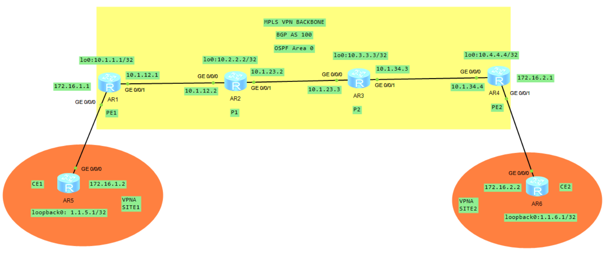
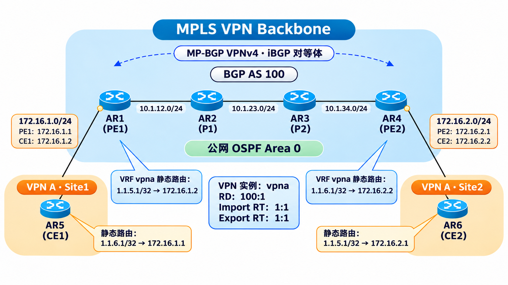

# MPLS VPN 基础

## 5.CE-PE 之间运行静态路由

### 5.1 网络拓扑介绍

如下图所示，某客户（VPN A）的两个站点（Site1 和 Site2）通过 MPLS VPN 实现互访，其中 CE1 连接 Site1，CE1 通过服务提供商的 PE1 接入至 MPLS VPN 骨干网。CE2 连接 Site2，CE2 通过服务提供商的 PE2 接入至 MPLS VPN 骨干网。

<div align="center">
    
</div>

服务商骨干网的 BGP AS 号为 100，IGP 使用 OSPF，服务商为客户分配的 VPN 实例名为 vpna，RD 值为 **`100:1`**，Site1 和 Site2 的 Import RT 值和 Export RT 值均为 **`1:1`**，PE-CE 之间使用静态路由。

在上述拓扑图中，作为经典的 MPLS L3 VPN 技术中，OSPF 作为运营商骨干网的 IGP，提供公网路由可达性，确保各 PE、P 路由器之间能够互相到达。**<font color="red">MPLS LDP 基于骨干网的 IP 可达性分发公网标签，建立从入口 PE 到出口 PE 的公网 LSP。MP-BGP VPNv4 在 PE 路由器之间交换客户 VPN 路由和私网标签</font>**，私网标签由通告 VPN 路由的出口 PE 分配，再通过 MP-BGP 随 VPNv4 路由传递给入口 PE。

中间 P 路由器 根据外层 MPLS 标签完成标签交换，无需学习客户 VPN 路由，不需要运行 BGP。出口 PE 根据私网标签确定对应 VRF 中的转发信息，并将数据包发送给目标 CE，最终到达目的站点。上述拓扑图的逻辑拓扑图如下所示。

<div align="center">
    
</div>

具体 AR1 上的配置如下所示：

```java{.line-numbers}
#
 sysname AR1
#
ip vpn-instance vpna
 ipv4-family
  route-distinguisher 100:1
  vpn-target 1:1 export-extcommunity
  vpn-target 1:1 import-extcommunity
#
mpls lsr-id 10.1.1.1
mpls
#
mpls ldp
#
interface GigabitEthernet0/0/0
 ip binding vpn-instance vpna
 ip address 172.16.1.1 255.255.255.0 
#
interface GigabitEthernet0/0/1
 ip address 10.1.12.1 255.255.255.0 
 mpls
 mpls ldp
#
interface LoopBack0
 ip address 10.1.1.1 255.255.255.255 
#
bgp 100
 router-id 10.1.1.1
 undo default ipv4-unicast
 peer 10.4.4.4 as-number 100 
 peer 10.4.4.4 connect-interface LoopBack0
 #
 ipv4-family unicast
  undo synchronization
  undo peer 10.4.4.4 enable
 # 
 ipv4-family vpnv4
  policy vpn-target
  peer 10.4.4.4 enable
 #
 ipv4-family vpn-instance vpna 
  import-route static
#
ospf 1 router-id 1.1.1.1 
 area 0.0.0.0 
  network 10.1.1.1 0.0.0.0 
  network 10.1.12.0 0.0.0.255 
#
ip route-static vpn-instance vpna 1.1.5.1 255.255.255.255 172.16.1.2
```

AR4 上的配置如下所示：

```java{.line-numbers}
#
 sysname AR4
#
ip vpn-instance vpna
 ipv4-family
  route-distinguisher 100:1
  vpn-target 1:1 export-extcommunity
  vpn-target 1:1 import-extcommunity
#
mpls lsr-id 10.4.4.4
mpls
#
mpls ldp
#
interface GigabitEthernet0/0/0
 ip address 10.1.34.4 255.255.255.0 
 mpls
 mpls ldp
#
interface GigabitEthernet0/0/1
 ip binding vpn-instance vpna
 ip address 172.16.2.1 255.255.255.0 
#
interface LoopBack0
 ip address 10.4.4.4 255.255.255.255 
#
bgp 100
 router-id 10.4.4.4
 undo default ipv4-unicast
 peer 10.1.1.1 as-number 100 
 peer 10.1.1.1 connect-interface LoopBack0
 #
 ipv4-family unicast
  undo synchronization
  undo peer 10.1.1.1 enable
 # 
 ipv4-family vpnv4
  policy vpn-target
  peer 10.1.1.1 enable
 #
 ipv4-family vpn-instance vpna 
  import-route static
#
ospf 1 router-id 4.4.4.4 
 area 0.0.0.0 
  network 10.1.34.0 0.0.0.255 
  network 10.4.4.4 0.0.0.0 
#
ip route-static vpn-instance vpna 1.1.6.1 255.255.255.255 172.16.2.2
```

注意，在 PE1 的上述配置中，**`ipv4-family vpn-instance vpna import-route static`** **<font color="red">用来将 VPN 实例 vpna 中的静态路由引入到 BGP 中</font>**。而 **`ipv4-family vpnv4 peer 10.1.1.1 enable`** 表示允许 PE2 与 PE1 通过 MP-BGP 交换 VPNv4 地址族的路由信息。因此综合上述配置，效果就是使得该 vpna 中的静态路由能够通过 MP-BGP VPNv4 发布给远端 PE。

**`ip route-static vpn-instance vpna 1.1.5.1 255.255.255.255 172.16.1.2`** 表示在 PE1 的 vpna 实例中配置了一条静态路由，指向 CE1 的地址。

### 5.2 控制层面

### 5.3 数据层面

## 6.CE-PE 之间运行 BGP 协议