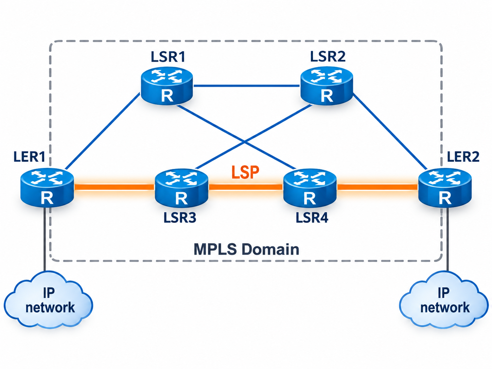
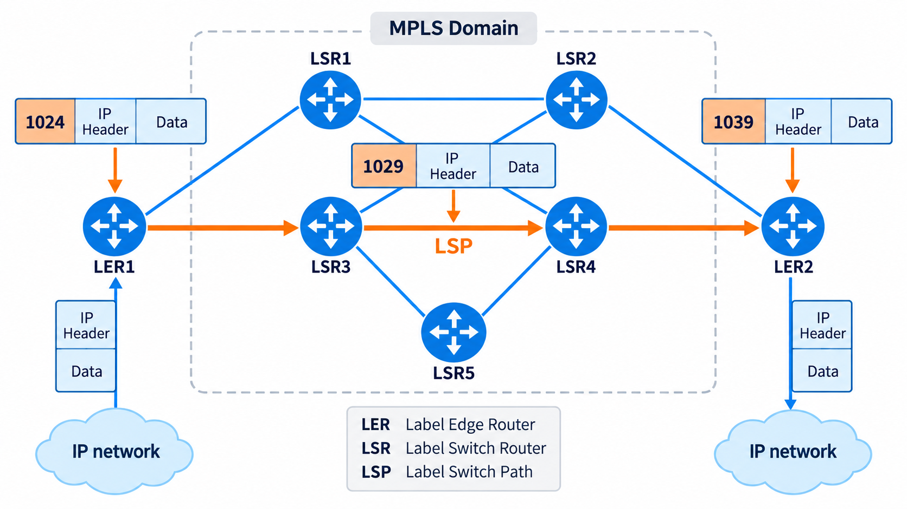
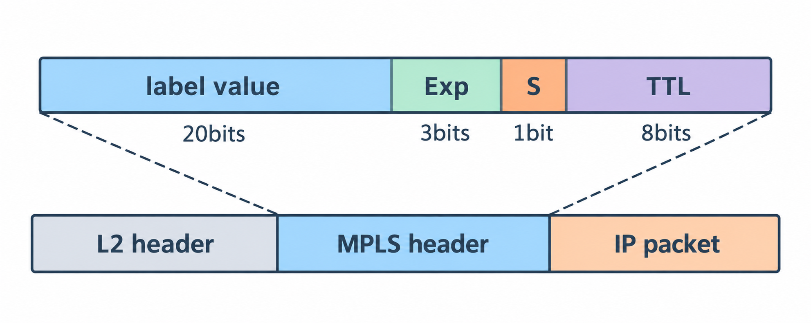
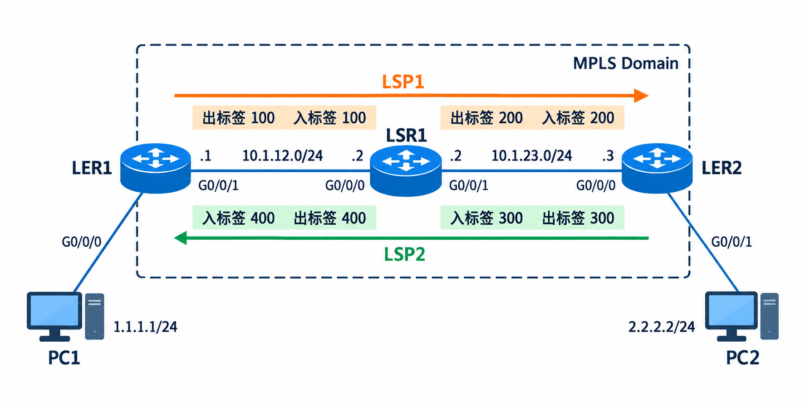
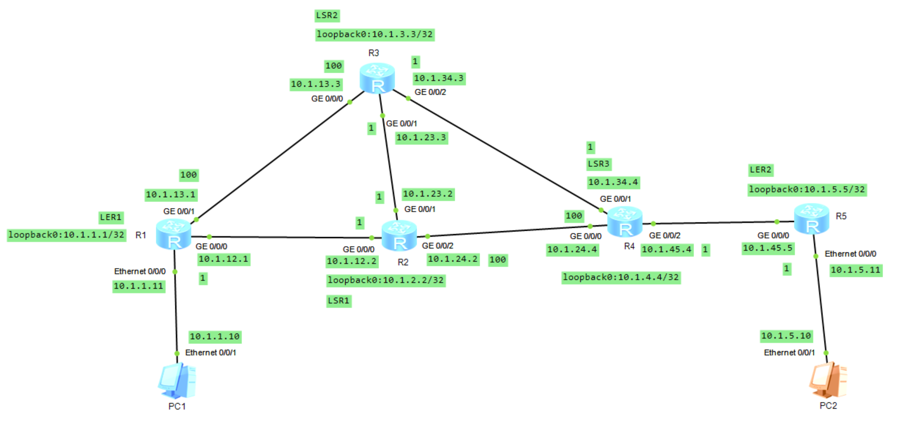
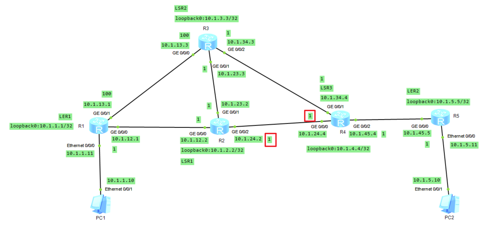
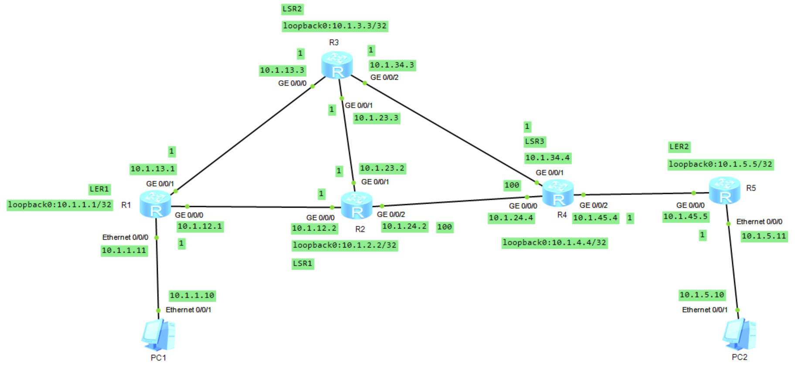
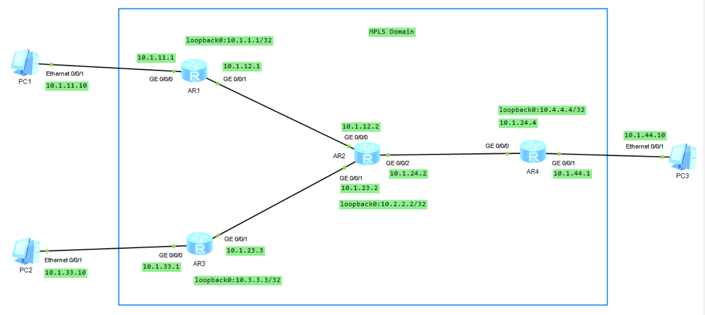
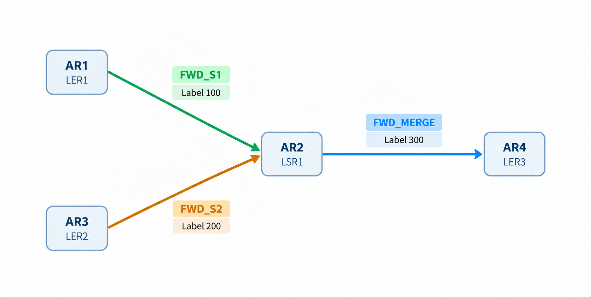
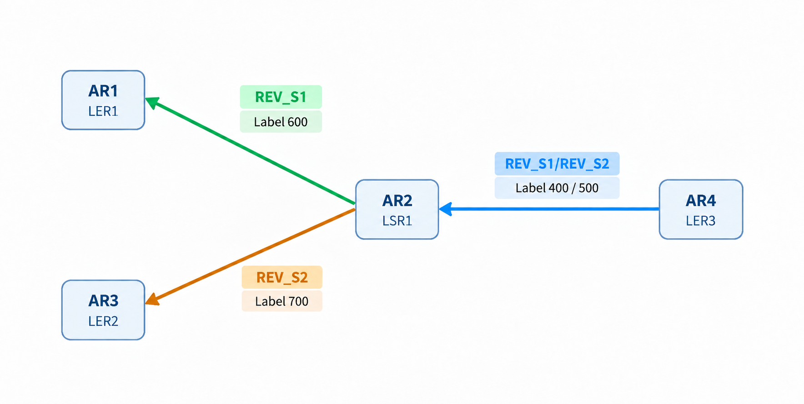

# MPLS 基础

## 1.前言

### 1.1 RIB、FIB 与数据转发

在传统 IP 网络中，路由器收到 IP 报文后，需要根据目的 IP 地址确定下一跳和出接口。在现代路由器中，路由计算与实际报文转发通常由不同的逻辑模块负责，**<font color="red">RIB 与 LIB 侧重控制平面知道什么，FIB 与 LFIB 侧重数据平面实际怎样转发</font>**。

- **RIB（Routing Information Base）**：保存、选择路由信息，属于控制平面。
- **FIB（Forwarding Information Base）**：保存用于实际 IP 报文转发的信息，属于数据平面，包含目的网段、出接口、下一跳 IP 地址、路由标记、路由优先级等信息。
- **LIB（Label Information Base）**：保存 MPLS 标签与 FEC 之间的绑定信息，主要属于控制平面，保存着每个标签与对应 FEC 的映射关系，用来管理 MPLS 标签信息，包含 FEC 网段、入标签、出标签、分发出标签的下游节点等元素。
- **LFIB（Label Forwarding Information Base）**：保存 MPLS 标签转发项，供数据平面完成标签转发，用于在 MPLS 网络中指导 MPLS 报文转发，是由从 LIB 中提取出的必要信息生成的，除了包含目的网段、出接口、下一跳 IP 地址，还包括入标签和出标签等元素。

#### 1.1.1 进程转发（Process Switching）

进程转发是 Cisco 传统 IOS 路由器的一种软件报文转发方式。在这种转发模式下，当路由器收到需要进行三层转发的 IP 数据包时，报文需要交给运行在系统处理器上的软件进程进行处理，由该进程决定报文应当通过哪个下一跳和出接口发送出去，并完成必要的报文处理以及链路层封装。与后来的 Fast Switching 和 Cisco Express Forwarding（CEF）不同，传统 Process Switching 不依赖已经建立的 Fast Switching 路由缓存来直接完成普通报文的转发。

当路由器收到 IP 报文时，路由器根据报文的目的 IP 地址查询 RIB，通过最长前缀匹配确定下一跳和出接口，再根据已有的 ARP 等信息获取下一跳的二层地址，重新封装数据帧，同时完成 TTL 递减、IPv4 首部校验和更新等必要操作，最后通过出接口发送报文。**<font color="red">进程转发的核心特点是每个报文都需要经过 CPU 软件进程处理，而不是直接利用高速转发缓存完成转发</font>**。

#### 1.1.2 快速转发（Fast Switching）

Fast Switching（快速交换）是 Cisco 一种基于高速路由缓存的 IP 转发机制，其核心思想为一次路由查询，多次利用缓存转发。当某个报文到达路由器，而 Fast Cache 中不存在匹配的转发项时，路由器首先通过进程转发查询 RIB，并结合 ARP 等信息确定下一跳、出接口及二层封装内容，然后将这些转发信息保存到 Fast Cache 中。后续命中相应缓存项的报文，便可以在中断上下文中直接查询缓存并完成转发，从而降低逐包处理开销，提高转发效率。

**<font color="red">因此，Fast Switching 相比 Process Switching 的主要改进，是通过缓存已经解析的下一跳和二层转发信息，减少后续报文的重复处理。但其不足在于缓存必须由业务流量按需触发建立，并且需要维护缓存的有效性。</font>**

#### 1.1.3 CEF（Cisco Express Forwarding）

思科快速转发（Cisco Express Forwarding，CEF）是 Cisco 开发的一种基于 FIB（转发信息表）和 Adjacency Table（邻接表）的第三层高速 IP 转发技术。**与传统 Process Switching 每个报文都要经过软件进程处理，以及 Fast Switching 根据首次到达的业务报文按需建立转发缓存不同**，CEF 会根据已经存在的路由信息，提前建立并维护用于实际报文转发的 FIB。

CEF 通过提前建立 FIB，并维护对应的邻接信息，将路由计算与普通 IP 数据报文的高速转发分离。当报文到达路由器时，设备首先根据目的 IP 地址查询 FIB，通过最长前缀匹配找到对应的转发项，然后利用该转发项关联的邻接信息，确定下一跳的二层封装和出接口，完成报文的必要修改后发送出去。**<font color="red">在正常高速转发过程中，CEF 不需要针对每个报文重新查询控制平面的 RIB，也不需要重新执行路由递归计算</font>**。

### 1.2 MPLS 体系架构

MPLS 的体系架构主要分为控制平面和数据平面，控制平面负责路由计算、标签分配以及 LSP（标签交换路径）的建立，数据平面则根据已经建立的转发信息完成 IP 报文或 MPLS 标签报文的实际转发。

#### 1.2.1 控制平面（Control Plane）

**<font color="red">MPLS 的控制平面主要负责建立路由信息和标签映射关系</font>**。首先，路由器通过 OSPF、IS-IS 等路由协议交换路由信息，计算到达目标网络的最优路径，并将相关路由信息维护在 RIB 中。其次，MPLS 路由器通过 LDP 为相应的 FEC（转发等价类）分配和通告标签，并将本地与邻居的标签绑定信息维护在 LIB 中。

#### 1.2.2 数据平面（Data Plane）

**<font color="red">MPLS 的数据平面主要负责根据控制平面建立的转发信息，对收到的数据报文进行实际转发</font>**。对于普通 IP 报文，路由器根据 RIB 中的有效路由及下一跳解析结果生成 FIB。收到 IP 报文后，设备根据目的 IP 地址匹配 FIB，确定下一跳及出接口，完成 IP 转发。对于 MPLS 标签报文，设备结合 LIB 中的标签绑定信息、当前路由下一跳以及相关转发信息，建立 LFIB。收到带标签的报文后，设备主要根据栈顶标签匹配 LFIB，执行 Push（压入标签）、Swap（交换标签）、Pop（弹出标签）等操作。

## 2.MPLS 基础

多协议标签交换 MPLS 是一种基于标签的数据包交换技术，介于 L2 和 L3 之间。数据包进入 MPLS 网络时会被封装上一个短而定长的标签，在转发过程中只需根据报文中的标签转发而无需查看上层报头信息。当数据包离开 MPLS 网络时，所有标签信息都会被剥离掉。**所以，路由器不再需要基于数据包的 IP 信息来进行路由表查找并进行转发，而只需要关心报文的标签信息，总结一句话，MPLS 其实就是一种隧道技术**。

### 2.1 MPLS 产生的背景

MPLS 起初是为了提高数据包转发效率而产生的。因为早期的路由器是用软件的方式来进行报文转发处理的，每一跳都需要根据报文目的 IP，使用最长掩码匹配原则查找路由表进行转发，效率比较低，尤其是在业务流量大的时候，对设备的性能影响特别大。

但是后来，随着芯片技术（比如 ASIC）的不断改进和提升，使用 IP 转发方式的效率也很高，MPLS 在这一方面发挥的优势渐渐不明显了。在今天的网络中，MPLS 技术已经被扩展到了新的应用领域，为网络提供一些增值业务，比如 MPLS VPN 或 MPLS TE。

### 2.2 MPLS 网络结构及术语解释

MPLS 网络的基本结构如下图所示，MPLS 域通过边界路由器连接用户的 IP 网络，一台边界路由器可以同时连接到多个用户的 IP 网络，**<font color="red">在 MPLS 域内的基本单元是标签交换路由器（LSR，Label Switching Router）</font>**，LSR 具有标签分配和基于标签转发数据报文的能力。用户的 IP 数据流进入 MPLS 域后，报文会以标签的方式经过每一台 LSR。为转发带标签的数据报文，每台 LSR 都会建立一张标签转发表，标签转发表就是通过标签分发协议依据路由表产生和建立的。

<div align="center">
    
</div>

LSR（标签交换路由器）即运行了 MPLS，具有标签分配和标签转发能力的路由器。

LER（标签边界路由器）即具有标签分配能力，并且同时连接 IP 和 MPLS 网络的路由器。分入站的 LER 和出站的 LER。**<font color="red">入站的 LER 负责对接收到的 IP 报文压入标签</font>**，然后转发进 MPLS 网络。**<font color="red">出站的 LER 负责给离开 MPLS 网络的报文移除标签</font>**，然后根据 IP 转发表进行转发。

FEC（转发等价类）用来描述具有相同特征的报文在转发过程中被 LSR 以相同方式处理。在 MPLS 中，一个 FEC 使用同一个标签来标记，**也就是说一个 FEC 的报文走的是同一条 LSP**。划分 FEC 的方式有很多，比如去往相同目的前缀的报文就是一个 FEC。

LSP（标签转发路径）即 MPLS 报文经过的路径。一条 LSP 起始 LSR 叫入站的 LER，最后一台 LSR 叫出站的 LER，可以把一条 LSP 理解为一个单向的隧道。可以使用静态和动态两种方式来创建一条 LSP。

如下图所示，这时假设左侧 IP 网络要访问右侧的 IP 网络，当报文进入 MPLS 域边界的 LSR 后被封装上标签（在原始 IP 报头之前），MPLS 网络中间的路由器只是根据交换标签信息来传递该报文（根据标签转发表把报文携带的标签替换成另一个标签）。当报文到达 MPLS 域另外一侧边界 LSR 时，数据包被解封装成原始的 IP 报文（移除标签），然后转发至 IP 网络。

<div align="center">
    
</div>

### 2.3 MPLS 标签格式

在帧模式的 MPLS 网络中，标签位于报文的二层头部和三层头部之间，一个 MPLS 标签长度为 32bit，有固定的格式，如下图所示。

<div align="center">
    
</div>

**Label Value**：标签的前 20bit 表示标签值（标签的数字标识），所以标签值的范围为 0 到 1048575，但是，标签值 0 到 15 是特殊用途的标签，这里列举几个常见的特殊标签的用途，其他 0～15 之间的被保留标签的功能目前暂时没有定义。

- 标签 0：IPv4 显式空标签；
- 标签 1：路由器报警标签；
- 标签 2：IPv6 显式空标签；
- 标签 3：隐式空标签；

**EXP**：EXP 是一个 3bit 的实验字段，之所以这么叫实验字段，是因为在 MPLS 设计之初还没确定该字段的作用，现在主要用来做 QoS。

**S**：S 位叫栈底位（BoS，Bottom of Stack）。某些特殊应用场景（比如 MPLS VPN）下，需要一个 MPLS 报文携带多个标签（理论上可携带的标签数量是没有限制的）。这些标签组成一个堆栈，**<font color="red">堆栈底部的标签（紧挨着 IP 报头）S 位的值为 1，其他标签的 S 位的值都为 0</font>**，如下图所示。

```java{.line-numbers}
Ethernet II, Src: Huawe iTe_3d:2b:2a (00:e0:fc:3d:2b:2a), Dst: Huawe iTe_6e:7f:be (00:e0:fc:6e:7f:be)
MultiProtocol Label Switching Header, Label: 1028, Exp: 0, S: 0, TTL: 254
    MPLS Label: 1028
    MPLS Experimental Bits: 0
    MPLS Bottom of Label Stack: 0
    MPLS TTL: 254
MultiProtocol Label Switching Header, Label: 1025, Exp: 0, S: 1, TTL: 254
    MPLS Label: 1025
    MPLS Experimental Bits: 0
    MPLS Bottom of Label Stack: 1
    MPLS TTL: 254
Internet Protocol, Src: 10.4.4.4 (10.4.4.4), Dst: 10.5.5.5 (10.5.5.5)
Internet Control Message Protocol
```

**TTL**：最后 8bit 叫 TTL，作为报文的生存周期，作用跟 IP 报头中的 TTL 是一样的，**在 MPLS 网络中每进行一次标签交换操作，最外层标签中的 TTL 就减 1，TTL 一旦减为 0，报文就被丢弃，从而预防数据包的转发环路**。IP 报文进入 MPLS 网络后，标签的 TTL 值可以使用初始值 255，也可以直接拷贝 IP 头中的 TTL 值。

### 2.4 LSP 的建立

LSP 的建立分为静态和动态两种方法。动态 LSP 是使用标签分发协议（比如 LDP）建立的。静态 LSP 是由管理员手工配置的，**<font color="red">所以静态 LSP 不需要使用任何标签分发协议，没有必要交互任何控制信息</font>**，资源开销小。使用静态 LSP 还可以避免因为标签分发协议（比如 LDP）故障而导致 MPLS 业务流量丢失，所以静态 LSP 一般是用来保障关键应用的业务连续性。但是由于静态 LSP 是由手工配置的，无法自动适应网络拓扑的变化，当网络出现故障后还需要管理员干预，一般适用于小型网络。

一条静态 LSP 经过的 LSR 共有 3 种角色：**`Ingress`**、**`Transit`**、**`Egress`**。Ingress 节点负责为接收到的 IP 报文压入标签并送入 LSP 隧道，Transit 节点负责以标签交换的方式转发报文，Egress 节点负责移除报文中的标签并将报文转发至 IP 网络。建立静态 LSP 时为各 LSR 手工分配标签时需要遵循的原则是：**<font color="red">前一节点（上游节点）出标签的值等于下一个节点（下游节点）入标签的值</font>**，具体要进行以下操作。

- 在 Ingress 节点配置此 LSP 的目的地址、下一跳和出标签的值。
- 在 Transit 节点配置此 LSP 的入接口、与上一节点出标签相等的入标签的值、对应的下一跳和出标签的值。
- 在 Egress 节点配置此 LSP 的入接口及与上一节点出标签相等的入标签的值。

如下图所示，PC1 与 PC2 之间通信的数据流需要经过中间的 MPLS 网络。**<font color="red">由于 LSP 是单向的隧道，要想实现 PC1 和 PC2 之间的双向通信，需要建立两条 LSP</font>**（图中的 LSP1 和 LSP2），LSP1 用于 PC1 到 PC2 方向的报文转发，LSP2 用于 PC2 到 PC1 方向的报文转发。

LSP1 的 Ingress 节点为 LER1（出标签为 100）、Transit 节点为 LSR1（入标签为 100，出标签为 200）、Egress 节点为 LER2（入标签 200）。LSP2 的 Ingress 节点为 LER2（出标签为 300），Transit 节点为 LSR1（入标签为 300，出标签为 400），Egress 节点为 LER1（入标签为 400）。

<div align="center">
    
</div>

下面以上图拓扑为例，来演示配置 LSP1 和 LSP2 的具体配置过程如下所示：

**（1）配置 LSP1**

Ingress 的节点 LER1 配置如下，指定 LSP1 的 FEC 为 **`2.2.2.0/24`**，使用出标签 100 将报文转发至下一跳 **`10.1.12.2`**。

```java{.line-numbers}
[LER1]static-lsp ingress LSP1 destination 2.2.2.0 24 nexthop 10.1.12.2 out-label 100
```

Transit 节点配置如下，Transit 节点从接口 **`G0/0/0`** 接收到带有标签为 100 的报文，将标签替换为 200 后转发至下一跳 **`10.1.23.3`**。

```java{.line-numbers}
[LSR1]static-lsp transit LSP1 incoming-interface g0/0/0 in-label 100 nexthop 10.1.23.3 out-label 200
```

Egress 节点配置如下，Egress 节点从入口为 **`G0/0/0`** 接收到入标签为 200，移除标签后以 IP 的方式转发出去。

```java{.line-numbers}
[LER2]static-lsp egress LSP1 incoming-interface gi0/0/0 in-label 200
```

**（2）配置 LSP2**

Ingress 节点配置如下所示：

```java{.line-numbers}
[LER2]static-lsp ingress LSP2 destination 1.1.1.0 24 nexthop 10.1.23.2 out-label 300
```

Transit 节点配置如下所示：

```java{.line-numbers}
[LSR1]static-lsp transit LSP2 incoming-interface gi0/0/1 in-label 300 nexthop 10.1.12.1 out-label 400
```

Egress 节点配置如下所示：

```java{.line-numbers}
[LER1]static-lsp egress LSP2 incoming-interface gi0/0/1 in-label 400
```

然后查看静态 LSP 的状态信息，如下输出所示：

```java{.line-numbers}
[LER1]display mpls static-lsp
Name          FEC           I/O Label    I/O If          Status
LSP1          2.2.2.0/24    NULL/100     -/GE0/0/1       Up
LSP2          -/-           400/NULL     GE0/0/1/-       Up

[LSR1]dis mpls static-lsp
Name          FEC           I/O Label    I/O If                 Status
LSP1          -/-           100/200      GE0/0/0/GE0/0/1        Up
LSP2          -/-           300/400      GE0/0/1/GE0/0/0        Up

[LER2]dis mpls static-lsp
Name          FEC           I/O Label    I/O If          Status
LSP1          -/-           200/NULL     GE0/0/0/-       Up
LSP2          1.1.1.0/24    NULL/300     -/GE0/0/0       Up
```

上述状态信息中，**`I/O Label`** 表示静态 LSP 的入标签（In Label）和出标签（Out Label），其数值反映了设备在 MPLS 标签交换路径中的转发行为。当入标签为 NULL、出标签为具体数值时，表示设备作为 Ingress 节点，为进入 LSP 的报文压入指定标签（Push）。当入标签和出标签均为具体数值时，表示设备作为 Transit 节点，将收到的标签替换为新的标签（Swap）。当入标签为具体数值、出标签为 NULL 时，表示设备作为 Egress 节点，弹出当前 LSP 的标签（Pop）。

本实验中，LSP1 的标签变化过程为 **`NULL/100->100/200->200/NULL`**，LSP2 的标签变化过程为 **`NULL/300->300/400->400/NULL`**。两条 LSP 的上下游标签均正确匹配，分别实现从 LER1 到 LER2、从 LER2 到 LER1 的单向标签交换。

### 2.5 静态 LSP 案例 1

我们使用如下的拓扑图进行说明，用户之间（PC1-PC2）的 IP 业务流量在穿越 MPLS 域时，如果使用动态 LSP，假设用户最终使用的路径是 **`LER1-LSR1-LSR3-LER2`**，因为动态 LSP 的建立是依赖路由表（FEC）的，如果到目标的路由有发生变化，那么 LSP 使用的路径也会随着路由的变化而变化。如果用户要求业务流量走特定的一条路径，比如 **`LER1-LSR1-LSR2-LSR3-LER2`**，不管动态路由的切换路径如何，都使用该路径，除非该路径发生故障。

<div align="center">
    
</div>

在这种情况下就可以使用静态 LSP 来实现 PC1 和 PC2 之间通过 **`LER1-LSR1-LSR2-LSR3-LER2`** 的路径进行通信。管理员可以手工配置 LSP 的路径和标签，从而保证业务流量按照预期的路径转发。为此我们配置了两条静态 LSP，分别为 LSP1 和 LSP2。LSP1 用于 PC1 到 PC2 的单向通信，LSP2 用于 PC2 到 PC1 的单向通信。

#### 2.5.1 正向静态 LSP：**`PC1 -> PC2`**

正向静态 LSP 的目的 FEC 为 **`10.1.5.0/24`**，入口路由器为 AR1，出口路由器为 AR5。数据从 PC1 发往 PC2 时，AR1 首先为 IP 报文压入 MPLS 标签 100，随后经过 AR2、AR3、AR4 逐跳交换标签，最后由 AR5 弹出标签，将原始 IP 报文转发给 PC2。各节点的标签处理过程：

- AR1（Ingress）：执行 Push 操作，为 IP 报文压入标签 100，下一跳为 **`10.1.12.2`**。
- AR2（Transit）：执行 Swap 操作，将入标签 100 替换为出标签 200，下一跳为 **`10.1.23.3`**。
- AR3（Transit）：执行 Swap 操作，将入标签 200 替换为出标签 300，下一跳为 **`10.1.34.4`**。
- AR4（Transit）：执行 Swap 操作，将入标签 300 替换为出标签 400，下一跳为 **`10.1.45.5`**。
- AR5（Egress）：执行 Pop 操作，弹出入标签 400，恢复原始 IP 报文，并根据 IP 路由表将其转发给 PC2。

#### 2.5.2 反向静态 LSP：**`PC2 -> PC1`**

反向静态 LSP 的目的 FEC 为 **`10.1.1.0/24`**，入口路由器为 AR5，出口路由器为 AR1。数据从 PC2 发往 PC1 时，AR5 首先压入 MPLS 标签 500，随后经过 AR4、AR3、AR2 逐跳交换标签，最后由 AR1 弹出标签并转发给 PC1。各节点的标签处理过程：

- AR5（Ingress）：执行 Push 操作，为 IP 报文压入标签 500，下一跳为 **`10.1.45.4`**。
- AR4（Transit）：执行 Swap 操作，将入标签 500 替换为出标签 600，下一跳为 **`10.1.34.3`**。
- AR3（Transit）：执行 Swap 操作，将入标签 600 替换为出标签 700，下一跳为 **`10.1.23.2`**。
- AR2（Transit）：执行 Swap 操作，将入标签 700 替换为出标签 800，下一跳为 **`10.1.12.1`**。
- AR1（Egress）：执行 Pop 操作，弹出入标签 800，恢复原始 IP 报文，并根据 IP 路由表将其转发给 PC1。

上述 2 条 LSP 的具体的配置如下所示：

```java{.line-numbers}
#
sysname AR1
#
static-lsp ingress FWD destination 10.1.5.0 24 nexthop 10.1.12.2 out-label 100
static-lsp egress REV incoming-interface GigabitEthernet0/0/0 in-label 800
#
sysname AR2
#
static-lsp transit FWD incoming-interface GigabitEthernet0/0/0 in-label 100 nexthop 10.1.23.3 out-label 200
static-lsp transit REV incoming-interface GigabitEthernet0/0/1 in-label 700 nexthop 10.1.12.1 out-label 800
#
sysname AR3
#
static-lsp transit FWD incoming-interface GigabitEthernet0/0/1 in-label 200 nexthop 10.1.34.4 out-label 300
static-lsp transit REV incoming-interface GigabitEthernet0/0/2 in-label 600 nexthop 10.1.23.2 out-label 700
#
sysname AR4
#
static-lsp transit FWD incoming-interface GigabitEthernet0/0/1 in-label 300 nexthop 10.1.45.5 out-label 400
static-lsp transit REV incoming-interface GigabitEthernet0/0/2 in-label 500 nexthop 10.1.34.3 out-label 600
#
sysname AR5
#
static-lsp egress FWD incoming-interface GigabitEthernet0/0/0 in-label 400
static-lsp ingress REV destination 10.1.1.0 24 nexthop 10.1.45.4 out-label 500
```

接下来分别在 5 台设备上检查静态 LSP 的状态信息：

```java{.line-numbers}
[AR1]display mpls static-lsp
TOTAL          :	2       STATIC LSP(S)
UP             :	2       STATIC LSP(S)
DOWN           :	0       STATIC LSP(S)
Name                FEC                I/O Label    I/O If                Status
FWD                 10.1.5.0/24        NULL/100     -/GE0/0/0             Up    
REV                 -/-                800/NULL     GE0/0/0/-             Up  
[AR2]display mpls static-lsp
TOTAL          :	2       STATIC LSP(S)
UP             :	2       STATIC LSP(S)
DOWN           :	0       STATIC LSP(S)
Name                FEC                I/O Label    I/O If                Status
FWD                 -/-                100/200      GE0/0/0/GE0/0/1       Up    
REV                 -/-                700/800      GE0/0/1/GE0/0/0       Up  
[AR3]display mpls static-lsp
TOTAL          :	2       STATIC LSP(S)
UP             :	2       STATIC LSP(S)
DOWN           :	0       STATIC LSP(S)
Name                FEC                I/O Label    I/O If                Status
FWD                 -/-                200/300      GE0/0/1/GE0/0/2       Up    
REV                 -/-                600/700      GE0/0/2/GE0/0/1       Up 
[AR4]display mpls static-lsp
TOTAL          :	2       STATIC LSP(S)
UP             :	2       STATIC LSP(S)
DOWN           :	0       STATIC LSP(S)
Name                FEC                I/O Label    I/O If                Status
FWD                 -/-                300/400      GE0/0/1/GE0/0/2       Up    
REV                 -/-                500/600      GE0/0/2/GE0/0/1       Up  
[AR5]display mpls static-lsp
TOTAL          :	2       STATIC LSP(S)
UP             :	2       STATIC LSP(S)
DOWN           :	0       STATIC LSP(S)
Name                FEC                I/O Label    I/O If                Status
FWD                 -/-                400/NULL     GE0/0/0/-             Up    
REV                 10.1.1.0/24        NULL/500     -/GE0/0/0             Up   
```

在 PC1 和 PC2 上分别使用 ping 命令测试两台主机之间的连通性，结果显示两台主机可以互相 ping 通，并且报文的传递路径确实为 **`PC1->AR1->AR2->AR3->AR4->AR5->PC2`**。

```java{.line-numbers}
PC>tracert 10.1.5.10
traceroute to 10.1.5.10, 8 hops max
(ICMP), press Ctrl+C to stop
 1  10.1.1.11   32 ms  15 ms  31 ms
 2  10.1.12.2   32 ms  47 ms  46 ms
 3  10.1.23.3   63 ms  62 ms  63 ms
 4  10.1.34.4   78 ms  94 ms  78 ms
 5  10.1.45.5   125 ms  109 ms  94 ms
 6  10.1.5.10   156 ms  125 ms  125 ms

PC>ping 10.1.5.10
Ping 10.1.5.10: 32 data bytes, Press Ctrl_C to break
From 10.1.5.10: bytes=32 seq=1 ttl=123 time=109 ms
From 10.1.5.10: bytes=32 seq=2 ttl=123 time=125 ms
From 10.1.5.10: bytes=32 seq=3 ttl=123 time=141 ms
From 10.1.5.10: bytes=32 seq=4 ttl=123 time=187 ms
From 10.1.5.10: bytes=32 seq=5 ttl=123 time=141 ms

--- 10.1.5.10 ping statistics ---
  5 packet(s) transmitted
  4 packet(s) received
  20.00% packet loss
  round-trip min/avg/max = 0/148/187 ms
```

为了进一步确认 PC1 与 PC2 之间的业务报文确实通过 MPLS 静态 LSP 进行转发，在 AR1 的 **`G0/0/0`** 口上抓取数据包，该链路同时承载正向 LSP 进入 MPLS 域的报文，以及反向 LSP 到达 AR1 出口节点之前的报文。结果如下所示，PC1 发往 PC2 的报文在进入 MPLS 网络时被压入标签 100，从 PC2 返回 PC1 的 ICMP 报文在到达 AR1 之前，仍然携带 MPLS 标签 800。

```java{.line-numbers}
Frame 23: 78 bytes on wire (624 bits), 78 bytes captured (624 bits) on interface -, id 0
Ethernet II, Src: HuaweiTe_92:59:9d (54:89:98:92:59:9d), Dst: HuaweiTe_d3:7e:bb (54:89:98:d3:7e:bb)
MultiProtocol Label Switching Header, Label: 100, Exp: 0, S: 1, TTL: 127
    0000 0000 0000 0110 0100 .... .... .... = MPLS Label: 100 (0x00064)
    .... .... .... .... .... 000. .... .... = MPLS Experimental Bits: 0
    .... .... .... .... .... ...1 .... .... = MPLS Bottom Of Label Stack: 1
    .... .... .... .... .... .... 0111 1111 = MPLS TTL: 127
Internet Protocol Version 4, Src: 10.1.1.10, Dst: 10.1.5.10
Internet Control Message Protocol

Frame 25: 78 bytes on wire (624 bits), 78 bytes captured (624 bits) on interface -, id 0
Ethernet II, Src: HuaweiTe_d3:7e:bb (54:89:98:d3:7e:bb), Dst: HuaweiTe_92:59:9d (54:89:98:92:59:9d)
MultiProtocol Label Switching Header, Label: 800, Exp: 0, S: 1, TTL: 124
    0000 0000 0011 0010 0000 .... .... .... = MPLS Label: 800 (0x00320)
    .... .... .... .... .... 000. .... .... = MPLS Experimental Bits: 0
    .... .... .... .... .... ...1 .... .... = MPLS Bottom Of Label Stack: 1
    .... .... .... .... .... .... 0111 1100 = MPLS TTL: 124
Internet Protocol Version 4, Src: 10.1.5.10, Dst: 10.1.1.10
Internet Control Message Protocol
```

### 2.6 静态 LSP 案例 2

现在将上述拓扑中 AR2 与 AR4 之间链路的 OSPF Cost 调整为 1，其余链路的 OSPF Cost 保持不变，同时不修改已配置的静态 LSP。通过这一实验，观察当 OSPF 最优路径发生变化时，静态 LSP 是否仍然按照手工指定的路径进行标签转发。

<div align="center">
    
</div>

通过查看 AR1、AR2 和 AR4 的 IP 路由表，可以发现 AR1 到目的网段 **`10.1.5.0/24`** 的 OSPF 最优下一跳仍然是 AR2，而 AR2 到该网段的最优下一跳已经变为 AR4。因此，如果按照普通 IP 路由表逐跳转发，PC1 访问 PC2 的最优路径应为 **`AR1->AR2->AR4->AR5`**，而手工配置的静态 LSP 路径仍然是 **`AR1->AR2->AR3->AR4->AR5`**。相关路由表项如下所示：

```java{.line-numbers}
<AR1>display ip routing-table 10.1.5.0
Route Flags: R - relay, D - download to fib
------------------------------------------------------------------------------
Routing Table : Public
Summary Count : 1
Destination/Mask    Proto   Pre  Cost      Flags NextHop         Interface
       10.1.5.0/24  OSPF    10   4           D   10.1.12.2       GigabitEthernet0/0/0
<AR2>display ip routing-table 10.1.5.0
Route Flags: R - relay, D - download to fib
------------------------------------------------------------------------------
Routing Table : Public
Summary Count : 1
Destination/Mask    Proto   Pre  Cost      Flags NextHop         Interface
       10.1.5.0/24  OSPF    10   3           D   10.1.24.4       GigabitEthernet0/0/2
<AR4>display ip routing-table 10.1.5.0
Route Flags: R - relay, D - download to fib
------------------------------------------------------------------------------
Routing Table : Public
Summary Count : 1
Destination/Mask    Proto   Pre  Cost      Flags NextHop         Interface
       10.1.5.0/24  OSPF    10   2           D   10.1.45.5       GigabitEthernet0/0/2
```

此时，**<font color="red">在 AR2 上存在两种不同的转发信息：一种是普通 IP 转发所使用的 IP 转发表（FIB），另一种是 MPLS 标签转发所使用的标签转发表（LFIB）</font>**。当 AR2 收到尚未携带 MPLS 标签的普通 IP 报文时，通常会根据 IP 转发表确定转发下一跳。而当 AR2 收到携带入标签 100 的 MPLS 报文时，则会根据本地标签转发表执行标签交换操作，按照静态 LSP 配置将报文转发给 AR3。**<font color="red">因此，在静态 LSP 的 Transit 节点上，管理员手工指定的 nexthop 可以与本地到目的 FEC 的最优 IP 路由下一跳不一致</font>**。

接下来，在 PC1 上分别使用 ping 和 tracert 命令测试 PC2 的连通性及实际转发路径。结果显示两台主机可以互相 ping 通，并且报文的传递路径确实为 **`PC1->R1->R2->R3->R4->R5->PC2`**，这说明**静态 LSP 能够在相关生效条件满足的情况下，使业务流量沿指定的标签交换路径转发，而不必与各 Transit 节点计算出的最优 IP 路由路径保持一致**。

```java{.line-numbers}
PC>ping 10.1.5.10

Ping 10.1.5.10: 32 data bytes, Press Ctrl_C to break
From 10.1.5.10: bytes=32 seq=1 ttl=123 time=109 ms
From 10.1.5.10: bytes=32 seq=2 ttl=123 time=141 ms
From 10.1.5.10: bytes=32 seq=3 ttl=123 time=140 ms
From 10.1.5.10: bytes=32 seq=4 ttl=123 time=140 ms
From 10.1.5.10: bytes=32 seq=5 ttl=123 time=141 ms

--- 10.1.5.10 ping statistics ---
  5 packet(s) transmitted
  5 packet(s) received
  0.00% packet loss
  round-trip min/avg/max = 109/134/141 ms

PC>tracert 10.1.5.10

traceroute to 10.1.5.10, 8 hops max
(ICMP), press Ctrl+C to stop
 1  10.1.1.11   16 ms  15 ms  32 ms
 2  10.1.12.2   46 ms  32 ms  47 ms
 3  10.1.23.3   62 ms  63 ms  62 ms
 4  10.1.34.4   78 ms  94 ms  78 ms
 5  10.1.45.5   109 ms  110 ms  94 ms
 6  10.1.5.10   125 ms  125 ms  125 ms
```

### 2.7 静态 LSP 案例 3

接下来，我们以案例 1 的原始拓扑为基础，将 **`AR1—AR3`** 链路的 OSPF Cost 调整为 1，其余链路的 OSPF Cost 保持不变。同时，不修改此前已经配置的静态 LSP。通过本次实验，进一步观察当 Ingress 节点到目的 FEC 的最优 IP 路由下一跳发生变化时，静态 LSP 的实际转发行为。

<div align="center">
    
</div>

通过查看 AR1、AR3 和 AR4 的 IP 路由表，可以发现 AR1 到目的网段 **`10.1.5.0/24`** 的 OSPF 最优下一跳已经由 AR2 变为 AR3，而 AR3 到该网段的最优下一跳为 AR4。因此，如果按照普通 IP 路由表逐跳转发，PC1 访问 PC2 的最优路径应为 **`AR1->AR3->AR4->AR5`**，而此前手工配置的静态 LSP 路径仍然是 **`AR1->AR2->AR3->AR4->AR5`**。相关路由表项如下所示：

```java{.line-numbers}
[AR1]display ip routing-table 10.1.5.0
Route Flags: R - relay, D - download to fib
------------------------------------------------------------------------------
Routing Table : Public
Summary Count : 1
Destination/Mask    Proto   Pre  Cost      Flags NextHop         Interface
       10.1.5.0/24  OSPF    10   4           D   10.1.13.3       GigabitEthernet0/0/1
[AR3]display ip routing-table 10.1.5.0
Route Flags: R - relay, D - download to fib
------------------------------------------------------------------------------
Routing Table : Public
Summary Count : 1
Destination/Mask    Proto   Pre  Cost      Flags NextHop         Interface
       10.1.5.0/24  OSPF    10   3           D   10.1.34.4       GigabitEthernet0/0/2
[AR4]display ip routing-table 10.1.5.0
Route Flags: R - relay, D - download to fib
------------------------------------------------------------------------------
Routing Table : Public
Summary Count : 1
Destination/Mask    Proto   Pre  Cost      Flags NextHop         Interface
       10.1.5.0/24  OSPF    10   2           D   10.1.45.5       GigabitEthernet0/0/2
```

接下来，在 PC1 上分别使用 ping 和 tracert 命令测试 PC2 的连通性及实际转发路径。结果显示两台主机可以互相 ping 通，同时，Tracert 结果显示，报文的实际转发路径为 **`PC1->AR1->AR3->AR4->AR5->PC2`**，与当前 OSPF 计算出的最优 IP 路径一致，而不再经过原静态 LSP 路径中的 AR2。

```java{.line-numbers}
PC>tracert 10.1.5.10
traceroute to 10.1.5.10, 8 hops max
(ICMP), press Ctrl+C to stop
 1  10.1.1.11   31 ms  16 ms  16 ms
 2  10.1.13.3   46 ms  47 ms  47 ms
 3  10.1.34.4   63 ms  62 ms  78 ms
 4  10.1.45.5   110 ms  78 ms  78 ms
 5    *10.1.5.10   109 ms  125 ms

PC>ping 10.1.5.10
Ping 10.1.5.10: 32 data bytes, Press Ctrl_C to break
From 10.1.5.10: bytes=32 seq=1 ttl=123 time=125 ms
From 10.1.5.10: bytes=32 seq=2 ttl=123 time=156 ms
From 10.1.5.10: bytes=32 seq=3 ttl=123 time=140 ms
From 10.1.5.10: bytes=32 seq=4 ttl=123 time=188 ms
From 10.1.5.10: bytes=32 seq=5 ttl=123 time=203 ms
--- 10.1.5.10 ping statistics ---
  5 packet(s) transmitted
  5 packet(s) received
  0.00% packet loss
  round-trip min/avg/max = 125/162/203 ms
```

但是，在 AR1 的 **`G0/0/1`** 接口上抓取数据包后发现，PC1 发往 PC2 的报文并未携带 MPLS 标签，而是以普通 IPv4 报文的形式发送给 AR3。这说明 **<font color="red">虽然静态 LSP 不依赖动态路由，但是在 LSP 的 Ingress 节点处，LSP 对应的 FEC 在本地路由表中需要存在相应的路由前缀，为 LSP 指定的下一跳也要和本地路由表一致</font>**。当这些条件不再满足时，原静态 LSP 可能无法正常生效，但只要普通 IP 路由仍然可达，业务报文就可能通过普通 IP 转发继续到达目的网络。

在本次实验的抓包结果中，PC1 发往 PC2 的 ICMP 报文直接封装在以太网帧中的 IPv4 协议内，没有出现 MPLS 标签头。

```java{.line-numbers}
Frame 44: 74 bytes on wire (592 bits), 74 bytes captured (592 bits) on interface -, id 0
Ethernet II, Src: HuaweiTe_92:59:9e (54:89:98:92:59:9e), Dst: HuaweiTe_53:2b:ae (54:89:98:53:2b:ae)
Internet Protocol Version 4, Src: 10.1.1.10, Dst: 10.1.5.10
Internet Control Message Protocol
```

### 2.8 静态 LSP 案例 4

我们使用如下所示拓扑图来展示静态 LSP 的最后一个案例。

<div align="center">
    
</div>

#### 2.8.1 两条正向静态 LSP

**（1）正向静态 LSP1：`FWD_S1`**

**`FWD_S1`** 的目的 FEC 为 **`10.1.44.0/24`**，AR1 为 Ingress，AR2 为 Transit，AR4 为 Egress。当 PC1 向 PC3 发送 IP 报文时，AR1 根据目的 FEC 匹配静态 LSP，执行 **Push** 操作，压入标签 **`100`** 并发送给 AR2。AR2 收到报文后，根据标签转发表执行 **Swap** 操作，将标签 **`100`** 替换为 **`300`**，并转发给 AR4。最后，AR4 执行 **Pop** 操作，弹出标签 **`300`**，将原始 IP 报文转发给 PC3。**转发路径及标签变化：`PC1 -> AR1（Push 100）-> AR2（Swap 100,300）-> AR4（Pop 300）-> PC3`**

**（2）正向静态 LSP2：`FWD_S2`**

**`FWD_S2`** 的目的 FEC 同样为 **`10.1.44.0/24`**，AR3 为 Ingress，AR2 为 Transit，AR4 为 Egress。当 PC2 向 PC3 发送 IP 报文时，AR3 执行 **Push** 操作，压入标签 **`200`** 并发送给 AR2。AR2 根据入标签 **`200`** 查找标签转发表，执行 **Swap** 操作，将标签 **`200`** 替换为 **`300`**，并转发给 AR4。最后，AR4 执行 **Pop** 操作，弹出标签 **`300`**，将原始 IP 报文转发给 PC3。**转发路径及标签变化：`PC2 -> AR3（Push 200）-> AR2（Swap 200,300）-> AR4（Pop 300）-> PC3`**。

根据 RFC 3031，标签汇聚的定义是：the replacement of multiple incoming labels for a particular FEC with a single outgoing label. 具体的工作原理为：Let us say that an LSR is capable of label merging if it can receive two packets from different incoming interfaces, and/or with different labels, and send both packets out the same outgoing interface with the same label. Once the packets are transmitted, the information that they arrived from different interfaces and/or with different incoming labels is lost.

在我们的例子中，**不同的入标签在 AR2 上被交换为相同的出标签，并使用相同的下一跳进行转发**。它允许多个上游分支共用同一段下游标签转发路径，从整体上形成多点到点的 LSP 树。两条正向的 LSP 的示意图如下所示：

<div align="center">
    
</div>

## 2.2 两条反向静态 LSP

由于普通 MPLS LSP 是单向的，上述拓扑图还配置了 **`REV_S1`** 和 **`REV_S2`** 两条反向静态 LSP，分别用于 PC3 访问 PC1 和 PC2。

**（1）反向静态 LSP1：`REV_S1`**

**`REV_S1`** 的目的 FEC 为 **`10.1.11.0/24`**。当 PC3 向 PC1 发送 IP 报文时，AR4 执行 **Push** 操作，压入标签 **`400`** 并发送给 AR2。AR2 执行 **Swap** 操作，将标签 **`400`** 替换为 **`600`**，并转发给 AR1。最后，AR1 执行 **Pop** 操作，弹出标签 **`600`**，将原始 IP 报文转发给 PC1。

**（2）反向静态 LSP2：`REV_S2`**

**`REV_S2`** 的目的 FEC 为 **`10.1.33.0/24`**。当 PC3 向 PC2 发送 IP 报文时，AR4 执行 **Push** 操作，压入标签 **`500`** 并发送给 AR2。AR2 执行 **Swap** 操作，将标签 **`500`** 替换为 **`700`**，并转发给 AR3。最后，AR3 执行 **Pop** 操作，弹出标签 **`700`**，将原始 IP 报文转发给 PC2。

反向静态 LSP 的示意图如下所示：

<div align="center">
    
</div>

上述拓扑图中的 AR1-AR4 的静态 LSP 配置和 LSP 信息如下所示：

```java{.line-numbers}
// AR1
static-lsp ingress FWD_S1 destination 10.1.44.0 24 nexthop 10.1.12.2 out-label 100
static-lsp egress REV_S1 incoming-interface GigabitEthernet0/0/1 in-label 600
// AR3
static-lsp ingress FWD_S2 destination 10.1.44.0 24 nexthop 10.1.23.2 out-label 200
static-lsp egress REV_S2 incoming-interface GigabitEthernet0/0/1 in-label 700
// AR2
static-lsp transit FWD_S1 incoming-interface GigabitEthernet0/0/0 in-label 100 nexthop 10.1.24.4 out-label 300
static-lsp transit FWD_S2 incoming-interface GigabitEthernet0/0/1 in-label 200 nexthop 10.1.24.4 out-label 300
static-lsp transit REV_S1 incoming-interface GigabitEthernet0/0/2 in-label 400 nexthop 10.1.12.1 out-label 600
static-lsp transit REV_S2 incoming-interface GigabitEthernet0/0/2 in-label 500 nexthop 10.1.23.3 out-label 700
// AR4
static-lsp egress FWD_MERGE incoming-interface GigabitEthernet0/0/0 in-label 300
static-lsp ingress REV_S1 destination 10.1.11.0 24 nexthop 10.1.24.2 out-label 400
static-lsp ingress REV_S2 destination 10.1.33.0 24 nexthop 10.1.24.2 out-label 500

[AR1]display mpls static-lsp 
Name                FEC                I/O Label    I/O If                Status
FWD_S1              10.1.44.0/24       NULL/100     -/GE0/0/1             Up    
REV_S1              -/-                600/NULL     GE0/0/1/-             Up  
[AR2]display mpls static-lsp 
Name                FEC                I/O Label    I/O If                Status
FWD_S1              -/-                100/300      GE0/0/0/GE0/0/2       Up    
FWD_S2              -/-                200/300      GE0/0/1/GE0/0/2       Up    
REV_S1              -/-                400/600      GE0/0/2/GE0/0/0       Up    
REV_S2              -/-                500/700      GE0/0/2/GE0/0/1       Up 
[AR3]display mpls static-lsp 
Name                FEC                I/O Label    I/O If                Status
FWD_S2              10.1.44.0/24       NULL/200     -/GE0/0/1             Up    
REV_S2              -/-                700/NULL     GE0/0/1/-             Up 
[AR4]display mpls static-lsp 
Name                FEC                I/O Label    I/O If                Status
FWD_MERGE           -/-                300/NULL     GE0/0/0/-             Up    
REV_S1              10.1.11.0/24       NULL/400     -/GE0/0/0             Up    
REV_S2              10.1.33.0/24       NULL/500     -/GE0/0/0             Up  
```


